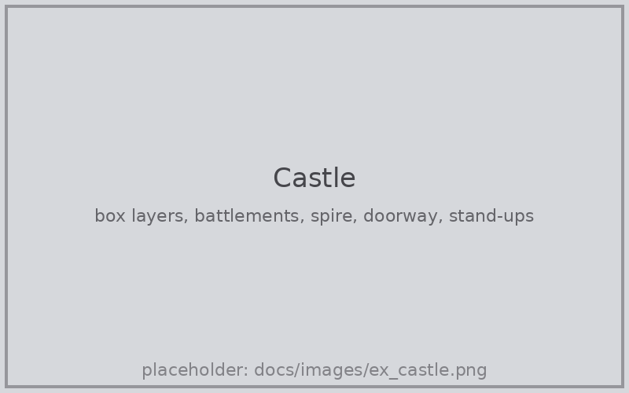
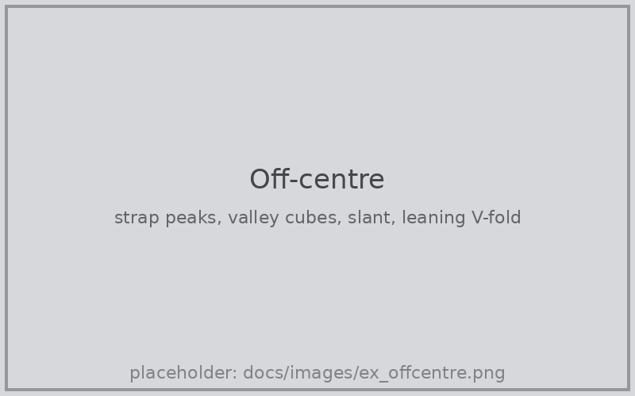
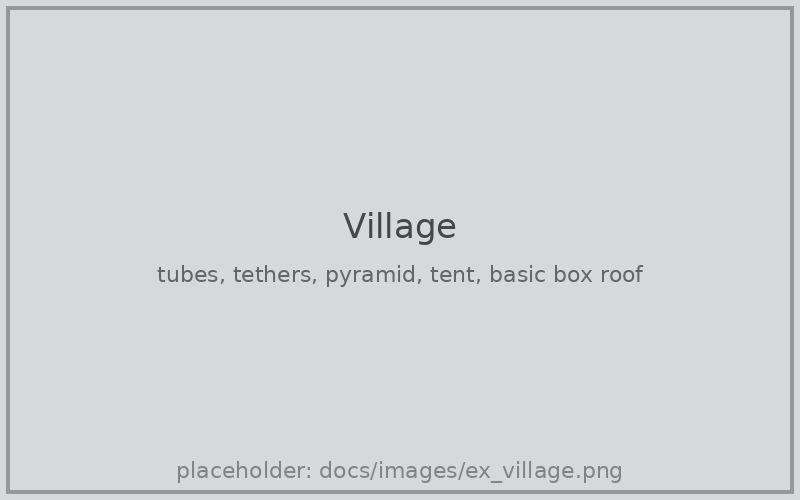
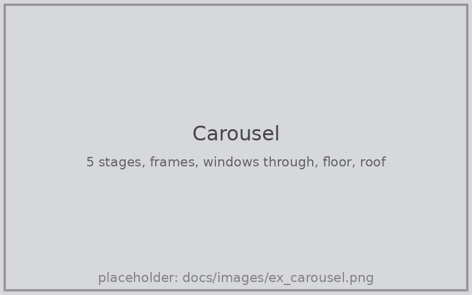
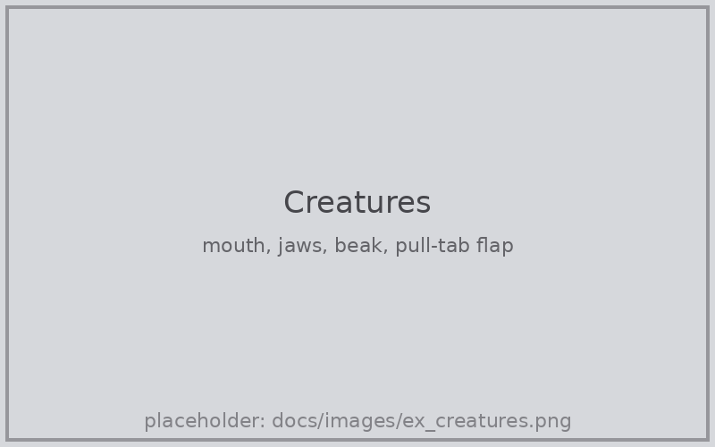
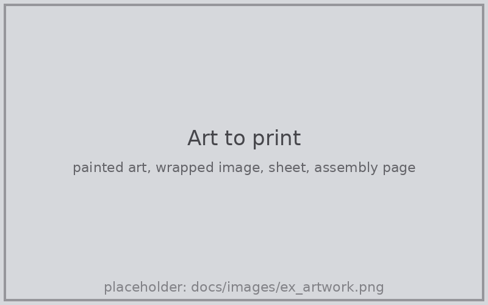

# Pop-Up Pro

**Design pop-up cards and books in Blender, test the movement, and print
them.**

<!-- SHOT: hero. Dawn render look, card about 120° open, 3-4 mechanisms
     with painted art, camera from the default card camera. -->

## Getting started

1. Download `popup_pro-x.y.z.zip` from
   [Releases](https://github.com/Liatach/Pop-UpPro/releases) and install it
   in Blender 4.3 or later: **Edit → Preferences → Get Extensions → ⌄ →
   Install from Disk**.
2. In the 3D view press **N** and open the **Pop-Up** tab.
3. Pick a card size and press **Build Card**. You get a card with a cube on
   it, a camera, lighting and a movement test: press **Play**.
4. Add mechanisms with **+** and drag their sliders; the card rebuilds as
   you go. Keep an eye on **Checks**: it turns red when something would
   tear, poke through or stick out.
5. Paint with **Paint Flat** or **Paint Folded**, or add an image with
   **Image on a Piece**.
6. **Export SVG Sheets**, print, cut, fold, glue.

Every setting is explained in the [guide](docs/guide.md).

## Examples

<!-- SHOT: box layer + box layer on top, Battlements / Pointed Tower / Doorway presets, two stand-ups (one in front of the other). Showcase look. -->
### Castle

Stacked box layers with battlements, a spire and a doorway cut in, and parallelogram stand-ups in front.

<!-- SHOT: strap Peaks 3 with cubes in two valleys; a slanted strap; asym V-fold with a box on its crease. Showcase look, ~110° open. -->
### Off the centre

A strap with three peaks carrying cubes in its valleys, a slanted strap, and an asymmetric V-fold leaning a tower to one side.

<!-- SHOT: hexagon tube with pointed roof, tent, pyramid, tethers between them; basic box (flat Dip roof + rib) with a V-fold on its roof. Dawn look. -->
### Village

Tubes and pyramids on parallel strips, tied together with tethers, and a basic box whose roof is a second spine.

<!-- SHOT: 5-stage carousel at ~300°, staging frame with an arch, window Through Everything Behind, a floor with a V-fold on its crease, peaked-roof background. Dawn look. -->
### Carousel

Five stages opening right round, with frames, windows cut through every layer, floors and a peaked roof.

<!-- SHOT: a mouth, two Jaw V-folds facing each other, a beak V-fold, a flap mid-pull. Could be a GIF. -->
### Creatures

Mouths, jaws and beaks that chomp as the card opens, and a lift-the-flap worked by a pull tab.

<!-- SHOT: split image: left the painted card with an image wrapped round a cube; right its card sheet + assembly page. -->
### From paint to print

Paint flat or folded, wrap an image round a cube, then export layered SVG sheets with an assembly page.

<!-- SHOT: movement GIF, open and close loop -->

## Features

**Mechanisms**
* V-folds (panels or beaks, symmetric or asymmetric), mouths and jaws.
* Box folds, box layers, straps (slanted, with peaks), 180° cubes with lids.
* Tubes, pyramids and tents on parallel strips, with tethers and roofs.
* Parallelogram stand-ups, pull-tab flaps.
* Carousels of 2 to 9 stages with frames, floors, ceilings and roofs, or one
  stage set standing in an ordinary card.

**Building**
* Stack anything on anything: boxes on boxes, V-folds on V-folds, cubes in
  valleys and gullies, off-centre on straps and glue folds.
* Extra creases and cuts from presets or drawn by hand: reverse points,
  steps, jaws, battlements, spires, doorways.
* Windows, arches and holes on any face, turned to any angle, painted or
  sketched, lined up through every layer behind.
* Live checks for tearing, poking through, sticking out and overlapping glue.

**Art and output**
* Paint flat or folded, sketch with Grease Pencil, or place images that wrap
  round cubes and tubes. Art stays on the paper as it folds.
* A movement test with one Open slider, on a rig that needs no Python
  auto-run.
* Render looks: Clean, Showcase, Dawn or your own.
* Layered SVG sheets, reverse sides, an assembly page, and cut-only and
  crease-only files for Cricut and other cutting machines.
* Card sizes from A6 to A3, US Letter sizes, 5×7 in and picture-book trims.

## Sources

The mechanisms follow The Pop-Up Channel's video tutorials:

* [Pop-Up Tutorial 1 - Box-fold](https://www.youtube.com/watch?v=RVZEsnzJTqM)
* [Pop-Up Tutorial 2 - V-folds Part 1: right-angle and acute-angle V-folds](https://www.youtube.com/watch?v=Lm2RYojO-q8)
* [Pop-Up Tutorial 3 - V-folds Part 2: pointed and obtuse-angle V-folds](https://www.youtube.com/watch?v=MvbGJxH-1pg)
* [Pop-Up Tutorial 4 - V-folds Part 3: asymmetric V-fold](https://www.youtube.com/watch?v=N-mv6ePRNAc)
* [Pop-Up Tutorial 5 - Parallel-folds Part 1: parallelogram](https://www.youtube.com/watch?v=BvF15GfYwVc)
* [Pop-Up Tutorial 6 - Parallel-folds Part 2: symmetric and asymmetric](https://www.youtube.com/watch?v=9xRj1-OUX64)
* [Pop-Up Tutorial 7 - Adding extra creases to basic pop-up shapes, Part 1](https://www.youtube.com/watch?v=IkJAnmS-2ZE)
* [Pop-Up Tutorial 9 - Raising Pop-Ups Off-Centre: The Strap](https://www.youtube.com/watch?v=AMbeFT8L7oI)
* [Pop-Up Tutorial 21 - Pyramids](https://www.youtube.com/watch?v=jZDHbUhV6Ms)
* [Pop-Up Tutorial 22 - Adding extra creases, Part 2: counter-folds](https://www.youtube.com/watch?v=Ze9shENIBf4)
* [Pop-Up Tutorial 29 - Asymmetric V-fold, Part 2](https://www.youtube.com/watch?v=1OqP1pXhDUQ)
* [Pop-Up Tutorial 30 - V-fold action: building a tower](https://www.youtube.com/watch?v=eCq12WLoRx4)
* [Pop-Up Tutorial 72 - Box, type 2](https://www.youtube.com/watch?v=6FKi95a14N4)
* [360° pop-up book](https://www.youtube.com/watch?v=HKvsssZ9W0E) (the basic box and carousels; also [on Reddit](https://www.reddit.com/r/popupbooks/comments/1xcfeks/how_to_make_360_popup_book/))

Duncan Birmingham's book *Pop-Up! A Manual of Paper Mechanisms* covers them
too, along with the mouth and jaws.

## Roadmap

* One card (or carousel) per scene. Mechanisms sit on the spine, on box
  folds and straps (and their valleys), stand-ups, a tube's roof, a V-fold's
  crease or glue folds, or outside a cube's or tube's walls.
* The checks look at paper footprints, but not at 3D collisions between
  separate mechanisms.
* Extra creases and cuts work on the card itself, V-folds, box folds and box
  layers; tubes,
  roofs and stand-up pictures don't take them yet (shape a picture by
  erasing its art). Asymmetric creases need their own matching crease on the
  other side (drawn with Mirror off).
* A debug view: look straight into a stage (or card) part open, flattened
  like a plan, with every layer drawn see-through, to check how
  mechanisms overlap in complex builds.
* The consolidation and elegance pass over the interface, continued. Done
  so far: one naming scheme (Stands On, Fold, Gully, Position; Length Along
  Fold, Width Left / Right, Height; Glue Length / Angle, Piece Angle, Fold
  Length), glue tabs folded away in every mechanism, Checks second and red
  when there's anything to fix, the movement test and paper settings folded
  down. Still to do:
  * Fewer mechanisms that do more: the Roof becomes a V-fold with Cut Away
    Background Above and Level Ridge; floors, ceilings and the background
    folding in sit together as one "Stage" section.
  * Holes and Shaping split into collapsible sub-panels (openings,
    the background, painted holes, drawn holes), each closed when empty.
  * The Add menu grouped by where things go (on the spine, on a V-fold, on
    a floor or ceiling, in a stage), offering only what fits the selected
    host.
  * Clicking a warning in Checks selects the mechanism it's about.
* A **fan**: like a large upright V-fold with extra creases, opening into a
  fan, but standing free of the centre crease, so it can arch across the
  scene as arches, rainbows and arcs.
* Next mechanisms: the 90° box with lid, floating layers on pedestals,
  arch V-folds, moving arms.
* Paint System with UDIM tiles is untested; Bake Art for Print is the safe
  route for printing.

## Development

Tests run with `pip install bpy`: `python tests/test_core.py`, then each
`tests/test_*.py` (one per release). How the solver and rig work is in the
[guide](docs/guide.md#how-it-works).

## Licence

GPL-3.0-or-later. By Kim Lang / [Liatach Makes](https://shop.kim-lang.com).
A companion to [Papercraft Pro](https://github.com/Liatach/papercraft-pro).
Pop-Up Pro is not affiliated with or endorsed by the Blender Foundation.
