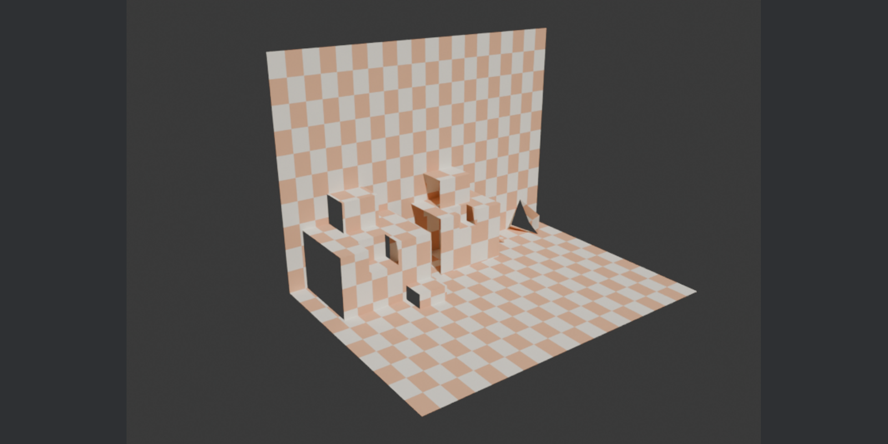
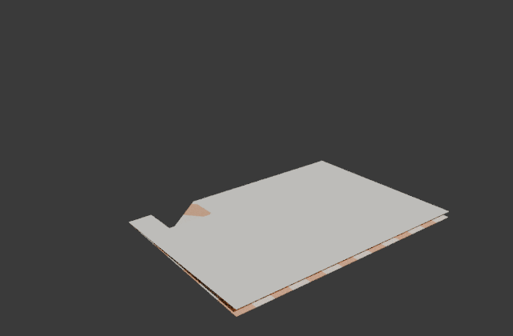

# Pop-Up Pro

**Design pop-up cards and books in Blender, test the movement, and print
them.**



## Features

* **Preset mechanisms** you tune with sliders: V-folds (panels or beaks),
  cut-in mouths, glued box folds, cut-in box layers, 180° cubes with lids,
  pull-tab flaps, tubes (hexagons, boxes) tethered together on parallel
  strips, and pyramids, tents and roofs.
* **Carousels**: 2 to 9 stages opening right round, each with a background,
  floating frames, a staging frame, floors and ceilings; one Open control
  for the lot, and each stage editable on its own. A single stage set can
  also stand in an ordinary card.
* **Windows, doorways and perforations**: placed openings that can line up
  through every layer behind or into the next stage, painted see-through
  areas, and holes sketched with Grease Pencil, all cut as real holes.
* **Extra creases and cuts** on V-folds, box folds and box layers: reverse
  points, steps, jaws and projections (Birmingham 5, 6, 9 and 10), and
  battlements, spires and doorways (Birmingham 37). Draw on one side and
  mirror; the new folds are solved and driven like any other.
* **Parallelogram stand-ups** (Birmingham 38): pictures held off the
  background on a bridge, or flat on a leg, stacking in front of and on top
  of each other, and standing in front of or behind V-fold halves.
* **Stack them**: boxes on boxes, steps up and forward, and inset (valley)
  boxes; V-folds and mouths sit on any box fold too.
* **Movement test**: one Open slider (0–180°) drives a driver-only rig, with
  no Python auto-run needed, and each flap has its own Pull slider. One click
  keyframes open-and-close, or a pull.
* **Art stays on the paper**: paint flat or folded (Texture Paint or Paint
  System), or sketch with Grease Pencil on any panel, and it rides along.
* **Checks** as you design: tearing V-folds, panels poking through the card,
  pieces sticking out when closed, overlapping glue and cuts.
* **Print sheets** as layered SVG, plus cut-only and crease-only files for
  Cricut and other cutting machines.
* **Card sizes**: folded A6–A3, US Letter sizes, 5×7 in, and common
  picture-book trims.



## Install

1. Download `popup_pro-x.y.z.zip` from
   [Releases](https://github.com/Liatach/Pop-UpPro/releases), or build it
   with `scripts/build.sh`.
2. In Blender 4.3 or later: **Edit → Preferences → Get Extensions → ⌄ →
   Install from Disk**.
3. Open the sidebar (**N**) in the 3D view and pick the **Pop-Up** tab.

Upgrading from *Pop-up Mechanics* 0.1–0.2: uninstall it first, since Blender
treats the renamed add-on as a separate extension. Your cards keep their
mechanisms, art and sketches.

## Use

1. **Card**: A5 (A4 folded, the default), A6, 150 mm square or custom.
   **Hold** picks which page stays still (right page flat is the usual 90°
   view; *Both Pages Move* keeps the spine upright).
2. **Build Card**. The first build adds a V-fold and a box fold to play with.
3. **Mechanisms**: add, remove and tune them. With **Live Rebuild** on (the
   clock icon) the card updates as you drag values.
4. **Open**: slider and 0/45/90/135/180° buttons; **Keyframe Movement Test**
   animates closed → flat → closed.
5. **Checks** lists problems found by sweeping the open angle: paper that
   would tear, panels poking through a page, pieces sticking out of the
   closed card, pieces too big for the sheet.
6. **Export SVG Sheets** writes one SVG per sheet.

### Closing and paper thickness

* **Paper Thickness** (default 0.3 mm, typical card stock).
* **Stop at Paper Thickness** (on by default): Open 0 is where the pages meet
  the folded mechanisms, not 0°, so a closed card doesn't squash everything
  through itself. The sidebar shows the angle it stops at. Turn it off for a
  card that closes to exactly 0°.
* **Solid Paper**: gives the card real thickness (behind the printed side)
  for renders. Modifiers you add to the card after it are kept on rebuild.

### Card sizes

A6, A5, A4 and A3 (from a folded A5, A4, A3 and A2), Half Letter and Letter
(folded US Letter and Tabloid), a 5 x 7 in greeting card, 150 mm square, the
common picture-book trims (8.5 x 8.5, 8 x 10, 10 x 8, 7.5 x 7.5 and
8.5 x 11 in), or Custom. Loose pieces go on the **Piece Paper** sheet, which
includes 12 x 12 and 12 x 24 in cutting mats.

### Mechanisms (all lengths in mm)

| | What it is | Settings |
|---|---|---|
| **V-fold** | A folded piece glued along two lines that meet on a fold | Position, Fold Length, Glue Length, Glue Angle (fold to glue line), Piece Angle (centre fold to glue edge), tab size and side, symmetric or separate left/right. **Shape: Panels or Beak** (two triangles meeting at a point) |
| **Mouth** | A slit across a fold with two pairs of triangles cut into the paper; the jaws open as the card opens | Slit Position, Jaw Length (slit each side of the fold), Upper Jaw, Lower Jaw |
| **Box fold** | A separate strip glued across a fold (parallel fold) | Position, Height (along the fold), Width Left, Width Right, tab size |
| **Box layer** | The same parallel fold cut into the paper itself | Position, Height, Width Left, Width Right |
| **Stand-up** | A picture held off the background by a bridge, or flat on a leg (Birmingham 38) | Picture (Upright or Flat), Position, Bridge or Leg Width, Bridge Height, Out From Back, Picture Width and Height, tab size |
| **Cube (180°)** | A box standing on one corner edge on the fold; it rises as the card opens flat | Position, Size, Height, Lid (Peaked, Dipped or None), base tab size and side |
| **Tube** | Hexagon, box or recessed tube on two parallel sticking strips (Birmingham 51, 67, 68) | Position, Strip Distance, Side Length, Height, Front and Back Width, each Pointed Out or In, base tabs, Roof (None, Pointed, or Flat with Peak/Dip and Overhang) |
| **Tether** | Wall from a tube's corner or crease to another tube or to a foot on a strip | From (tube and point), To (another tube's point, or a foot on the left or right strip), Height, Bend, Slack |
| **Pyramid** | Pyramid, hexagonal pyramid or tent on two parallel sticking strips (Birmingham 52) | Position, Strip Distance, Base Length, Height, Ridge, Front and Back Width, each Pointed Out or In, base tabs |
| **Flap** | A lift-the-flap worked by a pull tab, with its own **Pull** slider | Page, From Spine, Up the Page, Hinge edge, Width, Length, Hinge Tab, Lift angle, Glue Point (5 mm from the hinge by default), Strip Width, Slit Gap, Pull Tab |

### Cube (180°)

Four walls in one strip with a closing tab. The two front walls are a V-fold
on the fold (45° glue lines, square corners), glued down by the base tabs;
the back walls follow as a parallelogram. The lid is two right triangles on
the front walls, creased along the diagonal and joined by a glue tab: it
rises to a ridge (Peaked) or sinks into the box (Dipped) as the card closes.
A flat one-piece lid can't fold, so the lid is always two triangles.

### Tubes and tethers (parallel sticking strips)

A tube's side walls are glued to two strips parallel to the fold, the same
distance either side of it. Its front and back are pairs of walls whose
creases stay vertical above the fold, so the tube stays upright and folds
flat. A pair as wide as the strip distance gives a flat face when the card is
open flat (a box); wider pairs point out (a hexagon) or in (a recess).

Every wall in this family leans together, halfway between the pages, and
every crease stays parallel, so one tube can pull others into shape:

* **Tethers** join a tube's corner or crease to another tube's, or to a small
  foot glued on a strip. A tether stays flat (no crease) when its ends keep
  the same distance apart, such as two corners on the same strip. Otherwise
  it gets a crease, sized so it still folds flat when the card shuts, for
  example a tether crossing the centre. **Bend** picks the side the crease
  goes (Auto keeps it between the strips).
* All tubes joined by tethers must share the same **Strip Distance**: a strip
  further out sits lower, so the walls would have to slide.
* Anything standing at strip level must stay between the two strips, or it
  would pass under the pages as the card closes. The checks warn if a tether
  swings outside.
* Tethers whose ends would collide, or meet head-on along the fold as the
  card shuts, can't fold flat and are refused.

Their fold angles are solved when the card is built and stored in the rig as
driver curves (sampled every degree, more finely where needed), so the rig
still needs no scripts.

### Pyramids, tents and roofs (Birmingham 52)


A pyramid's two sloping sides are glued to the same pair of strips as a
tube, and meet above the fold at an apex. Give it a **Ridge** and it becomes
a tent: a ridge as long as the base gives upright gable ends, a shorter one a
hipped roof. Each end is a pair of triangles creased down the middle above
the fold. Its bottom edge floats free, as in the book, and the ends fold flat
as the card shuts. **Front** and **Back Width** shape the ends just as on a
tube: as wide as the strip distance gives a flat end, wider points it out
(a hexagonal pyramid) or, Pointed In, tucks it in. A flat end can crease
either way as the card starts to close; Pointed Out sends the crease
outwards, Pointed In tucks it under.

A tube can wear the same roof: set its **Roof** to *Pointed* and choose
**Roof Height** and **Ridge**. The roof is a separate piece whose tabs glue
inside the top of the side walls. Lying flat, a roof adds its slope length to
the tube's height, and the checks warn if that runs past the page edge.

**Flat** roofs are two halves creased straight down the middle above the
fold. Tabs folded in off the tops of the side walls are glued underneath, so
the roof can **Overhang** the walls all round, like eaves.


* **Peak**: the centre crease rises as the card closes and the halves stand
  up when shut. This adds the strip distance to how far the tube reaches
  out.
* **Dip**: the centre crease sinks into the tube and the halves tuck down
  inside the walls, so nothing extra sticks out. This needs walls at least
  as tall as the strip distance, and ends that don't point in.

### The basic box (Birmingham 67): a second spine


A tube with a *Flat* roof set to *Dip* is Birmingham's basic box. The roof's
centre crease stays the wall height above the spine, straight up the middle,
and its halves stay parallel to the pages. So the roof works as a second card
spine:

* **Centre Rib** (mm along the fold, 0 for none) adds the central piece that
  holds the roof up. It is a doubled strip standing on the spine; each layer
  is glued to one page at the bottom and under the other roof half at the
  top.
* Choose the box's roof as the **Host** of a V-fold, box fold, box layer,
  mouth or cube, and it stands on the roof crease and opens with the roof,
  just as it would on the card. Box layers and mouths are cut into the roof
  itself.
* A peaked roof turns the wrong way to be a spine, so it isn't offered as a
  host.

### Carousels (stage sets, Birmingham 118)


On an empty scene, **Make Carousel** turns the scene into a carousel of
**Stages** (2 to 9, 5 by default). Each stage is a scene of its own and a
normal Pop-Up Pro card, with its own mechanisms, art, sketches and export.
Its pages are the background, and it opens to 360 / Stages degrees: 72 for
five. The carousel scene shows every stage's folded card turned round one
spine, and one **Carousel Open** control (0 to 360 degrees) opens them all.
**Edit** goes to a stage; in a stage, **Carousel**, **Previous** and **Next**
move around.

* **Frames** span the stage from page to page, glued down each side at
  **Depth** from the spine, with a centre crease that folds back as the
  stage closes. Their width is worked out from the stage count, so every
  frame pulls flat exactly when the stage is fully open. A new stage starts
  with a staging frame at the front and one floating frame behind it; add
  up to three floating frames from the Add menu.
* **Floors** and **ceilings** are V-folds along the bottom and top edges of
  the pages. They lie flat when the stage is open and fold into the stage
  as it closes. Frames are cut back automatically to clear them. Floors and
  ceilings need three stages or more: at 180 degrees they would have to lie
  in the page planes the moment the stage starts to close. **Point** runs a
  floor's or ceiling's centre on past the front of the stage, as a pointed
  apron: shut, the centre crease lies on the page at half the stage angle,
  so it can go a long way (about 170 mm on an A5 three-stage carousel, 60 mm
  on five) before it would stick out. It is shortened, with a warning, if it
  would. Floors print with their art side up into the stage.
* **Corners**: where a floor or ceiling meets a wall is a fold too. Pick
  the floor or ceiling as the **Host** of a glued box fold, V-fold or cube
  and choose the **Wall** (left or right). Or select the floor and use the
  Add menu's corner entries. Box folds label their widths *Up Wall* and
  *Along Floor*. Their tabs may lie over the floor's own tab along the wall,
  glue on glue.
* **Joins**: *Glued* (default) makes each stage its own folded card. The
  back of each stage's right page is glued to the back of the next stage's
  left page. *Shared Page* prints each pair of neighbouring pages on one
  leaf, double-sided.
* Each stage stands a paper thickness clear of its neighbours, so glued
  pages sit back to back with Solid Paper on instead of passing through
  each other.
* Frames print the way up they stand, on A4 portrait by default in a stage.
* Grease Pencil sketches show in each stage's own scene but not in the
  carousel view (a stage's sketches are tied to its rig, which a collection
  instance can't carry); painted art shows in both.
* **Export** (in the carousel panel) writes every stage's sheets, named by
  stage, plus a carousel page with the joins and building order. With shared
  pages, the leaf sheets replace each stage's card sheet.

### Stage set in a card (Birmingham 118 as a V-fold)


**Stage Set** (Add menu) stands one stage in an ordinary card. Its
background is a V-fold whose halves are square to its back crease, glued
along their bottom edges at the **Glue Angle** either side of the fold. It
opens to twice the glue angle (120 degrees for 60) when the card is flat, and
its printed side faces into the stage. A new stage set comes with a staging
frame and one frame. With the stage set selected, the Add menu offers more
frames (up to three behind the staging frame) and a ceiling; the card itself
is its floor. Frames and the ceiling are sized to pull flat exactly when the
card is flat. The stage faces the top edge of the card; shut, its back
crease lies down the card from where it stands, and the checks say how far
up to move it if that would run off the bottom. Openings on its frames can
go *Through* to its background.

### Extra creases and cuts (Birmingham 5, 6, 9 and 10)


A V-fold's piece can carry extra fold lines and cuts, set in the V-fold's
**Extra creases and cuts** box. Lines are measured on the piece itself:
**X** across from the centre fold (the left half is negative), **Y** up the
centre fold from the V point, in mm. Mark the left half and keep **Mirror**
on to copy each line onto the right half; turn it off for one-sided cuts.

**+** offers a line to set by numbers, or a book shape scaled to the piece:

* *Reverse Point* (5, angles A): two creases and a cut; a point folds forward
  out of the V.
* *Step* (5, lengths B): creases parallel to the centre fold and a cut; the
  top steps back.
* *Folded Top* (5, angles C): creases from the centre fold up to the top edge;
  the top folds over.
* *Jaw* (9 and 10): creases from a point on the centre fold out to the sides.
  The centre fold turns from mountain to valley there and the top planes
  swing as the card opens. Two V-folds facing each other make the chomping
  mouth.
* *Projection* (6): a cut that starts and ends on the centre fold, on one
  half only. The fold isn't scored between the ends, so the shape stays
  flat with the other half and juts out past the fold.

To draw your own, use **Draw Creases** or **Draw Cuts** on the flat layout.
Creases are straightened end to end, and cuts keep their shape (arrows,
horses, trees). Then press **Add Drawn Lines**. Line ends within 1.5 mm of
the centre fold, an edge or another line snap onto it.

How the regions move (the same on every piece):

* A region cut off by creases turns about its crease. Its part of the fold it
  shares with its neighbour must still meet that neighbour, so the two turn
  together. This is solved for every open angle and driven in the rig like
  the other folds.
* A region joined only across a fold rides flat with the piece on the other
  side (a projection, a battlement). If it touches more than one fold, it
  stays with the card, and the other folds are cut.
* A shape cut right out (a closed cut) is a hole.
* The print shows the new creases (mountain or valley) and cuts. The usual
  checks apply: a jaw too big for the card is flagged as poking through.
  The checks also flag a crease with nothing to fold against (usually a
  mirror left off) and a line that doesn't reach an edge, cut or other line.

### Creases and cuts on boxes (Birmingham 37)


Box folds and box layers have the same **Extra creases and cuts** box. Here
**X** is measured from the box's front-top fold (negative over the top,
positive down the front) and **Y** along the box from its end. **Mirror** flips
a line end to end. "Score lines never cross cut lines; cut lines begin and end
at score lines" (Birmingham, p. 37): a cut that leaves a fold and comes back
to it makes a shape that stands with the panel across the fold.

* *Battlements*: notches along the front-top fold. The merlons stand up above
  the top with the front.
* *Pointed Tower*: a tall pointed shape cut into the top from that fold; it
  stands up like a spire. Put it on a box layer stacked on top for the castle
  keep.
* *Doorway*: an arch cut up from the front's bottom fold. On a box layer the
  door stays flat on the floor; on a glued box it is cut away.
* *Inset Step*: two creases and two cuts across the front-top fold. That part
  folds in.

Curved or irregular outlines work too: draw the cut with **Draw Cuts** from
one fold to another. On a box layer, **Draw Creases** and **Draw Cuts** work
on the card itself, over the box.

### Parallelogram stand-ups (Birmingham 38)

A picture held off the background by a small bridge. Seen from the side it is
a box fold (background, bridge, picture, floor), but the picture is its own
piece, as wide and tall as you like, and the bridge is a separate strip glued
to its back. **Picture** sets which way it faces:

* *Upright*: the picture stands parallel to the background on a foot tab glued
  to the floor. **Bridge Height** is where the bridge meets the background and
  the back of the picture (the book's A). **Out From Back** is the bridge's
  length (B).
* *Flat*: the picture lies parallel to the floor (the flying carpet), glued to
  the background along its back edge and held up by a leg. **Height Above
  Floor** is E and **Leg Out From Back** is F.

**Picture Width** and **Picture Height** (or **Depth**) size the picture, centred
on its bridge or leg. Shape its outline by erasing the art in Texture Paint
(Holes and Shaping), the way the family and the dog are cut out in the book.
Stand-ups stack: with one selected, **Add** offers *Stand-up in Front*, which
uses the picture as the background (the dog), and *Stand-up on Top*, which
sits on a flat picture against the background (the figure on the carpet).
Boxes and V-folds can sit on a stand-up's folds too.


Stand-ups can also stand **on a V-fold**. With a V-fold selected, **Add** offers
*Stand-up in front* or *behind*, on the left or right half. That half is the
picture's background and the page is its floor, so the picture stays
parallel to the half as the card opens. *In front* stands on the page outside
the V, and *behind* stands inside the V. **Out Along Glue Line** sets where it
sits along the half's glue line, measured from the V point. Glued boxes can
stand there too.

### Holes and shaping (every mechanism)


The **Holes and Shaping** panel works the same on every piece: the card, any
mechanism, roofs, ribs, frames, floors. Holes are cut into the paper itself,
so they show in 3D and print as cut lines:

* **Openings**: rectangles, arches and ovals, with **Across**, **Bottom**,
  **Width** and **Height** sliders, cut in any piece (**Cut In** lists them
  all). Across is measured from the piece's centre fold. **Through** carries an
  opening:
  * *Everything Behind*: every frame behind it and the background, lined up
    as seen from the front when the stage is fully open (on the background,
    it is stretched to match the angled pages).
  * *Next Stage*: on a background page, the neighbouring stage's page that
    is glued back to back with it, so a doorway leads from one stage into
    the next.
* **Painted**: in Texture Paint, paint with the *Erase Alpha* blend mode.
  Erase inside a piece for a hole, or up to its edge to change its outline
  (round a V-fold's corner, cut a jagged skyline). The see-through areas
  show see-through on the model straight away, and with **Cut Painted
  Areas** on (the default) they are traced into smooth cut lines when you
  leave Texture Paint and again before every export, so what you see is
  what prints. **Cut Now** does it by hand; ✕ drops them. This is also the
  way to perforate a staging frame.
* **Drawn holes**: **Draw Holes** turns the view to look straight down on the
  flat layout and starts a red Grease Pencil layer over it. Draw closed
  outlines on any piece, across a fold if you like. They are cut at the next
  rebuild (**Cut**). **Keep** fixes them onto their pieces and clears the
  strokes, so they stay put if the layout is rearranged; **Edit** puts them
  back as strokes. Holes sketched on panels in v0.10 are folded in by Keep.

Overlapping holes join together. Painted islands left inside a painted hole
stay as paper. The checks warn if a hole cuts all the way along a fold, for
example erasing across the line where a V-fold half meets its glue tab,
since that piece would come away.

### Flap and the Pull control

The flap is glued down by a tab along its hinge. A strip is glued under the
flap at the **Glue Point**. It runs back through a slit in the page, behind
the page, and out past the card edge as a pull tab. Pulling it lifts the
flap, which swings over towards the side you pull. Gluing the strip close to
the hinge lifts the flap furthest for the least pull.

Each flap has a **Pull** slider (0–1) and **Keyframe Pull Test**, separate
from the card's Open slider, so you can animate both. The checks warn when the
strip would run across the spine, or the pull tab is too short for the travel.
The strip runs behind the page, so glue a backing card behind it, leaving the
edge open where the tab comes out.

### Stacking: Host and Where

Every mechanism sits on a **Host**: the card spine, or any box. On a box,
**Where** picks which of its three folds:

* **On Top**: on the box's top, against the back panel (a step up).
* **In Front**: on the floor, against the box's front (a step forward).
* **Inset**: pushed into the box's outer corner. Its folds reverse (valley
  in the middle, mountains at the sides) and it opens inside the box, which
  makes doorways, windows and recesses.

Boxes stack as deep as you like, and V-folds and mouths can sit on a box
fold too. With a box selected, the **+** menu has *Inset Box Layer*, *Box
Layer on Top*, *Box Layer in Front* and the glued equivalents, which add
straight onto it. Whenever you pick a host and fold, the mechanism is
resized to half the host's panels and centred on it, so there's paper left
round it to read as a step or a recess. Each mechanism's warnings show under
its settings. Cut-in mechanisms (box layers, mouths) need both sides of the fold
to be one piece of paper: any fold of a box layer, or the inset fold of a
glued box. Glued mechanisms can go anywhere.


Rules of thumb the checks enforce: a V-fold's piece angle must be at least
its glue angle, or it tears before the card is flat; a box on the spine must
have height + depth within the page width; nothing may stick out of the
closed card or poke through a page; glue tabs and cut-outs on the same paper
must not overlap; and a tab must not land on a hole.

## Artwork that stays on the paper

Everything is one mesh, **Pop-up Card**, deformed by **Pop-up Rig**. Its rest
shape is the print layout, which you also see as **Pop-up Layout** (same
mesh, no rig). So:

* **Paint Flat / Paint Folded** opens Texture Paint on the layout or on the
  folded card. The paint goes into **Pop-up Art**, a UDIM image with one
  tile per piece (tile 1001 is the card), and shows on both.
* **Paint System**: paint the Layout or Card object and choose the
  **PopupArt** UV map for its layers. Then **Bake Art for Print** flattens
  whatever the material shows into **Pop-up Print** for the export. The bake
  works on temporary copies of the layout and its materials, so your
  materials and render settings are never changed.
* **Sketch on Panel** (Grease Pencil): pick a panel and press the button.
  It makes a layer on **Pop-up Sketch** parented to that panel's bone, sets
  the stroke placement to *Surface* and turns the view to face the panel.
  Strokes ride along as the card moves and survive rebuilds, and export as
  vector paths.
* **Editing shapes**: edit the Layout object in Edit Mode (cut an arch into
  a box front, round the top of a V-fold) and the folded card follows. A
  hand-edited card stops live rebuilding; **Rebuild** resets the shapes.

## Export

The **Export** panel (also shown in the file dialog) sets:

* **Content**:
  * *Print*: art, glue guides, labels and every line.
  * *Art + Cut Lines* (`_art`): art outlined by cut lines only, with no fold
    lines, guides or labels over the art.
  * *Cut Lines Only* (`_cut`), *Crease Lines Only* (`_crease`), *Cut +
    Crease* (`_lines`, creases red so they import as their own colour layer):
    plain solid strokes for cutting machines, with no art or text. For a
    Cricut, export Cut and Crease separately, upload both, set the crease
    file to *Score*, and attach them.
* **Colour Tabs**: glue tabs are paper white unless you tick this and pick a
  colour.
* **Bleed** (mm, off by default): the art runs that far past each piece's
  outline so a slightly-off cut doesn't show white.
* **Lines**: *Default* (black cuts, red mountain dash-dot, blue valley
  dashed), *Custom Colour* (one colour at your opacity, e.g. white at 40%
  over dark art), or *No Lines* (kept as hidden layers).
* **Line Width** in mm, and **Dashed Folds** (turn off for cutting machines,
  which treat each dash as a separate cut).

Sheet 1 is the card; loose pieces are packed onto further sheets. Each SVG
has Inkscape layers for art, sketch, glue, guides, valley, mountain, cut and
labels. Folds and slits are read from the actual mesh, so hand-edited
outlines print as edited. Glue guides (dotted) are drawn on whichever piece
each tab glues to.

Some tabs glue to the back of a piece, for example a roof's tabs inside a
tube's walls or a flat roof's tabs under the roof. Their guides are kept off
the art, and with **Reverse Sides** on, those sheets get a mirrored
`_sheetN_reverse.svg`. It shows faint outlines of every piece, the glue
markers, and labels reading *BACK of ...*. Print it on the other side of the
sheet (double-sided: flip on the long edge for portrait sheets, the short
edge for landscape), or hold the sheets up to the light and trace the
markers. Pieces that have markers on the back say so in their label.


**Assembly Page** (`_layout.svg`) shows the open card with each part's glue
footprint shaded and numbered, plus a parts list: which sheet each part is
on, and what its tabs glue to.


| Card sheet | Stacked layers sheet |
|---|---|
|  |  |

## How it works

* `core/model.py` solves each mechanism as rigid panels on a *host*: a fold
  between two panels whose opening always equals the card's. Every box
  fold makes three new hosts. A box is a parallelogram (each panel stays
  parallel to one side of its host). V-folds, beaks and both jaws of a
  mouth are V joints: the crease is the unit vector making the piece's
  fixed angles with both glue lines, on the branch that reaches into the
  host's gap.
* Extra creases and cuts split a mechanism's panels (and, for a box layer,
  the card round it) into regions (`core/folds.py`, a constrained
  triangulation). Where two panels meet, the edge counts as a fold if they
  stay together as the card opens, and as a slit if not. Regions that turn on a crease are
  solved together so their shared fold edges meet. The solution is continued
  degree by degree from a reference pose and driven by tabulated curves.
* Cut-in mechanisms carve their outline out of the host paper (convex
  pieces), so you can stack them.
* Each hinge's angle is written as a Blender driver on the bone's
  `rotation_euler[1]` (YZX order, so a constant offset can sit in X and Z).
  Box folds are linear in the open angle; V-folds use
  `atan2(b,a) ± acos(d/√(a²+b²))`, where a, b and d are helper properties
  driven by the open angle (Blender caps expressions at 256 characters).
  All are simple expressions, so the rig works without enabling Python
  auto-run. The formulas are checked against the solved geometry at every
  build.
* The open angle is the `pop_open` property on the rig (degrees).

## Development

```bash
python tests/test_core.py      # kinematics, stacking, overlap checks (needs: pip install bpy)
python tests/test_blender.py   # end to end in Blender
python tests/test_v04.py       # closing stop, solid paper, exports, safe bakes
python tests/test_v05.py       # 180° cube, pull-tab flaps, stacking
python tests/test_v06.py       # tubes and tethers on parallel strips
python tests/test_roofs.py     # pyramid, tent, hip, tube-cap and flat-roof kinematics
python tests/test_v07.py       # roofs end to end, reverse sheets, assembly page
python tests/test_v08.py       # basic box: rib, and mechanisms on the roof crease
python tests/test_stage.py     # stage frames, floors and ceilings for 3 to 9 stages
python tests/test_v10.py       # carousels, openings, painted and sketched holes, export
python tests/test_v11.py       # a stage set standing in an ordinary card
python tests/test_v12.py       # pointed floors, mechanisms in floor and ceiling corners
python tests/test_v13.py       # painted trims cut on export, openings in any piece
python tests/test_v14.py       # extra creases and cuts: reverse points, steps, jaws, projections
python tests/test_v15.py       # creases and cuts on boxes, stand-ups (also on V-folds)
```

## Limits and roadmap

* One card (or carousel) per scene. Mechanisms sit on the spine, on box
  folds, stand-ups or a basic box's roof. On V-folds only stand-ups and
  glued boxes can stand (in front of or behind a half).
* The checks look at paper footprints, but not at 3D collisions between
  separate mechanisms.
* Extra creases and cuts work on V-folds, box folds and box layers; tubes,
  roofs and stand-up pictures don't take them yet (shape a picture by
  erasing its art). Asymmetric creases need their own matching crease on the
  other side (drawn with Mirror off).
* Next mechanisms: the 90° box with lid, floating layers on pedestals,
  V-folds on V-folds, arch V-folds, moving arms.
* Paint System with UDIM tiles is untested; Bake Art for Print is the safe
  route for printing.


## Licence

GPL-3.0-or-later. By Kim Lang / [Liatach Makes](https://shop.kim-lang.com).
A companion to [Papercraft Pro](https://github.com/Liatach/papercraft-pro).
Pop-Up Pro is not affiliated with or endorsed by the Blender Foundation.
