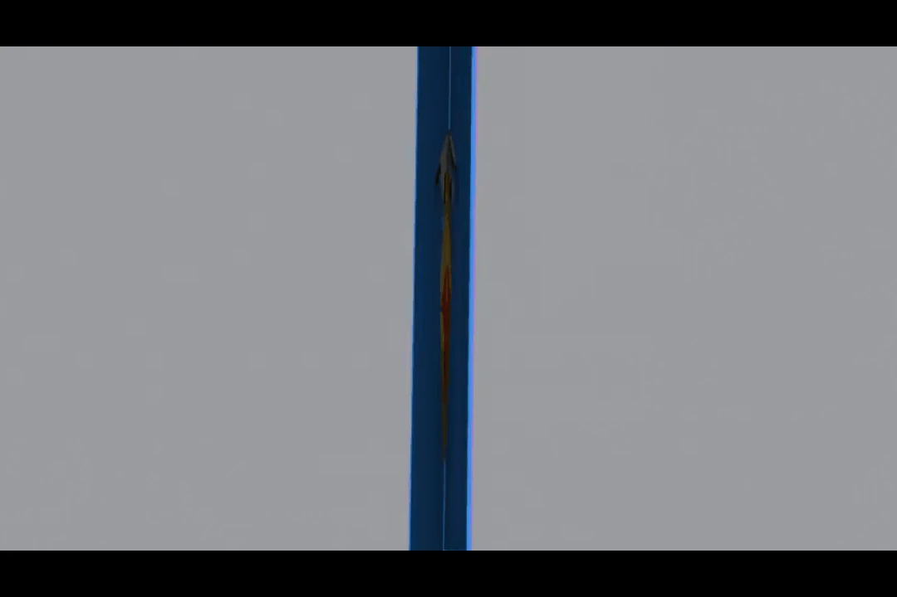

# Pop-Up Pro

**Design pop-up cards and books in Blender, test the movement, and print
them.**

<!-- SHOT: hero. Dawn render look, card about 120° open, 3-4 mechanisms
     with painted art, camera from the default card camera. -->

## Getting started

1. Download `popup_pro-x.y.z.zip` from
   [Releases](https://github.com/Liatach/Pop-UpPro/releases) and install it
   in Blender 5.0 or later: **Edit → Preferences → Get Extensions → ⌄ →
   Install from Disk**. Or simply drag the zip into Blender.
2. In the 3D view press **N** and open the **Pop-Up** tab.
3. Pick a card size and press **Build Card**, or **Make Carousel** for a
   5-stage carousel. You get a card with a cube on it (or the carousel's
   stages), a camera, lighting and a movement test: press **Play** to watch
   it open and close.
4. Add mechanisms with **+** and drag their sliders; the card rebuilds as
   you go. Keep an eye on **Checks**: it turns red when something would
   tear, poke through or stick out.
5. Draw on the card with **Draw Anywhere** (any Grease Pencil brush, folded
   or flat, across folds, painted into the paper: [how to](docs/sketching.md)), or add
   an image with **Image on a Piece**. Draw holes, use the built-in cut-out
   shapes, or cut away what's transparent in an image, or rub the paper
   see-through with **Erase the Paper**.
6. **Export SVG Sheets**, plus crease and cut patterns for Cricut and other
   cutting machines: print, cut, fold, glue.

Every setting is explained in more detail in the [guide](docs/guide.md).

## Examples

<!-- SHOT: box layer + box layer on top, Battlements / Pointed Tower presets, a door flap on the front, two stand-ups (one in front of the other). Showcase look. -->
### Castle

Stacked box layers with battlements, a spire and a hinged door, and parallelogram stand-ups in front.

<!-- SHOT: strap Peaks 3 with cubes in two valleys; a slanted strap; asym V-fold with a box on its crease. Showcase look, ~110° open. -->
### Off the centre

A strap with three peaks carrying cubes in its valleys, a slanted strap, and an asymmetric V-fold leaning a tower to one side.

### Stacking

Box layers stacked on box layers, glued boxes on top and insets pushed into their corners.

<!-- SHOT: hexagon tube with pointed roof, tent, pyramid, tethers between them; basic box (flat Dip roof + rib) with a V-fold on its roof. Dawn look. -->
### Village

Tubes and pyramids on parallel strips, tied together with tethers, and a basic box whose roof is a second spine.

<!-- SHOT: 5-stage carousel at ~300°, staging frame with an arch, window Through Everything Behind, a floor with a V-fold on its crease, peaked-roof background. Dawn look. -->
### Carousel

Five stages opening right round, with frames, windows cut through every layer, floors and a peaked roof.

<!-- SHOT: a mouth, two Jaw V-folds facing each other, a beak V-fold, a flap mid-pull. Could be a GIF. -->
### Creatures & Characters

Mouths, jaws and beaks that chomp as the card opens, eyes that move and more.

<!-- SHOT: split image: left the painted card with an image wrapped round a cube; right its card sheet + assembly page. -->
### From paint to print

Paint flat or folded, import and position images or simply textures, then export layered SVG sheets with an assembly page.

## Features

**Mechanisms**
* V-folds: panels, beaks, pleated fans, M-folds and zig-zags; symmetric or
  asymmetric, glued away from the spine (arched), or on top of each other.
  Mouths and jaws.
* Multiple quadrilaterals on angled glue lines.
* Box folds, square or angled (the glue lines turned and
  mirrored either side of the fold, with one crease or three, the panels
  tilting into new planes); box layers; straps (slanted, with peaks).
* 180° cubes with a lid, or a tower's pointed or flat roof, and collars.
* Tubes, cylinders, loops (Birmingham 16) and cones that narrow or flare,
  pyramids and tents on parallel strips, with tethers and roofs. Balconies
  on arches, with railings, on tube and cube walls, in front of boxes and
  outside towers.
* Castles (square, pentagonal or hexagonal): towers in a tube's corners and
  creases with pyramid, overhanging gabled, or flat roofs (sunk behind
  battlements, or with a ledge round the top). Collars: balconies
  with railings or battlements all the way round a tower, or tapered tops,
  stacked in tiers stepping out and in, that still fold flat.
* Parallelogram stand-ups (with a bridge, or a tail rolled up behind),
  picture placemats glued on any face, pull-tab flaps.
* 45° folds: a raised platform (on or off the centre), a rising sheet,
  propped square by 45° folds; the double 45° fold, its top piece twisting
  round; a jack in the box on a V-fold; triangles that leap out of a box's
  corners.
* Carousels of 2 to 9 stages with frames, floors, ceilings and roofs, or one
  stage set standing in an ordinary card.
* Cards that stand part open (**Opens To** 90° or 120°, say), with frames,
  floors and ceilings straight in the card.

**Building**
* Stack anything on anything: boxes on boxes, V-folds on V-folds, cubes in
  valleys and gullies, off-centre on straps and glue folds.
* Extra creases and cuts from presets or drawn by hand: reverse points,
  steps, jaws, battlements, spires; flip, turn and move a whole shape.
* Windows, arches, holes and hinged door flaps on any face, turned to any
  angle, painted or sketched, lined up through every layer behind.
* Duplicate a mechanism with everything on it.
* Align: line mechanisms up along the fold they share or across the whole
  card, or space them evenly; flaps on opposite pages mirror each other.
* Live checks for tearing, poking through, sticking out and overlapping glue,
  and a "Plan View" that squashes the card flat and see-through, a colour per
  mechanism, so overlaps in a busy build show plainly.

**Art and output**
* Draw with any Grease Pencil brush, folded or on the flat layout (they're
  the same paper), or place images that wrap round cubes and tubes; either
  way the art stays on the paper as it folds. Erase the paper see-through
  (round a drawing, say) and cut what's erased out.
* **Ink Layers**: what you draw is kept as strokes on layers to hide, fade,
  reorder and edit, and the paper is redrawn from them.
* Outside glue tabs print the art of the part they glue onto, so they
  disappear into the picture.
* A built in animated movement test with one Open slider, on a rig that needs no Python
  auto-run.
* Render looks: Clean, Showcase, Dawn, Studio or your own; metallic, glossy
  or glowing parts with their art kept, and metallic images (foil
  lettering on matt paper); the print layout in or out of renders.
* Layered SVG sheets, reverse sides, an assembly page, and cut-only and
  crease-only files for Cricut and other cutting machines.
* Card sizes from A6 to A3, US Letter sizes, 5×7 in and picture-book trims.

## Sources

The mechanisms follow The Pop-Up Channel's video tutorials:

* [Pop-Up Tutorial 1 - Box-fold](https://www.youtube.com/watch?v=RVZEsnzJTqM)
* [Pop-Up Tutorial 2 - V-folds Part 1: right-angle and acute-angle V-folds](https://www.youtube.com/watch?v=Lm2RYojO-q8)
* [Pop-Up Tutorial 3 - V-folds Part 2: pointed and obtuse-angle V-folds](https://www.youtube.com/watch?v=MvbGJxH-1pg)
* [Pop-Up Tutorial 4 - V-folds Part 3: asymmetric V-fold](https://www.youtube.com/watch?v=N-mv6ePRNAc)
* [Pop-Up Tutorial 5 - Parallel-folds Part 1: parallelogram](https://www.youtube.com/watch?v=BvF15GfYwVc)
* [Pop-Up Tutorial 6 - Parallel-folds Part 2: symmetric and asymmetric](https://www.youtube.com/watch?v=9xRj1-OUX64)
* [Pop-Up Tutorial 7 - Adding extra creases to basic pop-up shapes, Part 1](https://www.youtube.com/watch?v=IkJAnmS-2ZE)
* [Pop-Up Tutorial 9 - Raising Pop-Ups Off-Centre: The Strap](https://www.youtube.com/watch?v=AMbeFT8L7oI)
* [Pop-Up Tutorial 21 - Pyramids](https://www.youtube.com/watch?v=jZDHbUhV6Ms)
* [Pop-Up Tutorial 22 - Adding extra creases, Part 2: counter-folds](https://www.youtube.com/watch?v=Ze9shENIBf4)
* [Pop-Up Tutorial 23 - The 45-degree Fold](https://www.youtube.com/watch?v=_-pfbpDoiV8)
* [Pop-Up Tutorial 29 - Asymmetric V-fold, Part 2](https://www.youtube.com/watch?v=1OqP1pXhDUQ)
* [Pop-Up Tutorial 30 - V-fold action: building a tower](https://www.youtube.com/watch?v=eCq12WLoRx4)
* [Pop-Up Tutorial 72 - Box, type 2](https://www.youtube.com/watch?v=6FKi95a14N4)
* [360° pop-up book](https://www.youtube.com/watch?v=HKvsssZ9W0E) (the basic box and carousels; also [on Reddit](https://www.reddit.com/r/popupbooks/comments/1xcfeks/how_to_make_360_popup_book/))

Duncan Birmingham's splendid book *Pop-Up! A Manual of Paper Mechanisms* covers them
too.

Pop-Up Pro is self-contained. Paint layers you set up yourself on the
card's paper work alongside it. The fabulous
[Paint System](https://github.com/natapol2547/paintsystem) by Tawan
Sunflower is a good way to make them.

## Constraints
* One card (or carousel) per scene. Mechanisms stand on the spine or on the
  folds other mechanisms offer: the **+** menu lists what fits the one
  selected.
* The checks look at paper footprints, but not at 3D collisions between
  separate mechanisms (the Plan View helps you spot them by eye).
* Extra creases and cuts work on the card itself, V-folds, box folds and box
  layers; tubes, roofs and stand-up pictures don't take them yet.
  Asymmetric creases need their own matching crease on the other side
  (drawn with Mirror off).
* A tube's (or a castle's) walls are built of one or two strips of paper, each of which
  must fit on one print sheet.
* A floor can't turn a corner that opens out as the card closes unless it
  slopes, so a balcony round a tower is a collar (sloping, sliding at two
  corners); a tube's balconies go on its side walls.
* Some options only go together where the paper can fold: pyramid and flat
  tower roofs need a square tower; gabled roofs and sunken battlements are
  for castle towers, not cubes; a cone has no roof; an angled box fold takes
  no slant, peaks or railing. Checks says when one is left off.
* Draw Anywhere strokes are shown as paint once they are on the paper (a
  stroke that runs from one piece of paper onto another is split between
  them), and edited as strokes on the flat layout (**Edit Ink**), not on
  the folded card.
* Texture Paint itself is hidden from the panels: Draw Anywhere is the way
  to paint, and Erase the Paper (in the Artwork panel) the way to rub it
  see-through and cut painted holes.
* Paint layers of your own on UDIM tiles are untested; Bake Art for Print is
  the safe route for printing.

## Roadmap

* **Ink layers, continued**: strokes put on the paper as each one is
  finished (so they are never seen standing off it), editing them on the
  folded card as well as the flat layout, and the paper redrawn by itself
  when a layer's opacity changes.
* **Tubes and castles, continued**: battlements and a drawbridge in a
  tube's walls, and towers on other folds. Overhanging roofs on tubes, eaves
  on pyramid tower roofs, gabled roofs on cubes; stand-ups on a tower's
  sunken platform (its creases fold the wrong way up for them, so it needs a
  dish shaped for it); a balcony across a tube's front or back, if a way can
  be found for its floor to fold there; crenellations along more kinds of
  edge; a cylinder's lid trimmed as the book's (68).
* **Collars, continued**: round a whole tube or castle (its corners don't
  close in pairs the way a tower's do), round box folds, upside down as
  cornices, and on pillars.
* **Loops and cones, continued**: the loop made into an animal's head
  (Birmingham 17).
* **Angled box folds, continued**: on other folds (straps, towers, another
  box), glued by inset tabs, and with peaks.
* **Rising Sheet, continued**: 45° supports you can slide along the sheet,
  and slotted sheets: a second sheet slotted through the first, its slot
  locked to the page so the top piece tethers the other to it, the slot at
  least three paper thicknesses wide to leave room to move.
* The consolidation and elegance pass over the interface, continued:
  * Fewer mechanisms that do more: the Roof becomes a V-fold with Cut Away
    Background Above and Level Ridge; floors, ceilings and the background
    folding in sit together as one "Stage" section.
* Door flaps on cubes, tubes and stand-up pictures.
* **Tabs that carry the art**, continued: outside tabs (V-folds with Tab
  Side Outside) already print the art of the part they glue onto. Next:
  a Tab Side choice for box folds, straps and cubes, and inside tabs' backs
  printed on the reverse sheet.
* **Concertinas, continued**: a fan standing free of the centre crease,
  concertina corners (like an accordion's), rainbows and arcs.
* **45° folds, continued**: the jack in the box on a parallelogram, arms that
  reach out past the base's edges, box ends filled by double 45° folds, and
  a box lid lifted by a strut.
* Next mechanisms: the 90° box with lid, floating layers on pedestals,
  moving arms.
* **V-folds, continued** (Birmingham): the "bite" that sculpts a V-fold
  into a curve or a point (12–15), and tall narrow sides that twist (19).
* **Zig-zags and quadrilaterals, continued** (Birmingham): slanted fold
  lines (47), boxes cut into the faces (46, 48), and a quadrilateral lifted
  on a V-fold (56).

## Version history

* **0.82**: more of Birmingham's mechanisms. **Pop-up House** (49): a cube
  takes a gabled roof, with the book's sizes in the **+** menu. **Slotted
  Cross Piece** on a rising sheet (81): the two 45° folds as one piece
  slotted across the sheet, free to rise past it. **Box with Ends** (82): a
  box on one page pulled up by a 45° fold from the other, its ends filled
  in by pairs of 45° folds. **Animal Face** (17): a loop whose top carries
  on as a muzzle, folded back into a nose by a dart.
* **0.81.3**: **Used lately** and **Palette** now show while drawing (and
  Colour History while painting): an error in how the swatches were drawn
  cut the panel short, hiding them and the brush size, strength and ink
  layers below.
* **0.81.2**: while drawing, **Used lately** fills in as you draw (each
  stroke's colour, at once), and it and **Palette** are always shown, with a
  line saying what goes there while they're empty. **Done Drawing** is at
  the top of Artwork while you draw on the card, and no longer in Creases,
  Cuts and Holes (where it stays for drawn creases, cuts and holes).

Earlier versions are in the [changelog](CHANGELOG.md).

## Development

Tests run with `pip install bpy`: `python tests/run_all.py` runs them all,
several at a time, and `python tests/run_all.py collars` only one family's
(`--list` shows the families). `python scripts/since_upload.py` shows what
has changed since the last upload here. `scripts/build.sh` builds the zip
(with Blender, or with that same Python), `ruff check` lints
(`pip install ruff`; settings in `ruff.toml`), and
`scripts/gif_to_webp.sh` turns a GIF for this page into an animated WebP a
tenth of the size. How the solver and rig work is in
the [guide](docs/guide.md#how-it-works).

## Licence

GPL-3.0-or-later. By Kim Lang / [Liatach Makes](https://kim-lang.com) with LLM coding assistance.
Built on the shoulders of giants.
This will always be free! 
But if you'd like to support its development, please consider buying me a coffee:

A companion to [Papercraft Pro](https://github.com/Liatach/papercraft-pro).
Pop-Up Pro is not affiliated with or endorsed by the Blender Foundation.
