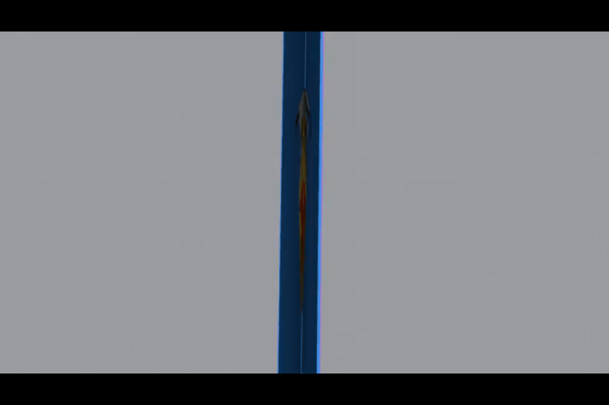

# Pop-Up Pro

**Design pop-up cards and books in Blender, test the movement, and print
them.**

<!-- SHOT: hero. Dawn render look, card about 120° open, 3-4 mechanisms
     with painted art, camera from the default card camera. -->

## Getting started

1. Download `popup_pro-x.y.z.zip` from
   [Releases](https://github.com/Liatach/Pop-UpPro/releases) and install it
   in Blender 4.3 or later: **Edit → Preferences → Get Extensions → ⌄ →
   Install from Disk**. Or simply drag the zip into Blender.
2. In the 3D view press **N** and open the **Pop-Up** tab.
3. Pick a card size and press **Build Card**, or **Make Carousel** for a
   5-stage carousel. You get a card with a cube on it (or the carousel's
   stages), a camera, lighting and a movement test: press **Play** to watch
   it open and close.
4. Add mechanisms with **+** and drag their sliders; the card rebuilds as
   you go. Keep an eye on **Checks**: it turns red when something would
   tear, poke through or stick out.
5. Draw on the card with **Draw Anywhere** (any Grease Pencil brush, folded
   or flat, across folds, painted into the paper: [how to](docs/sketching.md)), or add
   an image with **Image on a Piece**. Draw holes, use the built-in cut-out
   shapes, or cut away what's transparent in an image or your paint.
6. **Export SVG Sheets**, plus crease and cut patterns for Cricut and other
   cutting machines: print, cut, fold, glue.

Every setting is explained in more detail in the [guide](docs/guide.md).

## Examples

<!-- SHOT: box layer + box layer on top, Battlements / Pointed Tower presets, a door flap on the front, two stand-ups (one in front of the other). Showcase look. -->
### Castle

Stacked box layers with battlements, a spire and a hinged door, and parallelogram stand-ups in front.

<!-- SHOT: strap Peaks 3 with cubes in two valleys; a slanted strap; asym V-fold with a box on its crease. Showcase look, ~110° open. -->
### Off the centre

A strap with three peaks carrying cubes in its valleys, a slanted strap, and an asymmetric V-fold leaning a tower to one side.

### Stacking

Box layers stacked on box layers, glued boxes on top and insets pushed into their corners.

<!-- SHOT: hexagon tube with pointed roof, tent, pyramid, tethers between them; basic box (flat Dip roof + rib) with a V-fold on its roof. Dawn look. -->
### Village

Tubes and pyramids on parallel strips, tied together with tethers, and a basic box whose roof is a second spine.

<!-- SHOT: 5-stage carousel at ~300°, staging frame with an arch, window Through Everything Behind, a floor with a V-fold on its crease, peaked-roof background. Dawn look. -->
### Carousel

Five stages opening right round, with frames, windows cut through every layer, floors and a peaked roof.

<!-- SHOT: a mouth, two Jaw V-folds facing each other, a beak V-fold, a flap mid-pull. Could be a GIF. -->
### Creatures & Characters

Mouths, jaws and beaks that chomp as the card opens, eyes that move and more.

<!-- SHOT: split image: left the painted card with an image wrapped round a cube; right its card sheet + assembly page. -->
### From paint to print

Paint flat or folded, import and position images or simply textures, then export layered SVG sheets with an assembly page.

## Features

**Mechanisms**
* V-folds (panels, beaks or pleated fans; symmetric or asymmetric), mouths
  and jaws.
* Box folds, box layers, straps (slanted, with peaks), 180° cubes with lids.
* Tubes, pyramids and tents on parallel strips, with tethers and roofs, and
  castles: towers up a tube's inside corners with pyramid roofs that still
  fold flat.
* Parallelogram stand-ups, pull-tab flaps.
* 45° folds: a raised platform (on or off the centre) and a rising sheet,
  propped square by 45° folds; the double 45° fold, its top piece twisting
  round; a jack in the box on a V-fold; triangles that leap out of a box's
  corners.
* Carousels of 2 to 9 stages with frames, floors, ceilings and roofs, or one
  stage set standing in an ordinary card.

**Building**
* Stack anything on anything: boxes on boxes, V-folds on V-folds, cubes in
  valleys and gullies, off-centre on straps and glue folds.
* Extra creases and cuts from presets or drawn by hand: reverse points,
  steps, jaws, battlements, spires; flip, turn and move a whole shape.
* Windows, arches, holes and hinged door flaps on any face, turned to any
  angle, painted or sketched, lined up through every layer behind.
* Duplicate a mechanism with everything on it.
* Align: line mechanisms up along the fold they share or across the whole
  card, or space them evenly; flaps on opposite pages mirror each other.
* Live checks for tearing, poking through, sticking out and overlapping glue,
  and a Plan View that squashes the card flat and see-through, a colour per
  mechanism, so overlaps in a busy build show plainly.

**Art and output**
* Draw on the card with any Grease Pencil brush, folded or on the flat
  layout (they're the same paper), across folds: it's painted into the
  paper, flat on every fold. Or place images that wrap round cubes and
  tubes. Art stays on the paper as it folds.
* Outside glue tabs print the art of the part they glue onto, so they
  disappear into the picture.
* A movement test with one Open slider, on a rig that needs no Python
  auto-run.
* Render looks: Clean, Showcase, Dawn, Studio or your own; metallic, glossy
  or glowing parts with their art kept, and metallic images (foil
  lettering on matt paper); the print layout in or out of renders.
* Layered SVG sheets, reverse sides, an assembly page, and cut-only and
  crease-only files for Cricut and other cutting machines.
* Card sizes from A6 to A3, US Letter sizes, 5×7 in and picture-book trims.

## Sources

The mechanisms follow The Pop-Up Channel's video tutorials:

* [Pop-Up Tutorial 1 - Box-fold](https://www.youtube.com/watch?v=RVZEsnzJTqM)
* [Pop-Up Tutorial 2 - V-folds Part 1: right-angle and acute-angle V-folds](https://www.youtube.com/watch?v=Lm2RYojO-q8)
* [Pop-Up Tutorial 3 - V-folds Part 2: pointed and obtuse-angle V-folds](https://www.youtube.com/watch?v=MvbGJxH-1pg)
* [Pop-Up Tutorial 4 - V-folds Part 3: asymmetric V-fold](https://www.youtube.com/watch?v=N-mv6ePRNAc)
* [Pop-Up Tutorial 5 - Parallel-folds Part 1: parallelogram](https://www.youtube.com/watch?v=BvF15GfYwVc)
* [Pop-Up Tutorial 6 - Parallel-folds Part 2: symmetric and asymmetric](https://www.youtube.com/watch?v=9xRj1-OUX64)
* [Pop-Up Tutorial 7 - Adding extra creases to basic pop-up shapes, Part 1](https://www.youtube.com/watch?v=IkJAnmS-2ZE)
* [Pop-Up Tutorial 9 - Raising Pop-Ups Off-Centre: The Strap](https://www.youtube.com/watch?v=AMbeFT8L7oI)
* [Pop-Up Tutorial 21 - Pyramids](https://www.youtube.com/watch?v=jZDHbUhV6Ms)
* [Pop-Up Tutorial 22 - Adding extra creases, Part 2: counter-folds](https://www.youtube.com/watch?v=Ze9shENIBf4)
* [Pop-Up Tutorial 23 - The 45-degree Fold](https://www.youtube.com/watch?v=_-pfbpDoiV8)
* [Pop-Up Tutorial 29 - Asymmetric V-fold, Part 2](https://www.youtube.com/watch?v=1OqP1pXhDUQ)
* [Pop-Up Tutorial 30 - V-fold action: building a tower](https://www.youtube.com/watch?v=eCq12WLoRx4)
* [Pop-Up Tutorial 72 - Box, type 2](https://www.youtube.com/watch?v=6FKi95a14N4)
* [360° pop-up book](https://www.youtube.com/watch?v=HKvsssZ9W0E) (the basic box and carousels; also [on Reddit](https://www.reddit.com/r/popupbooks/comments/1xcfeks/how_to_make_360_popup_book/))

Duncan Birmingham's splendid book *Pop-Up! A Manual of Paper Mechanisms* covers them
too. 

Pop-Up Pro is self-contained. Paint layers you set up yourself on the
card's paper work alongside it: the fabulous
[Paint System](https://github.com/natapol2547/paintsystem) by Tawan
Sunflower is a good way to make them.

## Constraints

* One card (or carousel) per scene. Mechanisms sit on the spine, on box
  folds and straps (and their valleys), stand-ups, a tube's roof, a V-fold's
  crease or glue folds, outside a cube's or tube's walls, or (towers) up a
  tube's inside corners.
* The checks look at paper footprints, but not at 3D collisions between
  separate mechanisms (the Plan View helps you spot them by eye).
* Extra creases and cuts work on the card itself, V-folds, box folds and box
  layers; tubes (so castle walls: no battlements or drawbridge yet), roofs
  and stand-up pictures don't take them yet. Asymmetric creases need their
  own matching crease on the other side (drawn with Mirror off).
* A castle's wall is one strip of paper round all its walls, so it must fit
  on one print sheet.
* Draw Anywhere strokes become paint when they go on the paper: they can't
  be edited as strokes afterwards (Ctrl Z takes them off), and a stroke
  that runs from one piece of paper onto another is painted on each.
* Texture Paint (and with it Erase, painted holes and erasing a stand-up
  picture's outline) is hidden from the panels for now: Draw Anywhere is
  the way to paint.
* Paint layers of your own on UDIM tiles are untested; Bake Art for Print is
  the safe route for printing.

## Roadmap

* **Ink layers and editable strokes**: Draw Anywhere strokes kept as Grease
  Pencil lying on the flat layout, editable any time, in layers you can
  hide, reorder and fade, with the paper redrawn from them (**Update
  Paper**), so nothing is baked in for good. Strokes that keep to the piece
  they're on near folds and edges.
* **Castle, continued**: battlements and a drawbridge in the tube's walls, a
  castle wall in two strips (as Birmingham's), and towers on other folds.
  Gabled roofs, and roofs that overhang the walls, on towers and tubes;
  balconies with railings; crenellations along more kinds of edge.
* **Rising Sheet, continued**: 45° supports you can slide along the sheet,
  and slotted sheets: a second sheet slotted through the first, its slot
  locked to the page so the top piece tethers the other to it, the slot at
  least three paper thicknesses wide to leave room to move.
* The consolidation and elegance pass over the interface, continued:
  * Fewer mechanisms that do more: the Roof becomes a V-fold with Cut Away
    Background Above and Level Ridge; floors, ceilings and the background
    folding in sit together as one "Stage" section.
  * The Add menu grouped by where things go (on the spine, on a V-fold, on
    a floor or ceiling, in a stage), offering only what fits the selected
    host.
  * Clicking a warning in Checks selects the mechanism it's about.
* Door flaps on cubes, tubes and stand-up pictures.
* **Tabs that carry the art**, continued: outside tabs (V-folds with Tab
  Side Outside) already print the art of the part they glue onto. Next:
  a Tab Side choice for box folds, straps and cubes, and inside tabs' backs
  printed on the reverse sheet.
* **Concertina cont.**: opening into a
  fan, but standing free of the centre crease, congruent concertina corners like an accordion corner, arches, rainbows and arcs.
* Next mechanisms: the 90° box with lid, floating layers on pedestals,
  arch V-folds, moving arms.
* **45° folds** 
  * the jack in the box on a parallelogram, arms that reach out past the
    base's edges 
  * box ends filled by double 45° folds, and a box lid lifted by a strut
* **Multiple quadrilaterals**: a chain of linked quadrilaterals sweeping
  across the spine, each with its own height and shape, as long as each
  one's front and rear crease lengths balance.

## Version history

* **0.64**: visibility per mechanism (Normal, Wire, Hidden), with Draw
  Anywhere painting through; the Plan View shows where pieces of paper pass
  through each other; frames across an ordinary card's fold.
* **0.63**: the double 45°'s top piece no longer passes through itself on
  the way open; a jack in the box goes on top of any V-fold (Add with a
  V-fold selected), sized to fit.
* **0.62**: the double 45° fold, its top piece bending and twisting on
  screen; the jack in the box on a V-fold; 45° triangles in a box fold's
  corners; a stage set added to an emptied card works again.
* **0.61**: pyramids stand on other folds, like tubes; a plain tube after a
  castle is a plain tube again.
* **0.56–0.60**: Align (along a fold or across the card) and a see-through
  Plan View; castle towers in a tube's corners with pyramid roofs that fold
  flat; self-contained for Blender Extensions; Draw Anywhere with Grease
  Pencil, across folds, painted into the paper.
* **0.46–0.55**: 45° folds (Platform, Rising Sheet); part materials (metallic,
  glossy, glow) and metallic images; outside tabs that carry the art; folds
  that share vertices; the Studio look; colour history; painting tidied up.
* **0.40–0.45**: Grease Pencil sketching end to end; concertinas and fans;
  painting the card flat or folded without stopping.
* **0.32–0.39**: render looks; openings on any face, turned; crease and cut
  shapes you can flip, turn and move; door flaps; Duplicate; sheets sized to
  fit; painting sessions with Erase and painted holes.
* **0.24–0.31**: Set Up Scene; bake guards; images on pieces; picture-book
  sizes; off-centre pop-ups (straps, V-fold glue folds), slanted straps and
  peaks; images that wrap round cubes; the card camera.
* **0.17–0.23**: asymmetric V-folds and mechanisms on a V-fold's crease;
  floors and ceilings from card creases; peaked roofs; Solid Paper.
* **0.10–0.16**: carousels and stage sets; openings and holes; extra creases
  and cuts on V-folds and boxes; parallelogram stand-ups; True Colours.
* **0.3–0.9**: Pop-up Mechanics becomes Pop-Up Pro; the closing stop and export
  options; the 180° cube and pull-tab flaps; tubes and tethers; pyramids,
  tents and roofs; reverse sides and the assembly page; the basic box.

## Development

Tests run with `pip install bpy`: `python tests/test_core.py`, then each
`tests/test_*.py` (one per release). How the solver and rig work is in the
[guide](docs/guide.md#how-it-works).

## Licence

GPL-3.0-or-later. By Kim Lang / [Liatach Makes](https://kim-lang.com) with LLM coding assistance.
Built on the shoulders of giants.
This will always be free! 
But if you'd like to support its development, please consider buying me a coffee:

A companion to [Papercraft Pro](https://github.com/Liatach/papercraft-pro).
Pop-Up Pro is not affiliated with or endorsed by the Blender Foundation.
