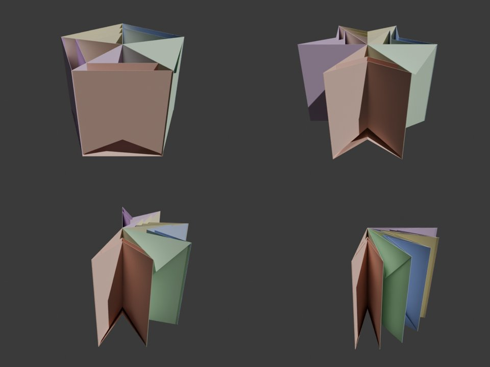
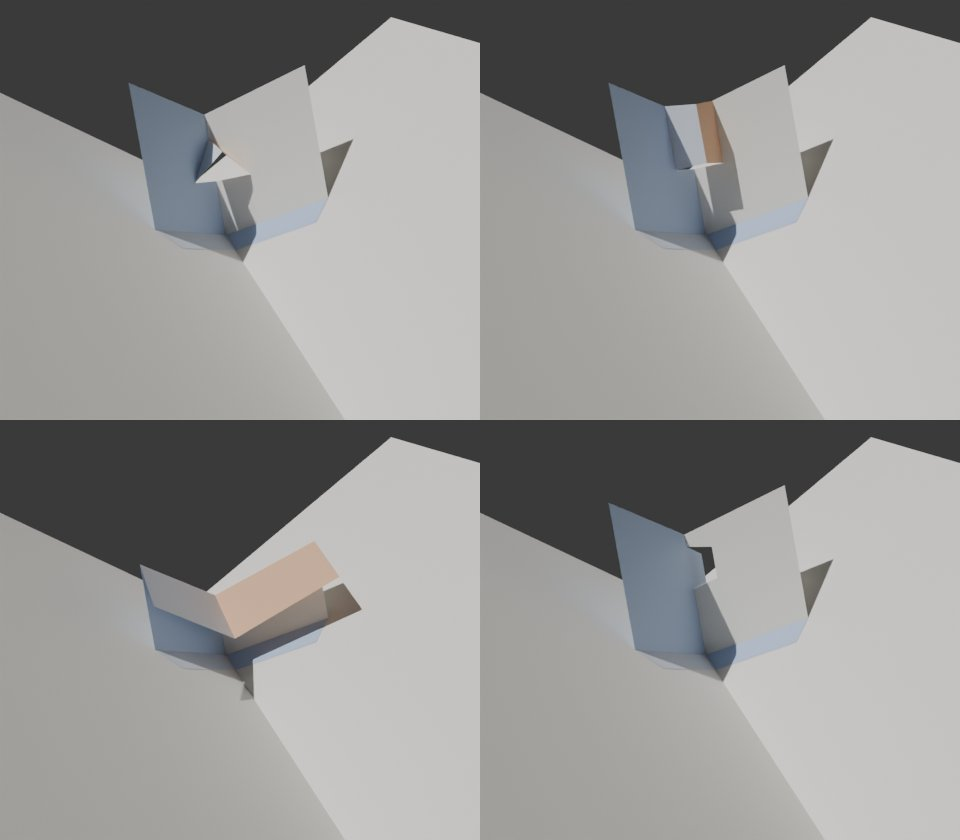
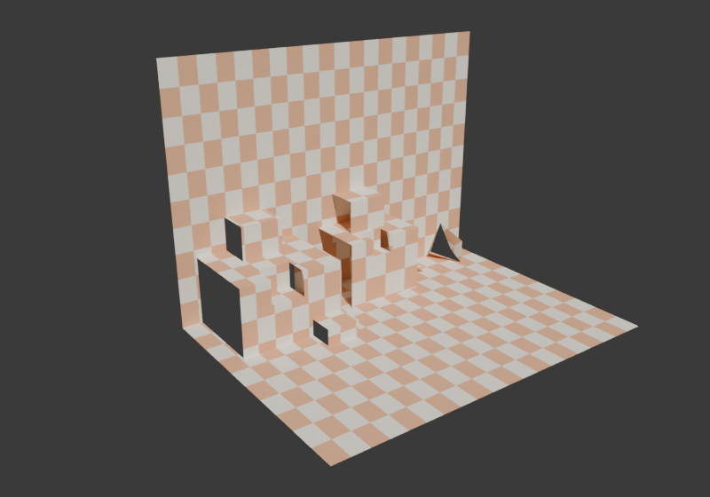
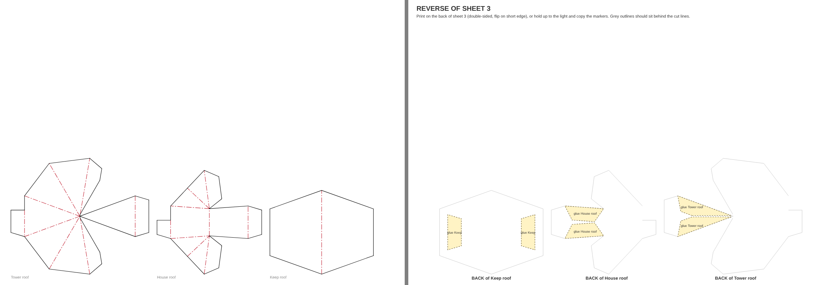
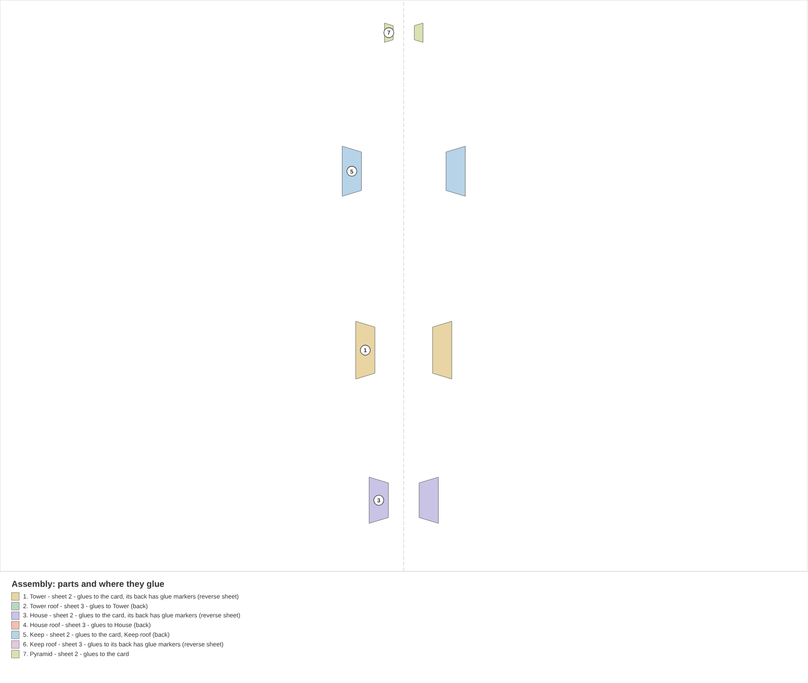
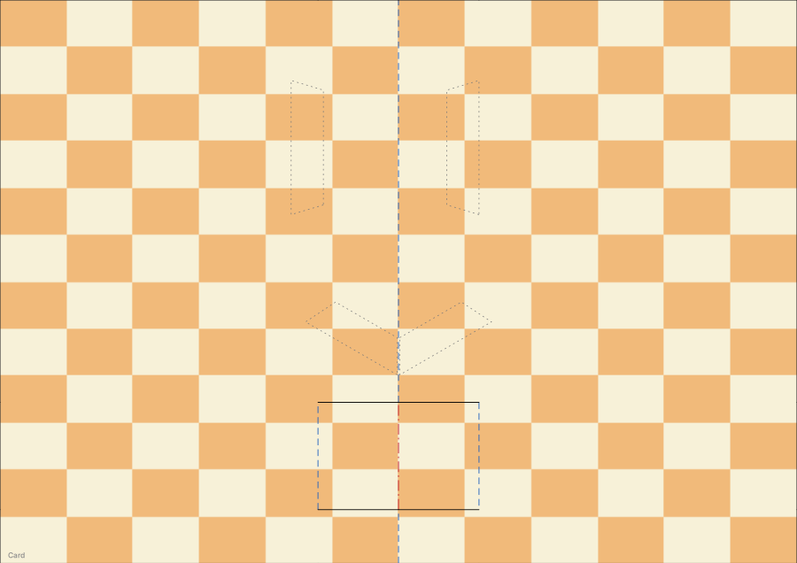
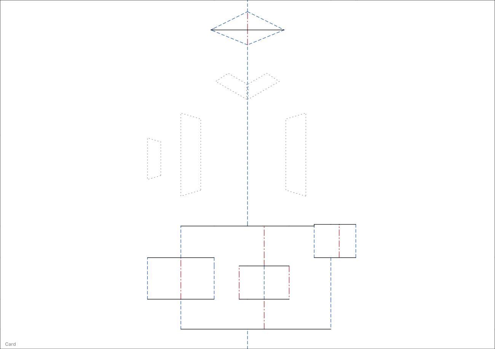

# Pop-Up Pro guide

The full reference: every setting, mechanism and export option. For a quick
start, see the [README](../README.md).

## Use

1. **Card**: A5 (A4 folded, the default), A6, 150 mm square or custom.
   **Opens**: *Picture Book* (the default) opens both pages out from the
   spine, like a book on its spine; *Right Page Flat* or *Left Page Flat*
   keeps one page on the table while the other turns over.
2. **Build Card**. The first build adds a cube to play with, sets the scene
   up (below), puts a camera past the bottom end of the spine, looking down
   along it so the whole card shows as it unfurls, and keys a movement test:
   press **Play**, or drag the timeline.
3. **Mechanisms**: add, remove and tune them. With **Live Rebuild** on (the
   clock icon) the card updates as you drag values.
4. **Set Up Scene** (runs by itself the first time you build a card or make a
   carousel in a file; press it again any time): settings chosen to make
   folds easy to read and to stay light on modest graphics cards.
   * Material Preview lit by Blender's dawn HDRI (*sunrise.exr*).
   * A gentle **Sun** (0.6, from above left): each panel takes its own
     shade and shadows fall inside the stage, which tells a valley fold
     from a mountain fold at a glance (no more inside-out illusion).
   * **Fold Lines**: the Wireframe overlay showing only edges where panels
     meet at an angle.
   * Light ambient occlusion in the creases, kept sharp: EEVEE's screen-space
     AO ("fast GI", AO only) at half resolution, nothing ray traced (the
     paper is matt, so it never needs to be) and no blur filter. A
     one-eighth resolution, as in many files, is what makes it look smeared.
   * The Standard view transform (true colours), on the carousel and every
     stage.
   * A **Camera** past the bottom end of the spine, above the card, framing
     it from shut to fully open (Kim's framing, scaled with the card; for a
     carousel, the whole ring). It becomes the scene camera (a new file's own
     Camera would otherwise win); turn off *Make It the Scene Camera* in the
     button's options to keep yours.
   * **Render Look** (the sun menu beside Set Up Scene): how finished
     renders are lit. The viewport keeps its own light, and painting,
     baking and printing never use any of it.
     * *Clean* (default): even white light, no sun, against a soft grey.
     * *Showcase*: a soft, faintly cool sky and a render-only key sun, so
       every fold casts a crisp shadow (64 render samples).
     * *Dawn*: Blender's sunrise light (the one Material Preview uses) with
       the sun: white paper turns warm where the low sun strikes and blue
       where only the sky reaches it (64 render samples).
     * *Your Own*: your scene's own world and lights.
   * **Paper Texture** (off by default): a fine grain as a bump, so colours
     and prints are untouched. It is one node group, *Pop-up Paper Texture*:
     put your own paper texture inside it and every card uses it.
5. **Open**: slider and 0/45/90/135/180° buttons. Under it, **Movement Test**
   is folded down to a play button and its length in frames; unfold it for
   **Open To** (degrees; a carousel up to 360), **Opening**, **Hold Open**
   and **Closing** (seconds), and **Open** (keys just the opening) or
   **Open and Close** (the whole cycle, setting the scene's end frame). Each
   press replaces the previous test. **Paper** folds away the same way,
   showing its thickness, with Stop at Paper Thickness and Solid Paper
   inside.
6. **Checks** sits right under the card panel. Its header says *all clear*,
   or turns red with how many things to fix: paper that would tear, panels
   poking through a page, pieces sticking out of the closed card, pieces
   too big for the sheet.
7. **Export SVG Sheets** writes one SVG per sheet.

### Closing and paper thickness

* **Paper Thickness** (default 0.3 mm, typical card stock).
* **Stop at Paper Thickness** (on by default): Open 0 is where the pages meet
  the folded mechanisms, not 0°, so a closed card doesn't squash everything
  through itself. The sidebar shows the angle it stops at. Turn it off for a
  card that closes to exactly 0°.
* **Solid Paper** (on by default): gives the card real thickness (behind the printed side)
  for renders. Modifiers you add to the card after it are kept on rebuild.

### Card sizes

A6, A5, A4 and A3 (from a folded A5, A4, A3 and A2), Half Letter and Letter
(folded US Letter and Tabloid), a 5 x 7 in greeting card, 150 mm square, the
common picture-book trims (8.5 x 8.5, 8 x 10, 10 x 8, 7.5 x 7.5 and
8.5 x 11 in), or Custom. Loose pieces go on the **Piece Paper** sheet, which
includes 12 x 12 and 12 x 24 in cutting mats. A piece too big for the piece
paper either way round gets a sheet of its own the size of the card's sheet
(turned if that fits better), and the checks say so; pick a bigger Piece
Paper to keep them together.

### Mechanisms (all lengths in mm)

The mechanism selected in the list is tinted orange on the folded card and the
layout. This is viewport only and never rendered; the pointer button under
**+** and **−** turns it off. **Duplicate** (under **−**) copies the
selected mechanism with its settings, creases, cuts and openings, 15 mm
further along its fold. New names keep counting up (Cube 1, Cube 2, Cube 3),
never reusing a number still in use.

| | What it is | Settings |
|---|---|---|
| **V-fold** | A folded piece glued along two lines that meet on a fold ([Tutorial 2](https://www.youtube.com/watch?v=Lm2RYojO-q8), [Tutorial 3](https://www.youtube.com/watch?v=MvbGJxH-1pg)) | Position, Fold Length, Glue Length, Glue Angle (fold to glue line), Piece Angle (centre fold to glue edge), tab size and side, symmetric or separate left/right. **Shape: Panels, Beak** (two triangles meeting at a point), **or a beak on one side and a panel on the other** |
| **Asymmetric V-fold** | A V-fold with different glue angles each side, whose crease leans over; it carries what stands on it off the card's centre ([Tutorial 4](https://www.youtube.com/watch?v=N-mv6ePRNAc), [Tutorial 29](https://www.youtube.com/watch?v=1OqP1pXhDUQ)) | As the V-fold, plus Glue Length R, Glue Angle R, Fold Flat and Lean |
| **Mouth** | A slit across a fold with two pairs of triangles cut into the paper; the jaws open as the card opens | Slit Position, Jaw Length (slit each side of the fold), Upper Jaw, Lower Jaw |
| **Box fold** | A separate strip glued across a fold (parallel fold; [Tutorial 1](https://www.youtube.com/watch?v=RVZEsnzJTqM)) | Position, Height (along the fold), Width Left, Width Right, tab size |
| **Box layer** | The same parallel fold cut into the paper itself ([Tutorial 5](https://www.youtube.com/watch?v=BvF15GfYwVc), [Tutorial 6](https://www.youtube.com/watch?v=9xRj1-OUX64)) | Position, Height, Width Left, Width Right |
| **Stand-up** | A picture held off the background by a bridge, or flat on a leg ([Tutorial 5](https://www.youtube.com/watch?v=BvF15GfYwVc)) | Picture (Upright or Flat), Position, Bridge or Leg Width, Bridge Height, Out From Back, Picture Width and Height, tab size |
| **Roof** | A peaked roof over a stage: the background cut to a gable, a V-fold glued along its eaves | Ridge Starts, Roof Slope, Eaves Length, Ridge Length, Level Ridge (or Piece Angle), tab size |
| **Cube (180°)** | A box standing on one corner edge on the fold; it rises as the card opens flat. **Width Right** makes the base a rectangle (lids need a square: a corner-to-corner lid can't fold flat over a rectangle). Stands on the spine, a box fold or strap, a stand-up, a floor's corner, a V-fold's glue folds or inside a V-fold (on its crease) | Position, Size, Height, Lid (Peaked, Dipped or None), base tab size and side |
| **Tube** | Hexagon, box or recessed tube on two parallel sticking strips ([Tutorial 72](https://www.youtube.com/watch?v=6FKi95a14N4)); on the spine, a box fold or strap, a stand-up, a V-fold's glue folds or inside a V-fold | Position, Strip Distance, Side Length, Height, Front and Back Width, each Pointed Out or In, base tabs, Roof (None, Pointed, or Flat with Peak/Dip and Overhang) |
| **Tether** | Wall from a tube's corner or crease to another tube or to a foot on a strip | From (tube and point), To (another tube's point, or a foot on the left or right strip), Height, Bend, Slack |
| **Pyramid** | Pyramid, hexagonal pyramid or tent on two parallel sticking strips ([Tutorial 21](https://www.youtube.com/watch?v=jZDHbUhV6Ms)) | Position, Strip Distance, Base Length, Height, Ridge, Front and Back Width, each Pointed Out or In, base tabs |
| **Flap** | A lift-the-flap worked by a pull tab, with its own **Pull** slider | Page, From Spine, Up the Page, Hinge edge, Width, Length, Hinge Tab, Lift angle, Glue Point (5 mm from the hinge by default), Strip Width, Slit Gap, Pull Tab |

### Cube (180°)

Four walls in one strip with a closing tab. The two front walls are a V-fold
on the fold (45° glue lines, square corners), glued down by the base tabs;
the back walls follow as a parallelogram. The lid is two right triangles on
the front walls, creased along the diagonal and joined by a glue tab: it
rises to a ridge (Peaked) or sinks into the box (Dipped) as the card closes.
A flat one-piece lid can't fold, so the lid is always two triangles.

### Tubes and tethers (parallel sticking strips)

A tube's side walls are glued to two strips parallel to the fold, the same
distance either side of it. Its front and back are pairs of walls whose
creases stay vertical above the fold, so the tube stays upright and folds
flat. A pair as wide as the strip distance gives a flat face when the card is
open flat (a box); wider pairs point out (a hexagon) or in (a recess).

Every wall in this family leans together, halfway between the pages, and
every crease stays parallel, so one tube can pull others into shape:

* **Tethers** join a tube's corner or crease to another tube's, or to a small
  foot glued on a strip. A tether stays flat (no crease) when its ends keep
  the same distance apart, such as two corners on the same strip. Otherwise
  it gets a crease, sized so it still folds flat when the card shuts, for
  example a tether crossing the centre. **Bend** picks the side the crease
  goes (Auto keeps it between the strips).
* All tubes joined by tethers must share the same **Strip Distance**: a strip
  further out sits lower, so the walls would have to slide.
* Anything standing at strip level must stay between the two strips, or it
  would pass under the pages as the card closes. The checks warn if a tether
  swings outside.
* Tethers whose ends would collide, or meet head-on along the fold as the
  card shuts, can't fold flat and are refused.

Their fold angles are solved when the card is built and stored in the rig as
driver curves (sampled every degree, more finely where needed), so the rig
still needs no scripts.

### Pyramids, tents and roofs

See The Pop-Up Channel's [Tutorial 21](https://www.youtube.com/watch?v=jZDHbUhV6Ms).

A pyramid's two sloping sides are glued to the same pair of strips as a
tube, and meet above the fold at an apex. Give it a **Ridge** and it becomes
a tent: a ridge as long as the base gives upright gable ends, a shorter one a
hipped roof. Each end is a pair of triangles creased down the middle above
the fold. Its bottom edge floats free, as in the book, and the ends fold flat
as the card shuts. **Front** and **Back Width** shape the ends just as on a
tube: as wide as the strip distance gives a flat end, wider points it out
(a hexagonal pyramid) or, Pointed In, tucks it in. A flat end can crease
either way as the card starts to close; Pointed Out sends the crease
outwards, Pointed In tucks it under.

A tube can wear the same roof: set its **Roof** to *Pointed* and choose
**Roof Height** and **Ridge**. The roof is a separate piece whose tabs glue
inside the top of the side walls. Lying flat, a roof adds its slope length to
the tube's height, and the checks warn if that runs past the page edge.

**Flat** roofs are two halves creased straight down the middle above the
fold. Tabs folded in off the tops of the side walls are glued underneath, so
the roof can **Overhang** the walls all round, like eaves.

* **Peak**: the centre crease rises as the card closes and the halves stand
  up when shut. This adds the strip distance to how far the tube reaches
  out.
* **Dip**: the centre crease sinks into the tube and the halves tuck down
  inside the walls, so nothing extra sticks out. This needs walls at least
  as tall as the strip distance, and ends that don't point in.

### The basic box: a second spine

The box in the [360° pop-up book](https://www.youtube.com/watch?v=HKvsssZ9W0E) video.

A tube with a *Flat* roof set to *Dip* is the basic box. The roof's
centre crease stays the wall height above the spine, straight up the middle,
and its halves stay parallel to the pages. So the roof works as a second card
spine:

* **Centre Rib** (mm along the fold, 0 for none) adds the central piece that
  holds the roof up. It is a doubled strip standing on the spine; each layer
  is glued to one page at the bottom and under the other roof half at the
  top.
* Choose the box's roof as the **Host** of a V-fold, box fold, box layer,
  mouth or cube, and it stands on the roof crease and opens with the roof,
  just as it would on the card. Box layers and mouths are cut into the roof
  itself.
* A peaked roof turns the wrong way to be a spine, so it isn't offered as a
  host.

### Carousels (stage sets)

As in the [360° pop-up book](https://www.youtube.com/watch?v=HKvsssZ9W0E) video.

On an empty scene, **Make Carousel** turns the scene into a carousel of
**Stages** (2 to 9, 5 by default). Each stage is a scene of its own and a
normal Pop-Up Pro card, with its own mechanisms, art, sketches and export.
Its pages are the background, and it opens to 360 / Stages degrees: 72 for
five. The carousel scene shows every stage's folded card turned round one
spine, and one **Carousel Open** control (0 to 360 degrees) opens them all.
**Edit** goes to a stage; in a stage, **Carousel**, **Previous** and **Next**
move around.

* **Frames** span the stage from page to page, glued down each side at
  **Depth** from the spine, with a centre crease that folds back as the
  stage closes. Their width is worked out from the stage count, so every
  frame pulls flat exactly when the stage is fully open. A new stage starts
  with a staging frame at the front and one floating frame behind it; add
  up to three floating frames from the Add menu.
* **Floors** and **ceilings** are V-folds along the bottom and top edges of
  the pages. They lie flat when the stage is open and fold into the stage
  as it closes. Frames are cut back automatically to clear them. Floors and
  ceilings need three stages or more: at 180 degrees they would have to lie
  in the page planes the moment the stage starts to close. **Point** runs a
  floor's or ceiling's centre on past the front of the stage, as a pointed
  apron: shut, the centre crease lies on the page at half the stage angle,
  so it can go a long way (about 170 mm on an A5 three-stage carousel, 60 mm
  on five) before it would stick out. It is shortened, with a warning, if it
  would. Floors print with their art side up into the stage.
* **Corners**: where a floor or ceiling meets a wall is a fold too. Pick
  the floor or ceiling as the **Host** of a glued box fold, V-fold or cube
  and choose the **Wall** (left or right). Or select the floor and use the
  Add menu's corner entries. Box folds label their widths *Up Wall* and
  *Along Floor*. Their tabs may lie over the floor's own tab along the wall,
  glue on glue.
* **On a floor's or ceiling's crease**: from inside the stage that crease is
  a mountain fold. It opens from fully folded to flat as the stage opens, so
  boxes and cubes can't stand there, but V-folds can. A V-fold there folds
  flat over the crease as the stage shuts and rises as the floor flattens.
  Select the floor and use **Add → V-fold on its crease**, or tick **On the
  Crease** on a V-fold whose host is the floor. On a ceiling it hangs down
  into the stage.
* **A V-fold roof with the walls above cut off**: on a V-fold on the
  card's spine whose glue lines fall away from it (Glue Angle over 90),
  tick **Cut Away Background Above**. The background above its glue lines
  is cut off, so the V-fold stands over the stage as a roof or ceiling with
  nothing behind it. Your V-fold keeps all its own numbers; the Roof below
  does the same with the piece angle worked out for a level ridge.
* **Roof** (in the Add menu's stage section): cuts the background to a gable
  along two eaves lines falling from the spine, and glues a V-fold along them
  whose crease rises to a ridge. Its numbers are the V-fold's:
  * **Ridge Starts** (up the spine) and **Glue Angle** (the roof's slope,
    100° by default, just past level).
  * **Glue Length** (the eaves). They stop at the card's edge; the panel
    says where when you ask for more.
  * **Fold Length** (the ridge): how far the ridge reaches into the stage.
    Shut, the roof lies flat in the cut-away corners, so the ridge can only
    be as long as still fits the closed card. The panel shows that length
    and warns (it doesn't trim) when you go past it. To reach further,
    start the roof lower or make the slope steeper: from 145 mm up a
    three-stage A5 card at 100° it fits 84 mm, from 100 mm up 142 mm, and
    at 120° from 145 mm, 115 mm.
  * **Level Ridge** works the **Piece Angle** out so the ridge runs level
    into the stage at full opening; turn it off to set the angle yourself.

  Full-width eaves make a roof about 300 mm across, so shorten them or
  print it on A3. A roof can't open out flat (it would tear past about
  135°), so it belongs in carousel stages. Things can hang from its ridge:
  its crease is a host like any V-fold's.
* **Valley Floor** (next to the Roof, or **Upside Down** on a roof): the roof
  turned upside down. The background is cut away below two lines rising
  from the spine, and a V-fold floor glued along them dips to a valley that
  runs level into the stage.

* **The background as a roof, ceiling or floor**: in **Holes and Shaping**,
  **The background folds in** sets it with a few numbers:
  * **Ceiling → Peaked Roof**: the top of the background is cut apart at the
    spine and joined again by a **Join Tab**, a wedge along each side of the
    cut, glued back to back as a fin above the ridge. It folds in over the
    stage as a peaked roof. **Drop at Spine** is how far below the top edge
    the roof starts; **Crease Slope** sets the pitch of the eaves (-10°,
    just below level, to start); the join tab is worked out so the ridge
    runs level into the stage at full opening, and **Ridge Lift** raises its
    front from there (tipping it down past level would tear the paper).
  * **Ceiling → Hanging**: two creases rising from the spine to the top
    edge. The top of the background folds in and hangs down in a V. Cut
    from one piece of card, a fold into the stage can only hang like this
    (or flip out behind the stage), which is why the peaked roof needs the
    cut and the tab.
  * **Floor** is the ceiling upside down, with the same choices: a **V
    Floor** (rising to a V at the centre) or a **Valley Floor** (the peaked
    roof upside down), with **Rise at Spine**, **Crease Slope** and
    **Valley Dip**.
  * **Your own creases and cuts** (folded away underneath) is the free
    version: lines by their ends or **By Angle** (start, angle from straight
    up the spine, length), drawn or typed. Lines that ask for a shape the
    paper can't fold to (a cut that doesn't run along the spine, say) are
    left flat with a warning rather than solved.

  Mechanisms glued where the background folds away are flagged (their tabs
  hang off the page).

* **Joins**: *Glued* (default) makes each stage its own folded card. The
  back of each stage's right page is glued to the back of the next stage's
  left page. *Shared Page* prints each pair of neighbouring pages on one
  leaf, double-sided.
* Each stage stands a paper thickness clear of its neighbours, so glued
  pages sit back to back with Solid Paper on instead of passing through
  each other.
* Frames print the way up they stand, on A4 portrait by default in a stage
  (on a larger sheet of their own, with a note in the checks, when they're
  too big for it).
* Grease Pencil sketches show in each stage's own scene but not in the
  carousel view (a stage's sketches are tied to its rig, which a collection
  instance can't carry); painted art shows in both.
* **Export** (in the carousel panel) writes every stage's sheets, named by
  stage, plus a carousel page with the joins and building order. With shared
  pages, the leaf sheets replace each stage's card sheet.

### Stage set in a card (a carousel stage as a V-fold)

**Stage Set** (Add menu) stands one stage in an ordinary card. Its
background is a V-fold whose halves are square to its back crease, glued
along their bottom edges at the **Glue Angle** either side of the fold. It
opens to twice the glue angle (120 degrees for 60) when the card is flat, and
its printed side faces into the stage. A new stage set comes with a staging
frame and one frame. With the stage set selected, the Add menu offers more
frames (up to three behind the staging frame) and a ceiling; the card itself
is its floor. Frames and the ceiling are sized to pull flat exactly when the
card is flat. The stage faces the top edge of the card; shut, its back
crease lies down the card from where it stands, and the checks say how far
up to move it if that would run off the bottom. Openings on its frames can
go *Through* to its background.

### Off-centre pop-ups: the Strap and V-fold glue folds

Most pop-ups straddle the card's spine. To stand one in the middle of a
page, give it a fold of its own that opens just like the spine:

* **Strap** (Add menu, under the box fold; [Tutorial 9](https://www.youtube.com/watch?v=AMbeFT8L7oI)):
  a strip glued across the spine, a box fold with equal sides. Open flat,
  it lies on the pages; its two glue folds are **gullies** off the centre,
  each opening exactly as the spine does. With the strap selected, the Add
  menu offers cubes, tubes, V-folds, boxes and stand-ups **on top** (the left
  gully) or **in front** (the right gully); move the gullies by changing
  the strap's Width Left and Width Right. **Peaks** creases the strip so it
  zig-zags into several peaks as the card closes, still one strip glued
  only at its ends: the plain strap's chevron, repeated smaller along the
  line between the gullies, so it still lies flat when open. Each **valley**
  between two peaks opens like a small spine: the Add menu offers cubes,
  tubes, V-folds and stand-ups there (**Fold**: *Valley*, **Gully** picks
  which, counted from the left). Evenly spaced and exact, so they don't
  break the way hand-drawn creases can. Flat open, a glued strip is shown
  resting on top of its glue tabs (allowing for both papers' thickness
  with Solid Paper), so nothing flickers where they meet. **Slant** runs the strap across the card at
  an angle: its creases stay parallel to the spine (they must), but one end
  sits further up the card than the other, so the gullies, and what stands
  in them, are offset diagonally. Box folds and box layers take a Slant too.
* **A V-fold's glue folds**: with a V-fold selected, the Add menu offers
  cubes, tubes, V-folds, glued boxes and stand-ups **in front of** its left
  or right half (the valley between the half and the page), and cubes and
  tubes **in the V** on its crease. A mechanism's **Fold** setting moves it
  between these afterwards, resized to fit.
* **Outside a cube's or tube's walls**: where a cube's front walls, or a
  tube's side walls, meet the page is a valley fold too. With a cube or tube
  selected, the Add menu offers cubes, tubes, V-folds, glued boxes and
  stand-ups outside its left or right wall; **Fold** moves them between
  the two.

### Asymmetric V-folds: carrying pop-ups off the centre

See [Tutorial 4](https://www.youtube.com/watch?v=N-mv6ePRNAc) and [Tutorial 29](https://www.youtube.com/watch?v=1OqP1pXhDUQ), and for raising pop-ups off-centre in general, [Tutorial 9](https://www.youtube.com/watch?v=AMbeFT8L7oI) and
[Tutorial 30](https://www.youtube.com/watch?v=eCq12WLoRx4).

**Add → V-fold (asymmetric)** gives a V-fold with a different glue angle on each
side. Its centre crease leans towards the side with the bigger glue angle,
and planes rise at unexpected angles. With **Fold Flat** on (the default), the
piece angles are worked out so the piece always folds flat in the closed
card: left piece angle = right glue angle + **Lean**, and right piece angle =
left glue angle + Lean. The panel shows the angles it uses. More Lean makes
steeper planes. Glue angles over 90° point the V-fold backwards (the same rule,
measured from the other end of the spine). Turn Fold Flat off to set the
piece angles yourself; the checks say if the paper would tear.

The V-fold's own crease is a spine in its own right, so what stands on it is
carried away from the card's centre. With a V-fold selected, **Add** offers a
glued box, a box layer cut into the piece, another V-fold, a mouth or a
stand-up **on the crease**. **Fold** → *On the Crease* and **Position**
place them. Its halves open like a little card as the card opens, and
everything on them follows. Boxes, box layers, mouths and stand-ups sit in the
angle between the halves. A V-fold sits on the other side of the crease, the
printed face, so V-folds stack outwards into a tower. Stand-ups and glued boxes can also stand in front
of or behind either half (above).

### Extra creases and cuts

See [Tutorial 7](https://www.youtube.com/watch?v=IkJAnmS-2ZE) and [Tutorial 22](https://www.youtube.com/watch?v=Ze9shENIBf4).

A V-fold's piece can carry extra fold lines and cuts, set in the V-fold's
**Extra creases and cuts** box. Lines are measured on the piece itself:
**X** across from the centre fold (the left half is negative), **Y** up the
centre fold from the V point, in mm. Mark the left half and keep **Mirror**
on to copy each line onto the right half; turn it off for one-sided cuts.

**+** offers a line to set by numbers, or a book shape scaled to the piece:

* *Reverse Point* (5, angles A): two creases and a cut; a point folds forward
  out of the V.
* *Step* (5, lengths B): creases parallel to the centre fold and a cut; the
  top steps back.
* *Folded Top* (5, angles C): creases from the centre fold up to the top edge;
  the top folds over.
* *Jaw* (9 and 10): creases from a point on the centre fold out to the sides.
  The centre fold turns from mountain to valley there and the top planes
  swing as the card opens. Two V-folds facing each other make the chomping
  mouth.
* *Projection* (6): a cut that starts and ends on the centre fold, on one
  half only. The fold isn't scored between the ends, so the shape stays
  flat with the other half and juts out past the fold.

To draw your own, use **Draw Creases** or **Draw Cuts** on the flat layout.
Creases are straightened end to end, and cuts keep their shape (arrows,
horses, trees). Then press **Add Drawn Lines**. Line ends within 1.5 mm of
the centre fold, an edge or another line snap onto it.

How the regions move (the same on every piece):

* A region cut off by creases turns about its crease. Its part of the fold it
  shares with its neighbour must still meet that neighbour, so the two turn
  together. This is solved for every open angle and driven in the rig like
  the other folds.
* A region joined only across a fold rides flat with the piece on the other
  side (a projection, a battlement). If it touches more than one fold, it
  stays with the card, and the other folds are cut.
* A shape cut right out (a closed cut) is a hole.
* Creases that cross, or parts hanging from other folded parts, are solved
  together. Every crease and fold edge they share has to stay closed.
* Line ends within 1.5 mm of a corner (the V point, where a fold meets an
  edge) snap onto it.
* The print shows the new creases (mountain or valley) and cuts. The usual
  checks apply: a jaw too big for the card is flagged as poking through.
  The checks also flag a crease with nothing to fold against (usually a
  mirror left off) and a line that doesn't reach an edge, cut or other line.

### Creases and cuts on boxes

See [Tutorial 5](https://www.youtube.com/watch?v=BvF15GfYwVc), [Tutorial 6](https://www.youtube.com/watch?v=9xRj1-OUX64) and [Tutorial 7](https://www.youtube.com/watch?v=IkJAnmS-2ZE).

Box folds and box layers have the same **Extra creases and cuts** box. Here
**X** is measured from the box's front-top fold (negative over the top,
positive down the front) and **Y** along the box from its end. **Mirror** flips
a line end to end. Score lines never cross cut lines, and cut lines begin and
end at score lines: a cut that leaves a fold and comes back to it makes a shape that stands with the panel across the fold.

* *Battlements*: notches along the front-top fold. The merlons stand up above
  the top with the front.
* *Pointed Tower*: a tall pointed shape cut into the top from that fold; it
  stands up like a spire. Put it on a box layer stacked on top for the castle
  keep.
* *Inset Step*: two creases and two cuts across the front-top fold. That part
  folds in.

Doors and windows live in **Holes and Shaping** (an opening on the box's
front, cut out or as a door flap); older cards keep their Doorway lines.

Each preset is one shape however many lines it has, and shows in the list
as one row: open it (the triangle) to see and edit its lines one by one.
With the shape (or any of its lines) selected, **Flip Across Fold** mirrors the whole shape to the other side of
the fold it starts from (a spire cut down into the front instead of up into
the top, so it juts forward), **Turn** rotates it about its centre, and
**Move X / Y** shifts it. The lines keep their own numbers underneath. The
same settings work on V-fold presets and on single lines.

Curved or irregular outlines work too: draw the cut with **Draw Cuts** from
one fold to another. On a box layer, **Draw Creases** and **Draw Cuts** work
on the card itself, over the box.

### Parallelogram stand-ups

See [Tutorial 5](https://www.youtube.com/watch?v=BvF15GfYwVc).

A picture held off the background by a small bridge. Seen from the side it is
a box fold (background, bridge, picture, floor), but the picture is its own
piece, as wide and tall as you like, and the bridge is a separate strip glued
to its back. **Picture** sets which way it faces:

* *Upright*: the picture stands parallel to the background on a foot tab glued
  to the floor. **Bridge Height** is where the bridge meets the background and
  the back of the picture (the book's A). **Out From Back** is the bridge's
  length (B).
* *Flat*: the picture lies parallel to the floor (the flying carpet), glued to
  the background along its back edge and held up by a leg. **Height Above
  Floor** is E and **Leg Out From Back** is F.

**Picture Width** and **Picture Height** (or **Depth**) size the picture, centred
on its bridge or leg. Shape its outline by erasing the art in Texture Paint
(Holes and Shaping), the way the family and the dog are cut out in the book.
Stand-ups stack: with one selected, **Add** offers *Stand-up in Front*, which
uses the picture as the background (the dog), and *Stand-up on Top*, which
sits on a flat picture against the background (the figure on the carpet).
Boxes and V-folds can sit on a stand-up's folds too.

Stand-ups can also stand **on a V-fold**. With a V-fold selected, **Add** offers
*Stand-up in front* or *behind*, on the left or right half. That half is the
picture's background and the page is its floor, so the picture stays
parallel to the half as the card opens. *In front* stands on the page outside
the V, and *behind* stands inside the V. **Out Along Glue Line** sets where it
sits along the half's glue line, measured from the V point. Glued boxes can
stand there too.

### Holes and shaping (every mechanism)

The **Holes and Shaping** panel works the same on every piece: the card, any
mechanism, roofs, ribs, frames, floors. Holes are cut into the paper itself,
so they show in 3D and print as cut lines:

* **Openings**: rectangles, arches and ovals, with **X (Across Page)**, **Y (Up Page)**,
  **Width** and **Height** sliders, cut in any piece (**Cut In** lists them
  all). X is measured from the piece's centre fold, Y up from its bottom.
  **Face** puts it on one face of the piece instead (a box's top or front,
  a cube's or tube's wall, a V-fold half): X across that face from its
  centre, Y up from its bottom edge, and the hole is kept inside the face so
  it never cuts through a fold. On a box, up is towards the fold the panel
  hangs from: a door in the front stands on the floor. Add Opening with a
  box fold or box layer selected starts with an arched doorway there.
  **Turn** rotates the opening about its centre (a diamond window, a
  sideways arch).
  **Cut**: *Hole* cuts it right out; *Door Flap* cuts every side but one,
  which is creased as the **Hinge** (Left, Right, Bottom, or Top for a
  rectangle), and the door swings out of the printed side as the card opens,
  to **Opens To** degrees when it is fully open and flat when it shuts. Door
  flaps work on the card, V-folds, box folds and box layers (elsewhere they
  are cut as holes, with a warning). A side-hinged door needs to stand a
  few mm off a fold below it, or it scrapes the paper there (the checks say
  so); hinged on the floor fold of a box front, it lies flat on the floor.
  **Through** carries an
  opening:
  * *Everything Behind*: every frame behind it and the background, lined up
    as seen from the front when the stage is fully open (on the background,
    it is stretched to match the angled pages).
  * *Next Stage*: on a background page, the neighbouring stage's page that
    is glued back to back with it, so a doorway leads from one stage into
    the next.
* **Painted**: in Texture Paint, paint with the *Erase Alpha* blend mode.
  Erase inside a piece for a hole, or up to its edge to change its outline
  (round a V-fold's corner, cut a jagged skyline). The see-through areas
  show see-through on the model straight away, and with **Cut Painted
  Areas** on (the default) they are traced into smooth cut lines when you
  leave Texture Paint and again before every export, so what you see is
  what prints. **Cut Now** does it by hand; ✕ drops them. This is also the
  way to perforate a staging frame.
* **Drawn holes**: **Draw Holes** turns the view to look straight down on the
  flat layout and starts a red Grease Pencil layer over it. Draw closed
  outlines on any piece, across a fold if you like. They are cut at the next
  rebuild (**Cut**). **Keep** fixes them onto their pieces and clears the
  strokes, so they stay put if the layout is rearranged; **Edit** puts them
  back as strokes. Holes sketched on panels in v0.10 are folded in by Keep.
  **Done Drawing** (in the panel and the 3D view's header while you draw)
  goes back to Object Mode and the view you had, leaving the strokes to cut
  later. Draw Creases and Draw Cuts have it too.

Drawn strokes not yet kept (holes, and creases and cuts waiting for Add Drawn
Lines) move with the piece they were drawn on when the layout is packed
again, so they never jump to a neighbouring piece.

Overlapping holes join together. Painted islands left inside a painted hole
stay as paper. The checks warn if a hole cuts all the way along a fold, for
example erasing across the line where a V-fold half meets its glue tab,
since that piece would come away.

### Flap and the Pull control

The flap is glued down by a tab along its hinge. A strip is glued under the
flap at the **Glue Point**. It runs back through a slit in the page, behind
the page, and out past the card edge as a pull tab. Pulling it lifts the
flap, which swings over towards the side you pull. Gluing the strip close to
the hinge lifts the flap furthest for the least pull.

Each flap has a **Pull** slider (0–1) and **Keyframe Pull Test**, separate
from the card's Open slider, so you can animate both. The pull test starts at
the current frame and uses the movement test's Opening, Hold Open and Closing
times for pulling out, holding and pushing back in. The checks warn when the
strip would run across the spine, or the pull tab is too short for the travel.
The strip runs behind the page, so glue a backing card behind it, leaving the
edge open where the tab comes out.

### Stacking: Stands On and Fold

Every mechanism **Stands On** something: the card spine, or another
mechanism. On a box, **Fold** picks which of its three folds:

* **On Top**: on the box's top, against the back panel (a step up).
* **In Front**: on the floor, against the box's front (a step forward).
* **Inset**: pushed into the box's outer corner. Its folds reverse (valley
  in the middle, mountains at the sides) and it opens inside the box, which
  makes doorways, windows and recesses.

Boxes stack as deep as you like, and V-folds and mouths can sit on a box
fold too. With a box selected, the **+** menu has *Inset Box Layer*, *Box
Layer on Top*, *Box Layer in Front* and the glued equivalents, which add
straight onto it. Whenever you pick a host and fold, the mechanism is
resized to half the host's panels and centred on it, so there's paper left
round it to read as a step or a recess. Each mechanism's warnings show under
its settings. Cut-in mechanisms (box layers, mouths) need both sides of the fold
to be one piece of paper: any fold of a box layer, or the inset fold of a
glued box. Glued mechanisms can go anywhere.

Rules of thumb the checks enforce: a V-fold's piece angle must be at least
its glue angle, or it tears before the card is flat; a box on the spine must
have height + depth within the page width; nothing may stick out of the
closed card or poke through a page; glue tabs and cut-outs on the same paper
must not overlap; and a tab must not land on a hole.

## Artwork that stays on the paper

Everything is one mesh, **Pop-up Card**, deformed by **Pop-up Rig**. Its rest
shape is the print layout, which you also see as **Pop-up Layout** (same
mesh, no rig). So:

* **Paint Folded / Paint Flat** starts painting: Texture Paint on the card,
  folded or laid out flat as it prints. While you paint, the panel (and the
  3D view's header) shows:
  * **Folded / Flat**: switch between them at any time without leaving
    Texture Paint (flat, the card's rig is switched off so it lies as its
    print layout, and the Layout object steps aside).
  * **Paper / Layer**: what the brush paints into. *Paper* is **Pop-up
    Art**, the paper itself (a UDIM image, one tile per piece, tile 1001 the
    card): its colour, and erased alpha cuts holes and trims. *Layer* is a
    paint layer on top of it, such as Paint System's: colour only. The
    button shows the layer's name.
  * **Done Painting**: back to Object Mode, the card folded and the view you
    had; see-through areas painted on the paper are cut then.

  Rebuilds wait while you paint, so the card never changes under the brush.
* **True Colours While Painting** (on by default): in Texture Paint the paper
  shows its art unlit (EEVEE and Material Preview; Solid views show flat
  texture colours) and the view transform is set to Standard. What you see
  is then exactly what is in the art and what prints, so colours picked off
  the screen with the eyedropper match the ones you painted. Under the usual
  AgX view and lighting, a re-sampled colour comes back duller and darker
  each time. Your view transform and shading come back when you leave
  Texture Paint.
* **Paint System**: paint the Card object (Paint Folded or Flat, then
  *Layer*) and choose the **PopupArt** UV map for its layers. Holes and
  trims still come from the paper: switch to *Paper* to erase them. True
  Colours leaves a material drawn by Paint System alone. Then **Bake Art for Print** flattens
  whatever the material shows into **Pop-up Print** for the export. The bake
  works on temporary copies of the layout and its materials, so your
  materials and render settings are never changed. It guards against two
  things that print the wrong colours (the same guards as Papercraft Pro):
  * Some Blender builds skip decoding sRGB image textures in Cycles, so
    painted art bakes pale while the viewport shows it right. Each bake
    checks, and on such a build bakes from linear copies of the paint.
  * Materials that colour through an emission path (Paint System often
    does) bake black as a base colour; the bake then takes the emission.

  The bake never uses the lighting, and neither does painting (True
  Colours) or the export: the scene's sun and shadows only show in the
  viewport and in renders.
* **Images on pieces** (Artwork panel): **Image on a Piece** puts an image
  file on the selected mechanism's piece (any piece, from its menu);
  **Image on the Card** puts it on the card itself: Front is the inside
  (the scene's background), Back the outside cover. It is fitted to the
  piece's face (**Fit**, **Fill**, **Stretch**, or **Wrap Around**, the
  default on cubes and tubes: round all their walls, back ones included;
  **Repeat** puts copies side by side, 4 for one on each wall of a cube), then **Move X / Y**, **Scale**, **Turn** and
  **Opacity** adjust it like a UV transform: it shows at once on the folded
  card and while painting, and nothing is painted into your art, so you can
  keep adjusting. Change its piece from the menu beside the piece name.
  * **Front** images print with the art; the export places the original
    image at full resolution, clipped to its piece (Bake Art for Print leaves
    them out so they aren't printed twice).
  * **Back** images print on the sheet's reverse page, mirrored so they line
    up when printed double-sided and read the right way round on the back.
  * **Cut Where Transparent**: the image's see-through parts are cut out of
    the paper (holes inside, or a new outline where it reaches the piece's
    edge), the same way as painted holes: a PNG with a transparent
    background cuts the piece to its shape.

  For a cutting machine, export **Cut Lines Only** and **Crease Lines Only**
  (or **Cut + Crease**) with Dashed Folds off; to print with the lines, or
  with outlines only over the art, use **Print** or **Art + Cut Lines**.
* **Sketch on Panel** (Grease Pencil): pick a panel and press the button.
  It makes a layer on **Pop-up Sketch** parented to that panel's bone, sets
  the stroke placement to *Surface* and turns the view to face the panel.
  Strokes ride along as the card moves and survive rebuilds, and export as
  vector paths.
* **Editing shapes**: edit the Layout object in Edit Mode (cut an arch into
  a box front, round the top of a V-fold) and the folded card follows. A
  hand-edited card stops live rebuilding; **Rebuild** resets the shapes.

## Export

The **Export** panel (also shown in the file dialog) sets:

* **Content**:
  * *Print*: art, glue guides, labels and every line.
  * *Art + Cut Lines* (`_art`): art outlined by cut lines only, with no fold
    lines, guides or labels over the art.
  * *Cut Lines Only* (`_cut`), *Crease Lines Only* (`_crease`), *Cut +
    Crease* (`_lines`, creases red so they import as their own colour layer):
    plain solid strokes for cutting machines, with no art or text. For a
    Cricut, export Cut and Crease separately, upload both, set the crease
    file to *Score*, and attach them.
* **Colour Tabs**: glue tabs are paper white unless you tick this and pick a
  colour.
* **Bleed** (mm, off by default): the art runs that far past each piece's
  outline so a slightly-off cut doesn't show white.
* **Lines**: *Default* (black cuts, red mountain dash-dot, blue valley
  dashed), *Custom Colour* (one colour at your opacity, e.g. white at 40%
  over dark art), or *No Lines* (kept as hidden layers).
* **Line Width** in mm, and **Dashed Folds** (turn off for cutting machines,
  which treat each dash as a separate cut).

Sheet 1 is the card; loose pieces are packed onto further sheets. Each SVG
has Inkscape layers for art, sketch, glue, guides, valley, mountain, cut and
labels. Folds and slits are read from the actual mesh, so hand-edited
outlines print as edited. Glue guides (dotted) are drawn on whichever piece
each tab glues to.

Some tabs glue to the back of a piece, for example a roof's tabs inside a
tube's walls or a flat roof's tabs under the roof. Their guides are kept off
the art, and with **Reverse Sides** on, those sheets get a mirrored
`_sheetN_reverse.svg`. It shows faint outlines of every piece, the glue
markers, and labels reading *BACK of ...*. Print it on the other side of the
sheet (double-sided: flip on the long edge for portrait sheets, the short
edge for landscape), or hold the sheets up to the light and trace the
markers. Pieces that have markers on the back say so in their label.

**Assembly Page** (`_layout.svg`) shows the open card with each part's glue
footprint shaded and numbered, plus a parts list: which sheet each part is
on, and what its tabs glue to.

| Card sheet | Stacked layers sheet |
|---|---|
|  |  |

## How it works

* `core/model.py` solves each mechanism as rigid panels on a *host*: a fold
  between two panels whose opening always equals the card's. Every box
  fold makes three new hosts. A box is a parallelogram (each panel stays
  parallel to one side of its host). V-folds, beaks and both jaws of a
  mouth are V joints: the crease is the unit vector making the piece's
  fixed angles with both glue lines, on the branch that reaches into the
  host's gap.
* Extra creases and cuts split a mechanism's panels (and, for a box layer,
  the card round it) into regions (`core/folds.py`, a constrained
  triangulation). Where two panels meet, the edge counts as a fold if they
  stay together as the card opens, and as a slit if not. Regions that turn on a crease are
  solved together so their shared fold edges meet. The solution is continued
  degree by degree from a reference pose and driven by tabulated curves.
* Cut-in mechanisms carve their outline out of the host paper (convex
  pieces), so you can stack them.
* Each hinge's angle is written as a Blender driver on the bone's
  `rotation_euler[1]` (YZX order, so a constant offset can sit in X and Z).
  Box folds are linear in the open angle; V-folds use
  `atan2(b,a) ± acos(d/√(a²+b²))`, where a, b and d are helper properties
  driven by the open angle (Blender caps expressions at 256 characters).
  All are simple expressions, so the rig works without enabling Python
  auto-run. The formulas are checked against the solved geometry at every
  build.
* The open angle is the `pop_open` property on the rig (degrees).

