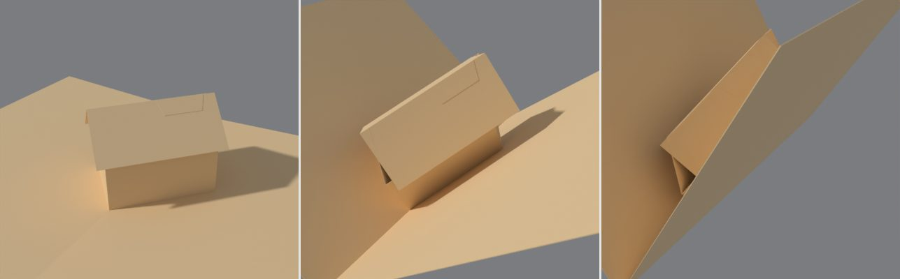

# Pop-Up Pro guide

The full reference: every setting, mechanism and export option. For a quick
start, see the [README](../README.md).

## Use

1. **Card**: A5 (A4 folded, the default), A6, 150 mm square or custom.
   **Opens**: *Picture Book* (the default) opens both pages out from the
   spine, like a book on its spine; *Right Page Flat* or *Left Page Flat*
   keeps one page on the table while the other turns over. **Opens To** is
   how far it opens: 180° (flat on the table) unless it is a card that
   stands part open (below).
2. **Build Card**. The first build adds a cube to play with, sets the scene
   up (below), puts a camera past the bottom end of the spine, looking down
   along it so the whole card shows as it unfurls, and keys a movement test:
   press **Play**, or drag the timeline.
3. **Mechanisms**: add, remove and tune them. The **+** menu has a column
   for each place things go: on the card's fold (by family), in a stage,
   and on whatever is selected. With **Live Rebuild** on (the
   clock icon) the card updates as you drag values. Tick the box beside a
   mechanism to pick it as well as the active one, then use **Align** (under
   the list) to line them up or space them evenly ([Align](#align)).
4. **Set Up Scene** (runs by itself the first time you build a card or make a
   carousel in a file; press it again any time): settings chosen to make
   folds easy to read and to stay light on modest graphics cards.
   * Material Preview lit by Blender's dawn HDRI (*sunrise.exr*).
   * A gentle **Sun** (0.6, from above left): each panel takes its own
     shade and shadows fall inside the stage, which tells a valley fold
     from a mountain fold at a glance (no more inside-out illusion).
   * **Fold Lines**: the Wireframe overlay showing only edges where panels
     meet at an angle.
   * Light ambient occlusion in the creases, kept sharp: EEVEE's screen-space
     AO ("fast GI", AO only) at half resolution, nothing ray traced (the
     paper is matt, so it never needs to be) and no blur filter. A
     one-eighth resolution, as in many files, is what makes it look smeared.
   * The Standard view transform (true colours), on the carousel and every
     stage.
   * A **Camera** past the bottom end of the spine, above the card, framing
     it from shut to fully open (Kim's framing, scaled with the card; for a
     carousel, the whole ring). It becomes the scene camera (a new file's own
     Camera would otherwise win); turn off *Make It the Scene Camera* in the
     button's options to keep yours.
   * **Render Look** (the sun menu beside Set Up Scene): how finished
     renders are lit. The viewport keeps its own light, and painting,
     baking and printing never use any of it.
     * *Clean* (default): even white light, no sun, against a soft grey.
     * *Showcase*: a soft, faintly cool sky and a render-only key sun, so
       every fold casts a crisp shadow (64 render samples).
     * *Dawn*: Blender's sunrise light (the one Material Preview uses) with
       the sun: white paper turns warm where the low sun strikes and blue
       where only the sky reaches it (64 render samples).
     * *Your Own*: your scene's own world and lights.
     * *Studio*: a photo studio's light (Blender's studio HDRI) and the
       key sun: soft, even light with real reflections for metallic and
       glossy parts (64 render samples). Lights you add yourself still
       shine too.
   * **Print Layout in Renders** (the grid button beside the Render Look,
     off by default): show the flat print layout in renders as well as the
     folded card. On a carousel the button sets every stage.
   * **Paper Texture** (off by default): a fine grain as a bump, so colours
     and prints are untouched. It is one node group, *Pop-up Paper Texture*:
     put your own paper texture inside it and every card uses it.
5. **Open**: slider and 0/45/90/135/180° buttons. Under it, **Movement Test**
   is folded down to a play button and its length in frames; unfold it for
   **Open To** (degrees; a carousel up to 360), **Opening**, **Hold Open**
   and **Closing** (seconds), and **Open** (keys just the opening) or
   **Open and Close** (the whole cycle, setting the scene's end frame). Each
   press replaces the previous test. **Paper** folds away the same way,
   showing its thickness, with Stop at Paper Thickness and Solid Paper
   inside.
6. **Checks** sits right under the card panel. Its header says *all clear*,
   or turns red with how many things to fix: paper that would tear, panels
   poking through a page, pieces sticking out of the closed card, pieces
   too big for the sheet. Click one to select the mechanism it's about.
   **Plan View** at its foot shows the card squashed
   flat and see-through, to see what overlaps what ([Plan View](#plan-view)).
7. **Artwork**: **Draw Anywhere** draws on the card with Grease Pencil, folded
   or flat, across folds, and puts it on the paper ([Artwork that stays on
   the paper](#artwork-that-stays-on-the-paper)); **Image on a Piece** places
   pictures.
8. **Export SVG Sheets** writes one SVG per sheet.

### Closing and paper thickness

* **Paper Thickness** (default 0.3 mm, typical card stock).
* **Stop at Paper Thickness** (on by default): Open 0 is where the pages meet
  the folded mechanisms, not 0°, so a closed card doesn't squash everything
  through itself. The sidebar shows the angle it stops at. Turn it off for a
  card that closes to exactly 0°.
* **Solid Paper** (on by default): gives the card real thickness (behind the printed side)
  for renders. Panels of one piece share the vertices of the fold between
  them, so the paper meets itself at every fold (a cube's dipped lid no
  longer pokes out past its walls, and halves don't open a slit along their
  crease). Modifiers you add to the card after it are kept on rebuild.

### Card sizes

A6, A5, A4 and A3 (from a folded A5, A4, A3 and A2), Half Letter and Letter
(folded US Letter and Tabloid), a 5 x 7 in greeting card, 150 mm square, the
common picture-book trims (8.5 x 8.5, 8 x 10, 10 x 8, 7.5 x 7.5 and
8.5 x 11 in), or Custom. Loose pieces go on the **Piece Paper** sheet, which
includes 12 x 12 and 12 x 24 in cutting mats. A piece too big for the piece
paper either way round gets a sheet of its own the size of the card's sheet
(turned if that fits better), and the checks say so; pick a bigger Piece
Paper to keep them together.

### Mechanisms (all lengths in mm)

The mechanism selected in the list is tinted orange on the folded card and the
layout. This is viewport only and never rendered; the pointer button under
**+** and **−** turns it off. **Duplicate** (under **−**) copies the
selected mechanism with its settings, creases, cuts and openings, 15 mm
further along its fold. New names keep counting up (Cube 1, Cube 2, Cube 3),
never reusing a number still in use.

| | What it is | Settings |
|---|---|---|
| **V-fold** | A folded piece glued along two lines that meet on a fold ([Tutorial 2](https://www.youtube.com/watch?v=Lm2RYojO-q8), [Tutorial 3](https://www.youtube.com/watch?v=MvbGJxH-1pg)) | Position, Fold Length, Glue Length, Glue Angle (fold to glue line), Piece Angle (centre fold to glue edge), tab size and side, symmetric or separate left/right. **Shape: Panels, Beak** (two triangles meeting at a point), **or a beak on one side and a panel on the other** |
| **Asymmetric V-fold** | A V-fold with different glue angles each side, whose crease leans over; it carries what stands on it off the card's centre ([Tutorial 4](https://www.youtube.com/watch?v=N-mv6ePRNAc), [Tutorial 29](https://www.youtube.com/watch?v=1OqP1pXhDUQ)) | As the V-fold, plus Glue Length R, Glue Angle R, Fold Flat and Lean |
| **Mouth** | A slit across a fold with two pairs of triangles cut into the paper; the jaws open as the card opens | Slit Position, Jaw Length (slit each side of the fold), Upper Jaw, Lower Jaw |
| **Box fold** | A separate strip glued across a fold (parallel fold; [Tutorial 1](https://www.youtube.com/watch?v=RVZEsnzJTqM)) | Position, Height (along the fold), Width Left, Width Right, tab size |
| **Box layer** | The same parallel fold cut into the paper itself ([Tutorial 5](https://www.youtube.com/watch?v=BvF15GfYwVc), [Tutorial 6](https://www.youtube.com/watch?v=9xRj1-OUX64)) | Position, Height, Width Left, Width Right |
| **Stand-up** | A picture held off the background by a bridge, or flat on a leg ([Tutorial 5](https://www.youtube.com/watch?v=BvF15GfYwVc)) | Picture (Upright or Flat), Position, Bridge or Leg Width, Bridge Height, Out From Back, Picture Width and Height, tab size |
| **Roof** | A peaked roof over a stage: the background cut to a gable, a V-fold glued along its eaves | Ridge Starts, Roof Slope, Eaves Length, Ridge Length, Level Ridge (or Piece Angle), tab size |
| **Cube (180°)** | A box standing on one corner edge on the fold; it rises as the card opens flat. **Width Right** makes the base a rectangle (lids need a square: a corner-to-corner lid can't fold flat over a rectangle). Stands on the spine, a box fold or strap, a stand-up, a floor's corner, a V-fold's glue folds or inside a V-fold (on its crease) | Position, Size, Height, Lid (Peaked, Dipped or None), base tab size and side |
| **Tube** | Hexagon, box or recessed tube on two parallel sticking strips ([Tutorial 72](https://www.youtube.com/watch?v=6FKi95a14N4)); on the spine, a box fold or strap, a stand-up, a V-fold's glue folds or inside a V-fold | Position, Strip Distance, Side Length, Height, Front and Back Width, each Pointed Out or In, base tabs, Roof (None, Pointed, or Flat with Peak/Dip and Overhang) |
| **Tether** | Wall from a tube's corner or crease to another tube or to a foot on a strip | From (tube and point), To (another tube's point, or a foot on the left or right strip), Height, Bend, Slack |
| **Pyramid** | Pyramid, hexagonal pyramid or tent on two parallel sticking strips ([Tutorial 21](https://www.youtube.com/watch?v=jZDHbUhV6Ms)) | Position, Strip Distance, Base Length, Height, Ridge, Front and Back Width, each Pointed Out or In, base tabs |
| **Flap** | A lift-the-flap worked by a pull tab, with its own **Pull** slider | Page, From Spine, Up the Page, Hinge edge, Width, Length, Hinge Tab, Lift angle, Glue Point (5 mm from the hinge by default), Strip Width, Slit Gap, Pull Tab |

### Cube (180°)

Four walls in one strip with a closing tab. The two front walls are a V-fold
on the fold (45° glue lines, square corners), glued down by the base tabs;
the back walls follow as a parallelogram. The lid is two right triangles on
the front walls, creased along the diagonal and joined by a glue tab: it
rises to a ridge (Peaked) or sinks into the box (Dipped) as the card closes.
A flat one-piece lid can't fold, so the lid is always two triangles.

A cube is a tower whose front corner closes on the fold, so it takes a
castle tower's **Tower Roof** (Pointed or Flat, with Overhang) and **Collar**
(balcony or tapered top, railings, tiers) too: the same settings as a
tower's, in place of the lid. The roof's and collar's tabs glue over the
cube's closing tab at the back corner (glue on glue is fine).

**Pop-up House** (Birmingham 49, in the **+** menu) is a cube with a
rectangular base and **Tower Roof: Gabled**, at the book's sizes: walls 65
by 45 mm and 35 high, gables 20 higher, the roof 5 mm past the walls. Two
facing walls get gable ends (**Turn Roof** for the other pair), a rib joins
their tips, and the roof, creased along its ridge, is stuck only to tabs on
the rib. Each half rests on the tops of the walls on its side: the walls
push it open as they spread and let it down as they shear flat, so they
never come through it. Nearly shut, as the house leans over, the overhang
reaches the page (from about 75° at the book's sizes): Checks says so. In
card the overhang just flexes there; a steeper roof (more **Gable Height**)
or less **Overhang** makes it later and smaller. A gabled roof takes the
place of a cube's lid.

### Tubes and tethers (parallel sticking strips)

A tube's side walls are glued to two strips parallel to the fold, the same
distance either side of it. Its front and back are pairs of walls whose
creases stay vertical above the fold, so the tube stays upright and folds
flat. A pair as wide as the strip distance gives a flat face when the card is
open flat (a box); wider pairs point out (a hexagon) or in (a recess).

**Front / Back: Round** makes a cylinder (Birmingham 68): the wall pair
curves round from the side walls to a crease above the fold (F at the front,
G at the back), straight when the card is shut and round as it opens. Picked,
it sets the width to a quarter of the circle through the strips, so each end
is a half circle when the card is open flat; wider walls bulge further. Each curved wall is
modelled as eight narrow facets with no folds drawn between them on the
pattern: score only F, G and the side walls' edges and let the card curve.
A tube round at both ends names itself Cylinder. A flat roof follows the
curve; a pointed roof needs straight walls. A tube's walls can't curve
narrower than about 1.4 times the strip distance (Checks widens them).

**Loop** (Birmingham 16, in the **+** menu): a ring of card on two tabs, a
cylinder whose side walls are short flats with a tab under each (**Side
Length** 14 mm, so the tabs are wide enough to hold).
The tabs glue down **Strip Distance** either side of the fold, mirrored, and
that distance sets its size: open flat, the ring is about twice it across.
It flattens to a lens as the card shuts, creased at its two ends (F and G).
Change the strip distance and set the front and back walls to a quarter of
the new circle (Checks widens them if they're too short); wider walls make
a taller oval. A tube's base tabs reach their full **Tab** size out from the
wall however short the wall is.

**Top Radius** (round front and back): a slice of a cone. The top is that far
from the middle where the bottom is the strip distance: smaller and the walls
lean in (a lampshade the right way up), bigger and they flare out (the panel
shows the lean). Every wall turns about the cone's point, which rides up and
down above the fold as the card opens (like a pyramid's apex), so it still
shuts flat; the round ends' facets keep their crease on the middle line. It's
cut as a curved band (two bands if it would wrap too far round to cut in one
piece). 0: straight up (a plain loop or cylinder). **Lean** is the same
setting as an angle, the walls' lean in from upright (less than 0 flares
them out): set either and the other follows, Top Radius = Strip Distance -
Height x tan(Lean). A cone takes a **Flat** roof as a lid, the shape of its
top, in two halves hinged on the side walls' tops: **Peak** stands it up as
the card shuts, **Dip** tucks it down inside (the walls must be at least as
tall as Top Radius), and **Eave** lets a peaked lid overhang. No other roof
on a cone.

**Animal Face** (Birmingham 17, in the **+** menu; or tick it on any loop
or tube) is the book's next step from the loop: the top edge carries on up
past the front crease as a muzzle, and a bite taken out of the end of the
crease, its edges stuck together, folds the muzzle back over the loop into a
nose. Stiff paper can't curve, so the bite is a dart between two flat
facets, one each side of the front crease, each creased off the wall's top
(straight across the curve of a round wall, from the crease to **Muzzle
Width** along it). **Muzzle Length** is how far it rises past the wall and
**Nose Dart** the angle cut out each side. Shut, the muzzle leans back by
just its dart; it folds further back as the loop opens, and lies flat back
when the front has opened as far as the dart allows. Past that real card
curves and this can't follow: Checks says so (narrow the dart or the
muzzle). The loop's base tabs become the book's glued **ears**: pointed, out
from the loop, **Ear Size** from the wall's foot; its join at the back is
the strap under the chin. From the **+** menu it comes a little conical
(**Lean** 15°, narrower at the nose); a muzzle goes on a straight loop, a
cone or a tube alike. Draw the face on it, and erase its art to shape it.

**Balconies**: with a tube or cube selected, the **+** menu adds a
**Balcony** on its left or right wall, or **Balconies on Both Side Walls**;
with a box fold selected, a **Balcony in Front**. A balcony is a box fold
standing against the wall: its top is the floor, **Height** up the wall,
**Depth** out from it, and its front is the leg under the floor. **Railing**
sticks a strip on the outside of the leg standing that far above the floor
(any box fold can have one); **Open Railing** cuts it into posts under a top
rail. **Front: Arches** cuts the leg into an arcade (**Arches** across), so
the balcony stands on pillars. It stays parallel to the wall and the floor to
the page, so it folds flat with them. A tube's balconies go on its side
walls. Its front and back walls swing round as the card closes, and every
corner round them (and round a tower's outside) opens out as it shuts: a
floor hinged on each wall would have to bend at the corner, so a balcony
can't wrap round them.

**Strips**: a tube's walls are one strip of paper round all six walls, or,
at 2, two strips (the left side and the front, the right side and the back),
each with a tab glued inside the other's side wall, so a big tube or castle
fits the print sheet. Checks suggests it when the strip is too long.

Every wall in this family leans together, halfway between the pages, and
every crease stays parallel, so one tube can pull others into shape:

* **Tethers** join a tube's corner or crease to another tube's, or to a small
  foot glued on a strip. A tether stays flat (no crease) when its ends keep
  the same distance apart, such as two corners on the same strip. Otherwise
  it gets a crease, sized so it still folds flat when the card shuts, for
  example a tether crossing the centre. **Bend** picks the side the crease
  goes (Auto keeps it between the strips).
* All tubes joined by tethers must share the same **Strip Distance**: a strip
  further out sits lower, so the walls would have to slide.
* Anything standing at strip level must stay between the two strips, or it
  would pass under the pages as the card closes. The checks warn if a tether
  swings outside.
* Tethers whose ends would collide, or meet head-on along the fold as the
  card shuts, can't fold flat and are refused.

Their fold angles are solved when the card is built and stored in the rig as
driver curves (sampled every degree, more finely where needed), so the rig
still needs no scripts.

### Castle towers (towers in a tube's corners)

Birmingham's parallel castle: a box-shaped tube (front and back as wide as
the strip distance) with a tower standing up each inside corner. A front or
back that points out (wider than the strip distance) has a crease a tower
can stand in too, inside: with both, a hexagonal castle with six towers;
with one, a pentagon with five. **Add →
Castle** makes one with a roofed tower in all four corners; with a tube
selected, the **+** menu adds a **Tower in Every Inside Corner** or one in a
corner you pick. Any glued box fold can stand there: set **Stands On** to the
tube and **Fold** to an *Inside Corner*.

* A tower's pieces are laid out on the sheet standing up, as they stand
  in the castle, and on a tower's face an opening's **Y** runs up the
  tower. A box fold added on a castle's corner is named for it (**Castle 1:
  front tower**).
* Seen from inside the castle, each side corner is square when the card is
  open flat and opens out to 180° as it shuts; a front or back crease closes
  to 0° instead, like the spine. A box fold lies flat either way. A tower is a box fold on that
  corner: its two outer faces are the castle walls themselves, which rise to
  the tower's top over its width; its two inner faces are a strip folded
  into an L whose tabs glue inside the walls (**Along Wall** left and right,
  **Tower Height**, **Position** up the corner). It squashes into a diamond
  and lies flat with the walls.
* **Roof: Gabled** (Birmingham 49, the pop-up house) gives a tower gable
  ends on two of its faces (one a castle wall, the other the inner face
  across from it, **Turn Roof** for the other pair), **Gable Height** above
  the tower, and a roof that overhangs the walls by **Overhang** all round.
  As the tower shears into a diamond those two faces stay parallel and the
  gables' tips keep their distance, so a rib joins the tips on vertical
  folds, and the roof, creased along its ridge, is stuck only to tabs on the
  rib's top. The walls' tops hold its halves up (whichever top holds each
  further open): square when the card is open, the halves let down flat
  against the walls when shut. Any tower can
  have one, square or not. The overhang is what stops it snagging as it
  closes.
* **Roof: Pointed** gives a square tower (the same distance along both
  walls; its corners needn't be square) a pyramid roof, **Roof Height**
  above the walls. The pyramid is two V-folds in the two corners of the tower
  that close to 0° as the card shuts (which is what V-folds fold flat at),
  hinged on the two top edges that meet there, with their creases rising
  to the apex over the tower's middle. In a side corner those are where the
  L meets the walls; on a crease, the tower's own corner and the L's inner
  one. Open flat the four faces meet in a pyramid; part-way they part along
  two hips; shut, they lie flat inside the walls.
* **Roof: Flat** is the same two V-folds with the apex only **Slope** above
  the edges: flat to the eye, but sloped enough that the creases know which
  way to fold (perfectly flat, a V-fold can go either way). Below 0 it's a
  shallow dish. **Below Top** sinks it inside the tower, a platform with
  the walls standing round it, cut into **Battlements**. At the top,
  **Overhang** sticks a second sheet over each V-fold, the same triangles
  grown out past the walls: a ledge all round the tower's top. It moves with
  the roof, so it folds flat with it (part-way, the ledge parts at the
  corners with the roof).
* The tower's tabs stop short of the roof's tabs, which glue inside the
  walls under the roof's edges, and under the battlements' notches.
* **Collar**: a balcony floor all the way round the tower,
  part-way up it (**Collar Below Top**, but above the castle's walls) or at
  its top. Each side's floor is hinged on the outside of its wall by a
  strip glued down the wall, and slopes up and out (**Collar Slope**: 0 up
  the wall, up to 80; never quite level, or it can't tell which way to
  fold) for **Collar Width**. At the two corners of the tower that close as
  the card shuts, the floors meeting there are one V-fold hung outside the
  corner, creased along the mitre: one L-shaped piece each. At the other
  two the floors stop **Corner Gap** (0.75 mm) apart on the mitre. As the
  card shuts each would pass through the other along a line turning about
  the tower's corner, so with **Slide Inside** one slides inside the other,
  its end curling (always the same way, just as far as it must at every
  opening right down to shut, easing back flat as the card shuts; no fold
  drawn there, it's a curl in the paper), or with **Notch**
  one is cut back so they never touch (a wedge-shaped gap when open). Any
  slope works, as long as it's the same both sides of the corner; the
  floors fold up flat against the walls above as the card shuts. Crease
  towers get one too.
  * **Railing**: a railing that tall stands on each floor's outer edge,
    upright like the walls as the floor turns, so it folds flat on it;
    **Battlements** cuts notches along its top.
  * **Shape: Tapered Top** turns it upside down (a box with a tapered
    top): from the top of the walls the floors lean up and in, at most
    half-way across the tower, in place of a roof; with a railing on top
    it's a smaller tower standing on the taper.
  * **Tiers** (with a railing): another collar hung on the railings' tops,
    and another on that one's, up to six: the same width and slope, each
    tier's tabs glued down the railing below. On a curling corner the
    railing runs right into the corner as one strip: it bends on the
    upright line where the curl starts, and is cut free of the curl's edge
    there so the curl can turn under it. Out, they step out like a
    pagoda's balconies; tapering in, each leans in as far again, so only so
    many fit before they meet in the middle (narrower, steeper floors fit
    more; Checks says how many). Battlements go on the top tier.
    **Alternate Out and In** turns every other tier the other way: out, in,
    out (or in, out, in), so the steps go in and out again. At the back left corner they lie over the tube's own closing
  tab: glue on glue is fine there.
* The castle wall is one strip, so it must fit on one print sheet (the
  Castle preset does on A4); for a bigger castle set the tube's **Strips**
  to 2.
* **Balconies Outside the Towers** (the **+** menu, with the castle
  selected) puts a balcony on the side wall beside each tower, as long as
  the tower and its floor level with the top of the castle walls, on
  arches, with an open railing.

### Pyramids, tents and roofs

See The Pop-Up Channel's [Tutorial 21](https://www.youtube.com/watch?v=jZDHbUhV6Ms).

A pyramid's two sloping sides are glued to the same pair of strips as a
tube, and meet above the fold at an apex. Give it a **Ridge** and it becomes
a tent: a ridge as long as the base gives upright gable ends, a shorter one a
hipped roof. Each end is a pair of triangles creased down the middle above
the fold. Its bottom edge floats free, as in the book, and the ends fold flat
as the card shuts. **Front** and **Back Width** shape the ends just as on a
tube: as wide as the strip distance gives a flat end, wider points it out
(a hexagonal pyramid) or, Pointed In, tucks it in. A flat end can crease
either way as the card starts to close; Pointed Out sends the crease
outwards, Pointed In tucks it under.

Like a tube, a pyramid can stand on more than the card spine: set **Stands
On** and **Fold** to put it on a box fold (on top, in front or inset), up a
V-fold's crease or in front of one of its halves, or outside a cube's or
tube's wall. It is sized to fit when you pick the fold.

A tube can wear the same roof: set its **Roof** to *Pointed* and choose
**Roof Height** and **Ridge**. The roof is a separate piece whose tabs glue
inside the top of the side walls. Lying flat, a roof adds its slope length to
the tube's height, and the checks warn if that runs past the page edge.

**Flat** roofs are two halves creased straight down the middle above the
fold. Tabs folded in off the tops of the side walls are glued underneath, so
the roof can **Overhang** the walls all round, like eaves.

* **Peak**: the centre crease rises as the card closes and the halves stand
  up when shut. This adds the strip distance to how far the tube reaches
  out.
* **Dip**: the centre crease sinks into the tube and the halves tuck down
  inside the walls, so nothing extra sticks out. This needs walls at least
  as tall as the strip distance, and ends that don't point in.

### Angled box folds

**Angled Glue Lines** (in a box fold's settings,
or **Box Fold (angled glue lines)** in the **+** menu) turns the strip's glue
lines that many degrees, mirrored either side of the fold, so they run
toward the fold and meet it below the strip (positive: the box widens
upward) or above it (negative: it narrows). **Out From Fold** is how far out
they are at the strip's bottom; both sides mirror each other. The crease
meets them on the fold too, so the whole strip turns about that point and
its panels tilt into planes no square box fold reaches. The strip itself is
a plain band with its ends cut along the glue lines.

* **Creases: One**: one crease down the middle, like a box fold's.
* **Creases: Three**: two creases with a free middle panel between them,
  and a third (a valley) down the middle's centre. Open, the middle spans
  the gap like a shelf; closing, once the side panels lie flat on their
  pages, it folds down its centre like a V-fold, so it all lies flat shut.
  Without the centre crease it can't close (the shelf would push through the
  pages).
* **Crease Angle**: the angle on the strip between each glue line and the
  crease beside it. 0 (the default) makes it the glue angle (half of it with
  three creases), so the strip lies flat open and shut. Bigger and it stands
  up even with the card open flat, like a V-fold; smaller would tear, so
  Checks raises it.

Slant, peaks, railings and 45° triangles aren't made on an angled box fold,
and a box layer or a tower can't be angled.

### The basic box: a second spine

The box in the [360° pop-up book](https://www.youtube.com/watch?v=HKvsssZ9W0E) video.

A tube with a *Flat* roof set to *Dip* is the basic box. The roof's
centre crease stays the wall height above the spine, straight up the middle,
and its halves stay parallel to the pages. So the roof works as a second card
spine:

* **Centre Rib** (mm along the fold, 0 for none) adds the central piece that
  holds the roof up. It is a doubled strip standing on the spine; each layer
  is glued to one page at the bottom and under the other roof half at the
  top.
* Choose the box's roof as the **Host** of a V-fold, box fold, box layer,
  mouth or cube, and it stands on the roof crease and opens with the roof,
  just as it would on the card. Box layers and mouths are cut into the roof
  itself.
* A peaked roof turns the wrong way to be a spine, so it isn't offered as a
  host.

### Carousels (stage sets)

As in the [360° pop-up book](https://www.youtube.com/watch?v=HKvsssZ9W0E) video.

On an empty scene, **Make Carousel** turns the scene into a carousel of
**Stages** (2 to 9, 5 by default). Each stage is a scene of its own and a
normal Pop-Up Pro card, with its own mechanisms, art, sketches and export.
Its pages are the background, and it opens to 360 / Stages degrees: 72 for
five. The carousel scene shows every stage's folded card turned round one
spine, and one **Carousel Open** control (0 to 360 degrees) opens them all.
**Edit** goes to a stage; in a stage, **Carousel**, **Previous** and **Next**
move around.

* **Frames** span the stage from page to page, glued down each side at
  **Depth** from the spine, with a centre crease that folds back as the
  stage closes. Their width is worked out from the stage count, so every
  frame pulls flat exactly when the stage is fully open. A new stage starts
  with a staging frame at the front and one floating frame behind it; add
  up to three floating frames from the Add menu. Frames go on an ordinary
  card too (Add > Frame, with no stage set selected): a layer across the
  card's fold, glued to both pages, that pulls flat when the card is open
  flat; each new one goes a little further in.
* **Floors** and **ceilings** are V-folds along the bottom and top edges of
  the pages. They lie flat when the stage is open and fold into the stage
  as it closes. Frames are cut back automatically to clear them. Floors and
  ceilings need three stages or more: at 180 degrees they would have to lie
  in the page planes the moment the stage starts to close. **Point** runs a
  floor's or ceiling's centre on past the front of the stage, as a pointed
  apron: shut, the centre crease lies on the page at half the stage angle,
  so it can go a long way (about 170 mm on an A5 three-stage carousel, 60 mm
  on five) before it would stick out. It is shortened, with a warning, if it
  would. Floors print with their art side up into the stage.
* **Corners**: where a floor or ceiling meets a wall is a fold too. Pick
  the floor or ceiling as the **Host** of a glued box fold, V-fold or cube
  and choose the **Wall** (left or right). Or select the floor and use the
  Add menu's corner entries. Box folds label their widths *Up Wall* and
  *Along Floor*. Their tabs may lie over the floor's own tab along the wall,
  glue on glue.
* **On a floor's or ceiling's crease**: from inside the stage that crease is
  a mountain fold. It opens from fully folded to flat as the stage opens, so
  boxes and cubes can't stand there, but V-folds can. A V-fold there folds
  flat over the crease as the stage shuts and rises as the floor flattens.
  Select the floor and use **Add → V-fold on its crease**, or tick **On the
  Crease** on a V-fold whose host is the floor. On a ceiling it hangs down
  into the stage.
* **A V-fold roof with the walls above cut off**: on a V-fold on the
  card's spine whose glue lines fall away from it (Glue Angle over 90),
  tick **Cut Away Background Above**. The background above its glue lines
  is cut off, so the V-fold stands over the stage as a roof or ceiling with
  nothing behind it. Your V-fold keeps all its own numbers; the Roof below
  does the same with the piece angle worked out for a level ridge.
* **Roof** (in the Add menu's stage section): cuts the background to a gable
  along two eaves lines falling from the spine, and glues a V-fold along them
  whose crease rises to a ridge. Its numbers are the V-fold's:
  * **Ridge Starts** (up the spine) and **Glue Angle** (the roof's slope,
    100° by default, just past level).
  * **Glue Length** (the eaves). They stop at the card's edge; the panel
    says where when you ask for more.
  * **Fold Length** (the ridge): how far the ridge reaches into the stage.
    Shut, the roof lies flat in the cut-away corners, so the ridge can only
    be as long as still fits the closed card. The panel shows that length
    and warns (it doesn't trim) when you go past it. To reach further,
    start the roof lower or make the slope steeper: from 145 mm up a
    three-stage A5 card at 100° it fits 84 mm, from 100 mm up 142 mm, and
    at 120° from 145 mm, 115 mm.
  * **Level Ridge** works the **Piece Angle** out so the ridge runs level
    into the stage at full opening; turn it off to set the angle yourself.

  Full-width eaves make a roof about 300 mm across, so shorten them or
  print it on A3. A roof can't open out flat (it would tear past about
  135°), so it belongs in carousel stages. Things can hang from its ridge:
  its crease is a host like any V-fold's.
* **Valley Floor** (next to the Roof, or **Upside Down** on a roof): the roof
  turned upside down. The background is cut away below two lines rising
  from the spine, and a V-fold floor glued along them dips to a valley that
  runs level into the stage.

* **The background as a roof, ceiling or floor**: in **Creases, Cuts and Holes**,
  **The background folds in** sets it with a few numbers:
  * **Ceiling → Peaked Roof**: the top of the background is cut apart at the
    spine and joined again by a **Join Tab**, a wedge along each side of the
    cut, glued back to back as a fin above the ridge. It folds in over the
    stage as a peaked roof. **Drop at Spine** is how far below the top edge
    the roof starts; **Crease Slope** sets the pitch of the eaves (-10°,
    just below level, to start); the join tab is worked out so the ridge
    runs level into the stage at full opening, and **Ridge Lift** raises its
    front from there (tipping it down past level would tear the paper).
  * **Ceiling → Hanging**: two creases rising from the spine to the top
    edge. The top of the background folds in and hangs down in a V. Cut
    from one piece of card, a fold into the stage can only hang like this
    (or flip out behind the stage), which is why the peaked roof needs the
    cut and the tab.
  * **Floor** is the ceiling upside down, with the same choices: a **V
    Floor** (rising to a V at the centre) or a **Valley Floor** (the peaked
    roof upside down), with **Rise at Spine**, **Crease Slope** and
    **Valley Dip**.
  * **Your own creases and cuts** (folded away underneath) is the free
    version: lines by their ends or **By Angle** (start, angle from straight
    up the spine, length), drawn or typed. Lines that ask for a shape the
    paper can't fold to (a cut that doesn't run along the spine, say) are
    left flat with a warning rather than solved.

  Mechanisms glued where the background folds away are flagged (their tabs
  hang off the page).

* **Joins**: *Glued* (default) makes each stage its own folded card. The
  back of each stage's right page is glued to the back of the next stage's
  left page. *Shared Page* prints each pair of neighbouring pages on one
  leaf, double-sided.
* Each stage stands a paper thickness clear of its neighbours, so glued
  pages sit back to back with Solid Paper on instead of passing through
  each other.
* Frames print the way up they stand, on A4 portrait by default in a stage
  (on a larger sheet of their own, with a note in the checks, when they're
  too big for it).
* Grease Pencil sketches show in each stage's own scene but not in the
  carousel view (a stage's sketches are tied to its rig, which a collection
  instance can't carry); painted art shows in both.
* **Export** (in the carousel panel) writes every stage's sheets, named by
  stage, plus a carousel page with the joins and building order. With shared
  pages, the leaf sheets replace each stage's card sheet.

### A card that stands part open (Opens To)

Set the card's **Opens To** under 180° (90° or 120°, say) for a card that
stands part open, like a corner or a little theatre. Everything is then
worked out to be fully open at that angle: the **Open** slider and the
movement test stop there, and the card itself is the stage, as each stage
of a carousel is. The **+** menu offers **Frame**, **Floor** and
**Ceiling** straight *In the card*: a frame is Depth × sin(half the angle)
each side, so it pulls flat exactly as the card reaches Opens To, and the
floor and ceiling lie flat then too and fold up into the card as it shuts
(they need Opens To under 150°). Every other mechanism goes in as usual; a
box fold on the card's fold is square when the card is at 90°. Back at
180°, floors and ceilings are skipped with a warning (flat, they would
have to lie in the pages), and frames across the fold pull flat at 180°.

### Stage set in a card (a carousel stage as a V-fold)

**Stage Set** (Add menu) stands one stage in an ordinary card. Its
background is a V-fold whose halves are square to its back crease, glued
along their bottom edges at the **Glue Angle** either side of the fold. It
opens to twice the glue angle (120 degrees for 60) when the card is flat, and
its printed side faces into the stage. A new stage set comes with a staging
frame and one frame. With the stage set selected, the Add menu offers more
frames (up to three behind the staging frame) and a ceiling; the card itself
is its floor. Frames and the ceiling are sized to pull flat exactly when the
card is flat. The stage faces the top edge of the card; shut, its back
crease lies down the card from where it stands, and the checks say how far
up to move it if that would run off the bottom. Openings on its frames can
go *Through* to its background.

### Off-centre pop-ups: the Strap and V-fold glue folds

Most pop-ups straddle the card's spine. To stand one in the middle of a
page, give it a fold of its own that opens just like the spine:

* **Strap** ([Tutorial 9](https://www.youtube.com/watch?v=AMbeFT8L7oI)): a box fold
  with **Strap (lies flat)** ticked, so its two sides stay equal (one
  **Width Each Side**). Untick it for an ordinary box fold again. Open flat,
  it lies on the pages; its two glue folds are **gullies** off the centre,
  each opening exactly as the spine does. With the strap selected, the Add
  menu offers cubes, tubes, V-folds, boxes and stand-ups **on top** (the left
  gully) or **in front** (the right gully); move the gullies by changing
  the strap's Width Left and Width Right. **Peaks** creases the strip so it
  zig-zags into several peaks as the card closes, still one strip glued
  only at its ends: the plain strap's chevron, repeated smaller along the
  line between the gullies, so it still lies flat when open. Each **valley**
  between two peaks opens like a small spine: the Add menu offers cubes,
  tubes, V-folds and stand-ups there (**Fold**: *Valley*, **Gully** picks
  which, counted from the left). Evenly spaced and exact, so they don't
  break the way hand-drawn creases can. Flat open, a glued strip is shown
  resting on top of its glue tabs (allowing for both papers' thickness
  with Solid Paper), so nothing flickers where they meet. **Slant** runs the strap across the card at
  an angle: its creases stay parallel to the spine (they must), but one end
  sits further up the card than the other, so the gullies, and what stands
  in them, are offset diagonally. Box folds and box layers take a Slant too.
* **A V-fold's glue folds**: with a V-fold selected, the Add menu offers
  cubes, tubes, V-folds, glued boxes and stand-ups **in front of** its left
  or right half (the valley between the half and the page), and cubes and
  tubes **in the V** on its crease. A mechanism's **Fold** setting moves it
  between these afterwards, resized to fit.
* **Outside a cube's or tube's walls**: where a cube's front walls, or a
  tube's side walls, meet the page is a valley fold too. With a cube or tube
  selected, the Add menu offers cubes, tubes, V-folds, glued boxes and
  stand-ups outside its left or right wall; **Fold** moves them between
  the two.

### Asymmetric V-folds: carrying pop-ups off the centre

See [Tutorial 4](https://www.youtube.com/watch?v=N-mv6ePRNAc) and [Tutorial 29](https://www.youtube.com/watch?v=1OqP1pXhDUQ), and for raising pop-ups off-centre in general, [Tutorial 9](https://www.youtube.com/watch?v=AMbeFT8L7oI) and
[Tutorial 30](https://www.youtube.com/watch?v=eCq12WLoRx4).

**Add → V-fold (asymmetric)** gives a V-fold with a different glue angle on each
side. Its centre crease leans towards the side with the bigger glue angle,
and planes rise at unexpected angles. With **Fold Flat** on (the default), the
piece angles are worked out so the piece always folds flat in the closed
card: left piece angle = right glue angle + **Lean**, and right piece angle =
left glue angle + Lean. The panel shows the angles it uses. More Lean makes
steeper planes. Glue angles over 90° point the V-fold backwards (the same rule,
measured from the other end of the spine). Turn Fold Flat off to set the
piece angles yourself; the checks say if the paper would tear.

The V-fold's own crease is a spine in its own right, so what stands on it is
carried away from the card's centre. With a V-fold selected, **Add** offers a
glued box, a box layer cut into the piece, another V-fold, a mouth or a
stand-up **on the crease**. **Fold** → *On the Crease* and **Position**
place them. Its halves open like a little card as the card opens, and
everything on them follows. Boxes, box layers, mouths and stand-ups sit in the
angle between the halves. A V-fold sits on the other side of the crease, the
printed face, so V-folds stack outwards into a tower. Stand-ups and glued boxes can also stand in front
of or behind either half (above).

### V-folds glued away from the spine

Birmingham 18–20. The two pieces still meet at the spine, but their glue tabs
start some way out along the glue lines: set **Glued From** (mm along the glue
line from where it meets the spine). The piece is cut away between the tab
starts, so nothing near the spine is glued: the spine end is free to move and
the piece can sit over things glued close to the fold.

* **Arch Height**: how far up the centre crease the cut reaches (0 lets it
  follow the larger Glued From).
* **Cut Shape**: Straight, Round, Square (up from the tab starts, then across)
  or Pointed (a gothic arch).
* Fans and M-folds take **Glued From** too: a fan's hub is cut away, an
  M-fold's outer tabs start further out.
* **Uneven Sides**: each side its own **Glue Length** and **Glued From**
  while the angles stay symmetric. With Symmetric off, the two sides are
  separate anyway.

### A V-fold on top of a V-fold

Birmingham 21–22. With a V-fold selected, **Add → V-fold on Top (tabs A)**
sticks a second creased piece on top of it (**On Top** on a V-fold standing on
another's crease does the same). The lifting V-fold's top is cut to a point
along the glue lines, and its own tabs (the book's tabs A) fold over and
stick under the top piece, its crease right up against the lifting piece's.

* **Point Angle** (the book's B): between the lifting piece's crease and each
  side of its pointed top. It changes how far the card opens the top piece.
* **Top Piece Angle** (the book's C): on the top piece, between its crease
  (pointing down past the point) and where tab A sticks. Keep it larger than
  the point angle; near it the top piece stands up, larger it lies flatter,
  hanging level over the lifting piece at about 70–80°.
* **Below the Join**: the top piece carries on down its crease past where it
  meets the lifting piece (the book's D: a nose, a tail, a body).
* **Point Angle** over 90 makes a V-shaped top instead (mechanism 22): the
  lifting piece's sides rise above its crease, tabs A at their tops.
* A top piece can lift a third the same way (select it, **Add → V-fold on
  Top**).
* Depending on the two angles the top piece stands up, lies level or leans
  back: angles where it can't fold say so.
* It always sits at the very top of the lifting piece's crease. Keep it small
  enough to fold away inside the lifting piece (the checks say if it pokes
  through the card).

### The M-fold

Birmingham 28–29. **Shape → M-fold** on a V-fold: each half bends at a
point on its bottom edge, and past the bend a crease rises off the edge (D),
a small panel E sits between it and crease H, and the outer panel past H is
the only part glued down, along a glue line that bends at the same point
(C). The halves, the E panels and the outer panels ride between each other,
so each opening is solved and tabulated. The centre crease takes other
mechanisms like any V-fold's.

* **Glue Angle (B)** and **Piece Angle (A)**: as a V-fold's, with the piece
  angle the larger. **Glue Length to the Bend**: from the spine to the bend.
* **Angle D**: on the piece, at the bend, between the edge back towards the
  centre and the crease rising off it. The glue line on the page bends by
  the same angle (C = D).
* **Angle E**: the little panel between that crease and crease H. The outer
  panel's corner F matches it (E = F). Panel E is what makes an M-fold an
  M-fold and not a zig-zag (page 29): without it the outer panel can't
  move.
* **Free Angles** lets you set C and F yourself. The book's rule: change
  them together (if D = C + x then E = F + x).
* **Crease Length (D and H)** and **Outer Glue Length**: the creases' and
  the outer panel's glued edge's lengths. **Glued From**: the outer panel's
  tab starts that far along its edge.
* A new M-fold starts at Piece Angle 80, Glue Angle 60, D 120 and E 60,
  standing up. Some angle sets hold the card from opening all the way;
  Checks says how far it gets.

### Zig-zag folds

Birmingham 45–48. A V-fold's **Shape → Zig-zag**: instead of a V, each glue
line carries a wall standing straight up off the page, and faces zig-zag in
from the walls to a centre crease. Every crease is square to the bottom edge.

* **Glue Angle** (as a V-fold's, measured from the spine going up; a zig-zag
  starts at 120, glue lines running down and out as the book draws them),
  **Glued From** (how far out along the glue line the wall starts) and
  **Glue Length** (the glued wall's width).
* **Faces Each Side**: 1 juts out like a V (mechanism 45); 2 or more make a
  concertina (48). **Face Width**, or **Uneven Faces** to give each its own
  width (mm, from the glued wall in).
* **Centre**: Juts Forward or Sits Back.
* **Bottoms**: walls on angled glue lines tip their bottom edges down towards
  the pages part way open. **Cut Lightly** (the default) trims them only
  where they'd dig in more than a few mm; **Cut to Clear** wherever they'd
  touch; **Leave Square** doesn't cut.
* Its centre crease takes other mechanisms, like a V-fold's.
* What sets the M-fold apart (page 29) is its angle E, between crease H and
  the glued edge; in a zig-zag every crease is square.

### Multiple quadrilaterals

Birmingham 57. **Add → Multiple Quadrilaterals**: a back zig-zag glued by its
end walls to angled strips, a front strip across the spine, and a side piece
each side making a quadrilateral from the strip's far end round to the
back's crease, in line with the back's centre face.

* **Back, Outer Face** and **Back, Centre Face**: the back's two faces each
  side, from the strip to its crease and from there to the centre.
* **Side**: the side piece from the back's crease to its front corner; the
  side's other face (to the strip's far end) is worked out so the
  quadrilateral folds flat (the book's AB + BC = AD + DC).
* **Front**: each half of the front strip, side piece to centre.
* Heights for back, sides and front; the side and front pieces glue on with
  tabs at their ends.
* **Glue Angle**, **Glued From** and **Glue Length** set the glue lines and
  end walls as on a zig-zag; **Bottoms** as there too.
* The back's centre crease takes other mechanisms.

### Extra creases and cuts

See [Tutorial 7](https://www.youtube.com/watch?v=IkJAnmS-2ZE) and [Tutorial 22](https://www.youtube.com/watch?v=Ze9shENIBf4).

A V-fold's piece can carry extra fold lines and cuts, set under **Creases
and cuts** in the **Creases, Cuts and Holes** panel with the V-fold
selected. Lines are measured on the piece itself:
**X** across from the centre fold (the left half is negative), **Y** up the
centre fold from the V point, in mm. Mark the left half and keep **Mirror**
on to copy each line onto the right half; turn it off for one-sided cuts.

**+** offers a line to set by numbers, or a book shape scaled to the piece:

* *Reverse Point* (5, angles A): two creases and a cut; a point folds forward
  out of the V.
* *Step* (5, lengths B): creases parallel to the centre fold and a cut; the
  top steps back.
* *Folded Top* (5, angles C): creases from the centre fold up to the top edge;
  the top folds over.
* *Jaw* (9 and 10): creases from a point on the centre fold out to the sides.
  The centre fold turns from mountain to valley there and the top planes
  swing as the card opens. Two V-folds facing each other make the chomping
  mouth.
* *Projection* (6): a cut that starts and ends on the centre fold, on one
  half only. The fold isn't scored between the ends, so the shape stays
  flat with the other half and juts out past the fold.

To draw your own, use **Draw Creases** or **Draw Cuts** on the flat layout.
Creases are straightened end to end, and cuts keep their shape (arrows,
horses, trees). Then press **Add Drawn Lines**. Line ends within 1.5 mm of
the centre fold, an edge or another line snap onto it.

**Fan** (a V-fold Shape): a pleated fan glued along its two end edges on the
glue lines, like a hand fan opened between the pages. Its paper reaches
**Spread** degrees round (180 is a semicircle), more than the gap between
its glued edges ever is, so the pleats are what make it fit: every pleat is
a small V-fold, its valleys spread evenly across the plane of the two glue
lines and its ridge standing out just far enough. Shut, every sector lies
flat against the next; open, it fans out evenly and never quite flat.
**Stand** sets how far its middle rises out of the plane of its two glued
edges when the card is open, like a V-fold's crease (0 lies along that
plane, 90 stands straight up); as the card shuts the pleats collapse first
and the middle then lies down with them. **Pleats** sets how many ridges,
**Radius** its size and **Glue Angle** where its edges are glued. A hole
cut where the pleats crowd together at the V point (an arch, say) makes it
easier to fold in real paper. If Spread is
less than the gap at full opening, the checks say it would tear.

The **+** menu's *Fan Pleats* and *Concertina Pleats* add creases to an
ordinary V-fold instead, with **Concertina** to fold them (below).

**Concertinas and fans.** Several creases side by side (a concertina, or
creases fanning out from the V point) leave the paper free to fold more
than one way: nothing in a V-fold forces them to fold at all. They settle
the way paper does, sharing any folding out evenly with both sides alike,
and lie flat when the card is shut or open flat. Set **Concertina** (under
the list, once there are lines) to pre-fold them: they pleat, alternating
mountain and valley, most where the piece stands half open, and open out
again with the card. Too much pleat for the piece can poke through the
card; the checks say where.

How the regions move (the same on every piece):

* A region cut off by creases turns about its crease. Its part of the fold it
  shares with its neighbour must still meet that neighbour, so the two turn
  together. This is solved for every open angle and driven in the rig like
  the other folds.
* A region joined only across a fold rides flat with the piece on the other
  side (a projection, a battlement). If it touches more than one fold, it
  stays with the card, and the other folds are cut.
* A shape cut right out (a closed cut) is a hole.
* Creases that cross, or parts hanging from other folded parts, are solved
  together. Every crease and fold edge they share has to stay closed.
* Line ends within 1.5 mm of a corner (the V point, where a fold meets an
  edge) snap onto it.
* The print shows the new creases (mountain or valley) and cuts. The usual
  checks apply: a jaw too big for the card is flagged as poking through.
  The checks also flag a crease with nothing to fold against (usually a
  mirror left off) and a line that doesn't reach an edge, cut or other line.

### Creases and cuts on boxes

See [Tutorial 5](https://www.youtube.com/watch?v=BvF15GfYwVc), [Tutorial 6](https://www.youtube.com/watch?v=9xRj1-OUX64) and [Tutorial 7](https://www.youtube.com/watch?v=IkJAnmS-2ZE).

Box folds and box layers take creases and cuts the same way. Here
**X** is measured from the box's front-top fold (negative over the top,
positive down the front) and **Y** along the box from its end. **Mirror** flips
a line end to end. Score lines never cross cut lines, and cut lines begin and
end at score lines: a cut that leaves a fold and comes back to it makes a shape that stands with the panel across the fold.

* *Battlements*: notches along the front-top fold. The merlons stand up above
  the top with the front.
* *Pointed Tower*: a tall pointed shape cut into the top from that fold; it
  stands up like a spire. Put it on a box layer stacked on top for the castle
  keep.
* *Inset Step*: two creases and two cuts across the front-top fold. That part
  folds in.

Doors and windows live in **Creases, Cuts and Holes** (an opening on the box's
front, cut out or as a door flap); older cards keep their Doorway lines.

Each preset is one shape however many lines it has, and shows in the list
as one row: open it (the triangle) to see and edit its lines one by one.
With the shape (or any of its lines) selected, **Flip Across Fold** mirrors the whole shape to the other side of
the fold it starts from (a spire cut down into the front instead of up into
the top, so it juts forward), **Turn** rotates it about its centre, and
**Move X / Y** shifts it. The lines keep their own numbers underneath. The
same settings work on V-fold presets and on single lines.

Curved or irregular outlines work too: draw the cut with **Draw Cuts** from
one fold to another. On a box layer, **Draw Creases** and **Draw Cuts** work
on the card itself, over the box.

### Parallelogram stand-ups

See [Tutorial 5](https://www.youtube.com/watch?v=BvF15GfYwVc).

A picture held off the background by a small bridge. Seen from the side it is
a box fold (background, bridge, picture, floor), but the picture is its own
piece, as wide and tall as you like, and the bridge is a separate strip glued
to its back. **Picture** sets which way it faces:

* *Upright*: the picture stands parallel to the background on a foot tab glued
  to the floor. **Bridge Height** is where the bridge meets the background and
  the back of the picture (the book's A). **Out From Back** is the bridge's
  length (B).
* *Upright, Rolled Tail*: picture and bridge in one piece, easier to fit when
  it's small or in a tight space. The picture's paper runs on below it: back
  along the floor to the corner (glued down), up the background to **Bridge
  Height** (glued), out again as the bridge (**Out From Back**) and down onto
  the picture's back as a tab. It rolls up into a small box behind the
  picture's foot. **Tail Width** is how wide the tail is.
* *Flat*: the picture lies parallel to the floor (the flying carpet), glued to
  the background along its back edge and held up by a leg. **Height Above
  Floor** is E and **Leg Out From Back** is F.

**Picture Width** and **Picture Height** (or **Depth**) size the picture; it
runs up the fold from where its bridge or leg starts. Shape its outline by erasing the art in Texture Paint
(Creases, Cuts and Holes), the way the family and the dog are cut out in the book
(Texture Paint is hidden for now, since v0.60).
Stand-ups stack: with one selected, **Add** offers *Stand-up in Front*, which
uses the picture as the background (the dog), and *Stand-up on Top*, which
sits on a flat picture against the background (the figure on the carpet).
Boxes and V-folds can sit on a stand-up's folds too.

Stand-ups can also stand **on a V-fold**. With a V-fold selected, **Add** offers
*Stand-up in front* or *behind*, on the left or right half. That half is the
picture's background and the page is its floor, so the picture stays
parallel to the half as the card opens. *In front* stands on the page outside
the V, and *behind* stands inside the V. **Out Along Glue Line** sets where it
sits along the half's glue line, measured from the V point. Glued boxes can
stand there too.

### 45° folds: Platform, Rising Sheet, Double 45°, Jack in the Box, triangles

A **45° fold** (Birmingham, *Pop-Up!*, pp. 66–69) is a small V-fold whose
glue lines are square to the fold it sits on and whose two piece angles are
45°. As the corner it sits in opens, it unfolds, and at 90° it stands as a
solid triangle, a gusset: the corner can't open any further. Put in a
corner that should end up square, it props it square when the card is flat.
Both mechanisms below put them in for you (each 45° fold is its own small
piece, listed under the mechanism's name).

* **Platform (45°)** (mechanism 80): a strip glued down along two strips
  parallel to the fold, **Out Left** and **Out Right** from it, rising on
  two legs (**Leg Height**) to a top that folds in a valley as the card
  shuts. The legs stay square to the line halfway between the pages and
  each half of the top stays parallel to its own page, so the valley rides
  at the leg height right above the fold whatever the two Out distances:
  with them unequal the platform stands off the centre (the book: "doesn't
  have to be centrally placed"). **45° Folds** puts one in each leg's outer
  corner (*One per Leg*, at the front end), at *Both Ends*, or *None*;
  **45° Fold Size** is the length of their glue edges. Other mechanisms
  stand on the platform's top: pick it in **Stands On** (positions along it
  are up the card, as on a box fold).
* **Rising Sheet (45°)** (mechanism 81): a single sheet standing on the
  fold, half way between the pages, held up by a 45° fold on each face
  (front left, back right). Its foot is glued down by two tabs, the front
  half onto the left page and the back half onto the right. **Sheet
  Height** and **Width Along Fold** size it; shape it into a tree or
  flowers by erasing its art. **Slotted Cross Piece** is the book's second
  version: the two 45° folds become one piece standing square across the
  sheet, the two interlocked by 2 mm slots (the taller piece slotted from
  its foot, the shorter from its top), so it can rise past the folds
  (**Cross Piece Height** and **Width**). **Slots Meet At** sets how far
  up the fold the two slots meet, **Cross Pieces** puts up to four on one
  sheet, each with its own feet, **Cross Piece Position** moves them along
  the sheet from its middle and **Spacing** sets how far apart they stand
  (at least the 45° fold size, or their feet overlap). Its two feet fold
  down onto the pages and are glued there: stick those first, then the
  sheet's tabs (which skip the slots that run up from the sheet's foot).

  
* **Box with Ends** (mechanism 82): a box glued to one page only (**Page**),
  one wall rising from the fold itself. Both its feet are on the same page,
  so a 45° fold from the other page pulls it up: the box lies flat on its
  page until the card is half open, then rises, and stands square when the
  card is flat. **Closed Ends** fills each end with two more 45° folds, in
  the two corners that close as the box flattens, cut along the end's
  diagonal; one face of each is part of the box, the other has a tab (onto
  the page, and inside the far wall). **Length Along Fold**, **Width** and
  **Wall Height** size it. **Tuck Flaps** adds the book's two small flaps
  (C and D) on each end's diagonal, that tuck behind the triangles across
  it so no gap shows when it's open; they're bent a little inward so they
  stay behind as it moves (while an end is still closing they lie in front
  instead, never through it). **Far Tab** glues the far wall's long foot
  tab outside the box, or folded back under it.

  

The rest use the other kind of 45° fold: one whose glue angle and piece
angle are both 45°. It lies flat while its host is flat and its crease
rises off the host's fold as the host closes, so it moves the most when
the card is nearly shut.

* **Double 45° Fold** (mechanism 77): an arms piece glued down by the two
  triangles either side of its centre (the hole there keeps the shut card
  thin), with a 45° fold above the centre and one below: as the card closes
  both arms rise, one leaning up the card and one down it. A **top piece**
  joins their tips, glued on diagonally (the upper arm's right half, the
  lower arm's left), and twists round as they rise. **Arm Width**, **Arm
  Length** (centre to tip) and **Top Piece Length** (F to H) size it; the
  top piece must be longer than both arms together, or it can't arch over
  them. Open flat, the top piece is an exact tent over the arms, and its
  fold at G stays a ridge all the way shut. Stiff paper
  can't do the twist, so on screen each half of the top piece bends and
  twists from its tip to its centre fold G; it prints as the one piece with
  the fold at G.
* **Jack in the Box** (mechanism 79): a figure on two pairs of 45° folds cut
  into the top of a V-fold's crease, the V-fold its body. With a V-fold
  selected, Add puts the figure on top of it, as big as its halves allow;
  otherwise it puts in a V-fold for it too. (Or pick the V-fold in **Stands
  On**.) If its chest's folds would run off the V-fold, Checks says so. As the card closes the chest leans back into the V,
  the arms (out past the chest's sides) swing round in front of it and the
  head rises off the chest. **Fold Spacing** (Birmingham's G) is the
  distance between all its parallel lines: from the crease to each side,
  between the two folds' points, and from the arms' bottom edge to their
  top; **Arm Reach** is how far the arms run past the sides; **Position**
  is how far up the crease the arms start. Draw the figure, and erase its
  art to shape it. The book's version on a strap (78) isn't here yet: its
  arms reach past the strips it's glued by, which stiff paper can't do.
* **45° Triangles** on a box fold or box layer (mechanism 74): a pair of
  small triangles cut into the corner where the box's top meets its front,
  at its **Top**, **Bottom** or **Both** ends; they swing up out of the box
  as the card closes. **Triangle Size** is how far down the crease (and out
  along the edge) they reach. Stick moving pictures on them: fish leaping,
  arms and legs thrown out.

### Pictures (glued on any face)

**Add > Picture** glues a piece of card flat onto one face of anything: with
a mechanism selected, onto it; otherwise onto a page. **Glued On** and
**Face** pick the face (a box's top or front, a V-fold half, a cube's wall,
a 45° triangle, a page; build once first so the faces are listed), **Side**
the front or back of it. **X** and **Y** place its bottom left corner (X
across the face from its centre, Y up from its bottom edge, either may be
negative); **Width** and **Height** grow it from that corner; **Turn** turns
it about the corner. It can reach past the face's
edges: on a box fold's front it stands up with it, a stand-up with no
bridge of its own. On the double 45°'s top piece it bends and twists with
the paper. It prints as its own piece; draw on it, or erase its art to shape
it.

On a box with **45° Triangles**, **Pictures on them: Left / Right / Both**
glues one on each triangle of each pair, laid out by **Pictures**: *Along the
Crease* (the default: each picture's bottom edge on the box's crease from
the box's edge in, reaching out across the box's face, so it swings up out of
the box with its triangle) or *Out Past the Edge* (standing on its triangle,
reaching out past the box's top or bottom edge, the leaping fish). Either
works at both ends of the box, mirrored. Near flat, pictures out past the
edge rest on the page, which Checks may note.

### Holes and shaping (every mechanism)

The **Creases, Cuts and Holes** panel gathers everything that cuts or creases
the paper, in three fold-away sections: **Openings** (windows, doorways, door
flaps), **Creases and cuts** on the selected mechanism or on the **Card**
(the switch at the top of the section; the card's own include the
background folding in), and **Draw by hand** (creases, cuts and holes drawn
on the flat layout, then added or cut). Holes painted with Erase are cut
from the Artwork panel, under Erase the Paper. Openings work the same on every piece: the card, any
mechanism, roofs, ribs, frames, floors. Holes are cut into the paper itself,
so they show in 3D and print as cut lines:

* **Openings**: rectangles, arches and ovals, with **X (Across Page)**, **Y (Up Page)**,
  **Width** and **Height** sliders, cut in any piece (**Cut In** lists them
  all). X is measured from the piece's centre fold, Y up from its bottom.
  **Face** puts it on one face of the piece instead (a box's top or front,
  a cube's or tube's wall, a V-fold half): X across that face from its
  centre, Y up from its bottom edge, and the hole is kept inside the face so
  it never cuts through a fold; **Cut Across Folds** lets it carry on over
  the face's folds onto the faces beside it (a gate through a tower's
  corner, an arch across a crease). On a box, up is towards the fold the
  panel hangs from: a door in the front stands on the floor (on a tower's
  wall, up the tower). Add Opening with a
  box fold or box layer selected starts with an arched doorway there.
  **Turn** rotates the opening about its centre (a diamond window, a
  sideways arch).
  **Cut**: *Hole* cuts it right out; *Door Flap* cuts every side but one,
  which is creased as the **Hinge** (Left, Right, Bottom, or Top for a
  rectangle), and the door swings out of the printed side as the card opens,
  to **Opens To** degrees when it is fully open and flat when it shuts. Door
  flaps work on the card, V-folds, box folds and box layers (elsewhere they
  are cut as holes, with a warning). A side-hinged door needs to stand a
  few mm off a fold below it, or it scrapes the paper there (the checks say
  so); hinged on the floor fold of a box front, it lies flat on the floor.
  **Through** carries an
  opening:
  * *Everything Behind*: every frame behind it and the background, lined up
    as seen from the front when the stage is fully open (on the background,
    it is stretched to match the angled pages).
  * *Next Stage*: on a background page, the neighbouring stage's page that
    is glued back to back with it, so a doorway leads from one stage into
    the next.
* **Painted**: Artwork panel, **Erase the Paper** (*Erase Paper* starts
  Texture Paint with the brush rubbing the paper see-through instead of
  painting colour; **Erase** turns it back to painting). Erase inside a
  piece for a hole, or up to its edge to change its outline (round a
  V-fold's corner, cut a jagged skyline). The see-through areas show on the
  model straight away; **Cut Painted Holes** traces them into smooth cut
  lines, so what you see is what prints, and ✕ drops them. With **Cut
  Automatically** on (off by default) that happens by itself each time you
  stop painting and before every export. This is also the way to perforate
  a staging frame.
* **Drawn holes**: **Draw Holes** turns the view to look straight down on the
  flat layout and starts a red Grease Pencil layer over it. Draw closed
  outlines on any piece, across a fold if you like. They are cut at the next
  rebuild (**Cut**). **Keep** fixes them onto their pieces and clears the
  strokes, so they stay put if the layout is rearranged; **Edit** puts them
  back as strokes. Holes sketched on panels in v0.10 are folded in by Keep.
  **Done Drawing** (in the panel and the 3D view's header while you draw)
  goes back to Object Mode and the view you had, leaving the strokes to cut
  later. Draw Creases and Draw Cuts have it too.

Drawn strokes not yet kept (holes, and creases and cuts waiting for Add Drawn
Lines) move with the piece they were drawn on when the layout is packed
again, so they never jump to a neighbouring piece.

Overlapping holes join together. Painted islands left inside a painted hole
stay as paper. The checks warn if a hole cuts all the way along a fold, for
example erasing across the line where a V-fold half meets its glue tab,
since that piece would come away.

### Flap and the Pull control

The flap is glued down by a tab along its hinge. **From Spine** and
**Position** are where the hinge starts; its **Width** runs on from there,
away from the spine (a hinge across the page) or up the card (one along it). A strip is glued under the
flap at the **Glue Point**. It runs back through a slit in the page, behind
the page, and out past the card edge as a pull tab. Pulling it lifts the
flap, which swings over towards the side you pull. Gluing the strip close to
the hinge lifts the flap furthest for the least pull.

Each flap has a **Pull** slider (0–1) and **Keyframe Pull Test**, separate
from the card's Open slider, so you can animate both. The pull test starts at
the current frame and uses the movement test's Opening, Hold Open and Closing
times for pulling out, holding and pushing back in. The checks warn when the
strip would run across the spine, or the pull tab is too short for the travel.
The strip runs behind the page, so glue a backing card behind it, leaving the
edge open where the tab comes out.

### Stacking: Stands On and Fold

Every mechanism **Stands On** something: the card spine, or another
mechanism. On a box, **Fold** picks which of its three folds:

* **On Top**: on the box's top, against the back panel (a step up).
* **In Front**: on the floor, against the box's front (a step forward).
* **Inset**: pushed into the box's outer corner. Its folds reverse (valley
  in the middle, mountains at the sides) and it opens inside the box, which
  makes doorways, windows and recesses.

Boxes stack as deep as you like, and V-folds and mouths can sit on a box
fold too. With a box selected, the **+** menu has *Inset Box Layer*, *Box
Layer on Top*, *Box Layer in Front* and the glued equivalents, which add
straight onto it. Whenever you pick a host and fold, the mechanism is
resized to half the host's panels and centred on it, so there's paper left
round it to read as a step or a recess. Each mechanism's warnings show under
its settings. Cut-in mechanisms (box layers, mouths) need both sides of the fold
to be one piece of paper: any fold of a box layer, or the inset fold of a
glued box. Glued mechanisms can go anywhere.

**Stands On** lists only what the selected kind can stand on, and picking
from it starts on a fold that works (a box layer or mouth on a glued box
starts Inset, or in a valley of a strap with several peaks; on a V-fold, on
its crease). The **+** menu, with a mechanism selected, offers what goes on
it. What stands where:

| Stands on | Fold | What can stand there |
|---|---|---|
| Card spine | | Everything |
| Box fold, strap, box layer, tower | On Top, In Front, Inset; a strap with several peaks has **Valley**s (pick one with **Gully**) and no Inset | Every kind but a jack in the box. Box layers and mouths only where the fold is one piece of paper |
| Stand-up | On Top, In Front, Inset | Every glued kind (no box layers, mouths or jack) |
| V-fold (panels, beak, asymmetric, M-fold) | On the Crease; In Front or Behind, Left or Right | On the crease: box folds, box layers, V-folds, mouths, cubes, tubes, pyramids, stand-ups, the jack in the box. In front of or behind a half: stand-ups, box folds, cubes, tubes, pyramids, V-folds |
| Zig-zag (the shape or the mechanism), multiple quadrilaterals | Its centre crease, the only one | As a V-fold's crease, without the jack |
| Cube, tube | Outside the Left or Right wall | Box folds, V-folds, cubes, tubes, pyramids, stand-ups. A tube also takes towers up its inside corners (a round end has none) and, with a flat roof that dips, anything on the roof's crease |
| Platform | The valley in its top | Every kind but a jack in the box |
| Floor, ceiling (in a stage) | The corner with the Left or Right wall; V-folds also **On the Crease** | Every glued kind |
| Stage set | | Its frames, floor and ceiling |

Nothing stands on a fan or on an angled box fold. A V-fold, cube or double
45° on a stand-up's folds has no short formula to follow, so its folds are
sampled like a tower's.

Rules of thumb the checks enforce: a V-fold's piece angle must be at least
its glue angle, or it tears before the card is flat; a box on the spine must
have height + depth within the page width; nothing may stick out of the
closed card or poke through a page; glue tabs and cut-outs on the same paper
must not overlap; and a tab must not land on a hole.

### Align

Tick the box beside each mechanism in the list to pick it (**Same Fold**,
**All** and **None** pick quickly); the active one is always included, and
is what the others line up with. Open **Align** under the list:

* **Along Fold** lines up mechanisms that share a fold: their **Start**,
  **Centre** or **End** along it, or **Distribute** them with equal gaps.
  Picked mechanisms on different folds line up with the others on their own
  fold. Extents come from the built card (where each one's paper actually
  lies along its fold, part open), so any kind lines up with any other.
* **Whole Card** lines them up the card (**Bottom**, **Middle**, **Top**,
  **Up** to distribute), and flaps across their pages, measured out from the
  spine, so a flap on the left page lines up as the mirror image of one on
  the right.
* **To** picks the reference: the **Fold / Card** itself (the default: the
  ends of the fold, or the card's edges and spine; Distribute then leaves
  the same gap at the ends), the **Active** mechanism, or the span of the
  **Selection**.

Things riding on a mechanism that moves go with it. Frames, floors,
ceilings, roofs and tethers stay where what they stand in puts them.
Anything that would run off its fold or the card is reported. One undo
step, one rebuild.

### Plan View

**Plan View** (under Checks) looks straight into the card part open, down
the line halfway between the pages, with everything squashed flat along
that line and drawn see-through, each mechanism in its own colour (or each
panel). Where pieces overlap the colours stack up darker, which makes it
plain what lies in front of what in a busy build, a stage set especially.
**Open** sets the angle (or follow the card's own Open slider), **Depth**
how much depth is kept, **See-through** the X-ray opacity. It works on a
carousel stage too. It is for the viewport only: renders and exports never
see it, and turning it off puts your view, shading and opening back.

**Show Clashes** (on by default) draws bright magenta lines, on top of
everything, where two pieces of paper actually pass through each other at
that opening, and lists which mechanisms clash (or one passing through
itself). Hinges, folds lying on a page and glue tabs under what stands on
them don't count. Turn the Open slider (or follow Open while you scrub the
Movement Test) to find where a clash starts.

### Visibility

Each row of the Mechanisms list has an eye: click it to cycle **Normal**,
**Wire** (outline only) and **Hidden**. The eye menu beside the list has
**Show All**, **Isolate Selected** (everything else hidden) and **Others
as Wire**. It is for the viewport only, on the folded card and the flat
layout: renders, prints and exports always show everything. Draw Anywhere
paints straight through a wire or hidden mechanism onto the paper behind
it (to paint the mechanism itself, set it back to Normal).

## Artwork that stays on the paper

Everything is one mesh, **Pop-up Card**, deformed by **Pop-up Rig**. Its rest
shape is the print layout, which you also see as **Pop-up Layout** (same
mesh, no rig). So:

* **Draw Anywhere** (Grease Pencil, below) is the way to paint the card:
  what you draw is painted into the paper. **Erase the Paper** (a fold-away
  section of the Artwork panel, since v0.74) is the one Texture Paint tool
  back in the panels: **Erase Paper** rubs the paper see-through (round a
  drawing, to shape a piece, for holes), with its brush's size and
  strength, **Cut Painted Holes** and **Cut Automatically**, and **Done
  Painting**. *Painting colour with Texture Paint (Paint, Paper / Layer,
  described next) stays hidden from the panels since v0.60; it's described
  here for files painted before.*
* **Paint** turns painting on and off: Texture Paint on the card just as it
  stands (folded, flat open, anywhere in between), and back to Object Mode.
  It is in the Artwork panel and the 3D view's header, for a quick touch-up.
  The paint goes into **Pop-up Art**, the paper itself (a UDIM image, one
  tile per piece, tile 1001 the card). **Erase** switches the brush to rub
  the paper see-through, for holes and trims (see Creases, Cuts and Holes), and
  is switched back when you stop painting. The folded card and the flat
  layout are the same paper: while Paint is on, whichever is under the
  pointer is the one you paint, switching between strokes, so you can
  paint either without stopping.
  * **Colour** and **Brush** fold out under Paint while you paint:
    Blender's colour, size, strength and blend.
  * **Colour history**: every colour you paint the card with is noted,
    newest first, under **Colour**. Click one to paint with it again.
  * **Paper / Layer** shows when the paper's material has another image on
    it, such as a paint layer you've set up yourself: what the brush paints
    into. The Layer button shows the layer's name; *Paper* is the one for
    holes.
  * Rebuilds wait while you paint, so the card never changes under the brush.
* **True Colours While Painting** (on by default): in Texture Paint the paper
  shows its art unlit (EEVEE and Material Preview; Solid views show flat
  texture colours) and the view transform is set to Standard. What you see
  is then exactly what is in the art and what prints, so colours picked off
  the screen with the eyedropper match the ones you painted. Under the usual
  AgX view and lighting, a re-sampled colour comes back duller and darker
  each time. Your view transform and shading come back when you leave
  Texture Paint.
* **Paint layers of your own.** Pop-Up Pro is self-contained and calls no
  other extension, but any layer setup you make on the paper's material
  works with it: paint through the **PopupArt** UV map so layers line up
  with the print, and put them into the paper's colour, over its art, so
  they're lit like the paper and render in Cycles too. The brush finds the
  layers' images (inside node groups as well) for *Paper / Layer*, and
  painting the folded card or the flat layout reaches them either way.
  Holes and trims still come from the paper (Erase works on it). A layer
  stack set up as flat *paint over* colour on top of the shaded paper shows
  unlit (and only in EEVEE): **Light the Paint Layers** (under Paint) puts it
  in the paper's colour, keeping every layer and image. The flat colours of
  True Colours only ever show while painting; one left behind is put back
  to the lit paper when the card rebuilds or the file opens.
  Then **Bake Art for Print** flattens
  whatever the material shows into **Pop-up Print** for the export. The bake
  works on temporary copies of the layout and its materials, so your
  materials and render settings are never changed. It guards against two
  things that print the wrong colours (the same guards as Papercraft Pro):
  * Some Blender builds skip decoding sRGB image textures in Cycles, so
    painted art bakes pale while the viewport shows it right. Each bake
    checks, and on such a build bakes from linear copies of the paint.
  * Materials that colour through an emission path (layer setups often
    do) bake black as a base colour; the bake then takes the emission.

  The bake never uses the lighting, and neither does painting (True
  Colours) or the export: the scene's sun and shadows only show in the
  viewport and in renders.
* **Images on pieces** (Artwork panel): **Image on a Piece** puts an image
  file on the selected mechanism's piece (any piece, from its menu);
  **Image on the Card** puts it on the card itself: Front is the inside
  (the scene's background), Back the outside cover. It is fitted to the
  piece's face (**Fit**, **Fill**, **Stretch**, or **Wrap Around**, the
  default on cubes and tubes: round all their walls, back ones included;
  **Repeat** puts copies side by side, 4 for one on each wall of a cube), then **Move X / Y**, **Scale**, **Turn** and
  **Opacity** adjust it like a UV transform: it shows at once on the folded
  card and while painting, and nothing is painted into your art, so you can
  keep adjusting. Change its piece from the menu beside the piece name.
  **Metallic** makes the image shine like foil in renders (gold or silver
  lettering) only where it is, the paper round it staying matt; it
  catches the light best with the *Studio* render look. Prints are
  unchanged.
  * **Front** images print with the art; the export places the original
    image at full resolution, clipped to its piece (Bake Art for Print leaves
    them out so they aren't printed twice).
  * **Back** images print on the sheet's reverse page, mirrored so they line
    up when printed double-sided and read the right way round on the back.
  * **Cut Where Transparent**: the image's see-through parts are cut out of
    the paper (holes inside, or a new outline where it reaches the piece's
    edge), the same way as painted holes: a PNG with a transparent
    background cuts the piece to its shape.

  For a cutting machine, export **Cut Lines Only** and **Crease Lines Only**
  (or **Cut + Crease**) with Dashed Folds off; to print with the lines, or
  with outlines only over the art, use **Print** or **Art + Cut Lines**.
* **Draw Anywhere** (Grease Pencil; step by step in
  [sketching.md](sketching.md)): draw with any Grease Pencil brush on the
  folded card at any opening or on the flat layout, across folds, with the
  colour (an ink, or a colour of your own), size and strength right in the
  panel. **Put on the Paper** or **Done Drawing** paints the strokes into
  the paper itself: every point onto the paper under it, then each piece's
  strokes rendered flat, straight down, into its tile of the art. They show
  on the folded card and the flat layout alike, lie flat on every fold and
  print with the art. Points off the paper are left out. (Texture Paint is
  hidden from the panels for now: Grease Pencil is the way to paint.)
  While you draw, **Whole Strokes While Drawing** shows the strokes in
  front of the card: a Grease Pencil stroke is a row of little pictures
  that always face you, so on paper seen at a slant the paper would cut
  through them (a stepped, shadowed look). They go flat onto the paper
  when you're done either way.
* **Ink Layers**: the strokes are kept as well, on a hidden object
  (**Pop-up Ink Layers**), and the paper shows a picture drawn from them,
  so nothing is baked in for good. New strokes go on the layer with the
  dot; **+** adds a layer. Each layer has a name, an opacity, an eye (show
  or hide), up and down (layers higher in the list are drawn over those
  below) and **×** (remove it and its strokes). Hiding, reordering,
  adding and removing redraw the paper; after changing an opacity (or a
  layer's tint or blend, in Blender's own layer settings) press **Update
  Paper**. So you can draw, test the movement, and carry on drawing or
  change what you drew, as often as you like.
  **Edit Ink** lays every layer's strokes out on the flat layout, seen
  straight down, as they print, with the paper bare meanwhile: move,
  reshape, erase or add to them with any Grease Pencil mode and tool, then
  **Done Editing** puts each point back on the paper under it (a stroke
  moved onto another piece is split between them; points moved off the
  paper are left out) and redraws the paper. Strokes belong to their piece
  of paper, so they stay put when you add mechanisms and the print layout
  moves. Art put on the paper before 0.81 has no strokes to edit: it stays
  as paint underneath the layers.
* **Sketch on Panel** (under **Lines on One Panel**): pick a panel and press
  the button.
  It makes a layer on **Pop-up Sketch** parented to that panel's bone, sets
  the stroke placement to *Surface* and turns the view to face the panel.
  Strokes ride along as the card moves and survive rebuilds, and export as
  vector paths.
* **Part Materials** (render only): pick a part and choose **Own
  Material**: *Metallic* (foil), *Glossy*, *Glow* (lit from within, for
  windows and stars) or *Paper* (to set up yourself). The part gets a copy
  of the paper material, art and all, with those settings, so metallic
  lettering keeps its colours; Metallic, Roughness, Coat and Emission show
  right there, and the material is an ordinary one to edit in the Shader
  Editor. The rest of the card stays paper. It's set by a Geometry Nodes
  modifier (*Pop-up Part Materials*) between the rig and Solid Paper,
  so rebuilding or resizing keeps it. **Back to Paper** undoes it. Prints and exports are unchanged. With
  **Whole Mechanism** (the link button, on by default) one material goes on
  every part of the picked part's mechanism (both halves of a V-fold, every
  wall of a cube) but not its glue tabs; turn it off for a single part. A
  single part's own material wins over its mechanism's.
* **Outside tabs carry the art** (as in Papercraft Pro): a glue tab whose
  printed side faces out where it's glued (a V-fold with **Tab Side**
  Outside) shows and prints the art of the part it glues onto, where it
  lands, so it disappears into the picture. Painting on the tab paints the
  card under it; Bake Art for Print and the SVG export put that art on the
  tab's own outline.
* **Editing shapes**: edit the Layout object in Edit Mode (cut an arch into
  a box front, round the top of a V-fold) and the folded card follows. A
  hand-edited card stops live rebuilding; **Rebuild** resets the shapes.

## Export

The **Export** panel (also shown in the file dialog) sets:

* **Content**:
  * *Print*: art, glue guides, labels and every line.
  * *Art + Cut Lines* (`_art`): art outlined by cut lines only, with no fold
    lines, guides or labels over the art.
  * *Cut Lines Only* (`_cut`), *Crease Lines Only* (`_crease`), *Cut +
    Crease* (`_lines`, creases red so they import as their own colour layer):
    plain solid strokes for cutting machines, with no art or text. For a
    Cricut, export Cut and Crease separately, upload both, set the crease
    file to *Score*, and attach them.
* **Colour Tabs**: glue tabs are paper white unless you tick this and pick a
  colour.
* **Bleed** (mm, off by default): the art runs that far past each piece's
  outline so a slightly-off cut doesn't show white.
* **Lines**: *Default* (black cuts, red mountain dash-dot, blue valley
  dashed), *Custom Colour* (one colour at your opacity, e.g. white at 40%
  over dark art), or *No Lines* (kept as hidden layers).
* **Line Width** in mm, and **Dashed Folds** (turn off for cutting machines,
  which treat each dash as a separate cut).

Sheet 1 is the card; loose pieces are packed onto further sheets. Each SVG
has Inkscape layers for art, sketch, glue, guides, valley, mountain, cut and
labels. Folds and slits are read from the actual mesh, so hand-edited
outlines print as edited. Glue guides (dotted) are drawn on whichever piece
each tab glues to.

Some tabs glue to the back of a piece, for example a roof's tabs inside a
tube's walls or a flat roof's tabs under the roof. Their guides are kept off
the art, and with **Reverse Sides** on, those sheets get a mirrored
`_sheetN_reverse.svg`. It shows faint outlines of every piece, the glue
markers, and labels reading *BACK of ...*. Print it on the other side of the
sheet (double-sided: flip on the long edge for portrait sheets, the short
edge for landscape), or hold the sheets up to the light and trace the
markers. Pieces that have markers on the back say so in their label.

**Assembly Page** (`_layout.svg`) shows the open card with each part's glue
footprint shaded and numbered, plus a parts list: which sheet each part is
on, and what its tabs glue to.

| Card sheet | Stacked layers sheet |
|---|---|
|  |  |

## How it works

* `core/model.py`, with a module beside it for each family of mechanisms
  (`core/vfolds.py`, `core/tubes.py`, `core/collars.py` and so on), solves
  each mechanism as rigid panels on a *host*: a fold
  between two panels whose opening always equals the card's. Every box
  fold makes three new hosts. A box is a parallelogram (each panel stays
  parallel to one side of its host). V-folds, beaks and both jaws of a
  mouth are V joints: the crease is the unit vector making the piece's
  fixed angles with both glue lines, on the branch that reaches into the
  host's gap.
* Extra creases and cuts split a mechanism's panels (and, for a box layer,
  the card round it) into regions (`core/folds.py`, a constrained
  triangulation). Where two panels meet, the edge counts as a fold if they
  stay together as the card opens, and as a slit if not. Regions that turn on a crease are
  solved together so their shared fold edges meet. The solution is continued
  degree by degree from a reference pose and driven by tabulated curves.
* Cut-in mechanisms carve their outline out of the host paper (convex
  pieces), so you can stack them.
* Each hinge's angle is written as a Blender driver on the bone's
  `rotation_euler[1]` (YZX order, so a constant offset can sit in X and Z).
  Box folds are linear in the open angle; V-folds use
  `atan2(b,a) ± acos(d/√(a²+b²))`, where a, b and d are helper properties
  driven by the open angle (Blender caps expressions at 256 characters).
  All are simple expressions, so the rig works without enabling Python
  auto-run. The formulas are checked against the solved geometry at every
  build.
* The open angle is the `pop_open` property on the rig (degrees).
* Align (`core/align.py`) measures each mechanism from the solved model, not
  its sliders: its panels at the set-up angle, mapped into its host's
  spine-style frame, give where it starts and ends along its fold. It moves
  Position (and a flap's From Spine), solves again and measures again until
  everything sits where it should, then rebuilds the card once.
* Plan View is a Geometry Nodes modifier, last on the card and off in
  renders: every vertex moves along the line halfway between the pages until
  only a sliver of depth is left, and each face takes a colour from its
  mechanism (the `pop_mech` face attribute) or panel (`pop_panel`).

